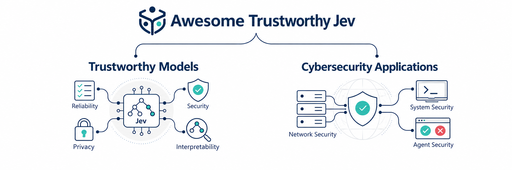
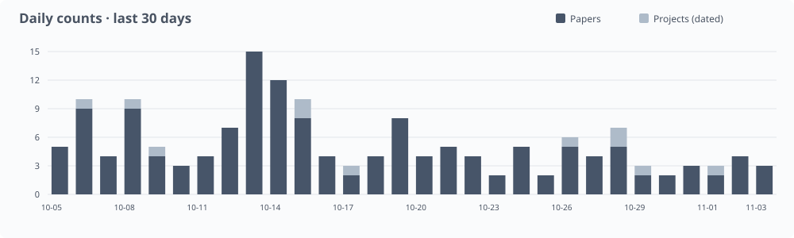
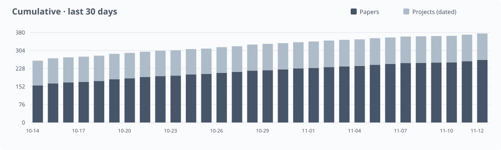

<p align="center"></p>

<p align="center"><a href="https://dongtsi.github.io/awesome-trustworthy-jev/?lang=en"></a></p>

<p align="center">Search papers · Filter resources · Explore charts</p>

[](https://awesome.re)

[English](README.md) · [Chinese](README.zh-CN.md)

Papers, models, projects and documentation on Jev foundations, trustworthiness, and cybersecurity applications.

`559` resources · `254` papers · `256` projects · `38` official documents · `11` articles

**[Explore the Web Library →](https://dongtsi.github.io/awesome-trustworthy-jev/?lang=en)** · [Daily papers](daily/README.md) · [RSS](feed.xml) · [Contributing](CONTRIBUTING.md)

**For AI agents**: [Read & contribute](AGENTS.md) ([Catalog](data/catalog.json) · [Taxonomy](data/taxonomy.json))

## Contents

- [Research library](#research)
  - [Foundations](#foundations)
    - [Architecture & Training](#architecture--training)
    - [Decision Interfaces](#decision-interfaces)
    - [Inference & Efficiency](#inference--efficiency)
    - [Decision Frameworks](#decision-frameworks)
  - [Trustworthiness](#trustworthiness)
    - [Security](#security)
    - [Safety](#safety)
    - [Reliability](#reliability)
    - [Privacy](#privacy)
    - [Fairness](#fairness)
    - [Interpretability](#interpretability)
    - [Transparency & Accountability](#transparency--accountability)
  - [Cybersecurity Applications](#applications)
    - [Agent & Tool Security](#agent--tool-security)
    - [Code & Supply-chain Security](#code--supply-chain-security)
    - [Intrusion & Anomaly Detection](#intrusion--anomaly-detection)
    - [Phishing & Fraud Detection](#phishing--fraud-detection)
    - [Access Control](#access-control)
    - [Industrial & Infrastructure Security](#industrial--infrastructure-security)
    - [Security Operations](#security-operations)
- [Open models](#open-models)
- [Datasets and benchmarks](#datasets)
- [Daily updates and activity](#activity)
- [Contributing](#contributing)
- [Citation](#citation)
- [Related lists](#related)
- [License](#license)

<a id="research"></a>

## Research library

<a id="foundations"></a>

<details open>
<summary><strong>Foundations</strong></summary>

<a id="foundations-architecture"></a>

### Architecture & Training

- [Bongard: Training Machine Intuition](https://arxiv.org/abs/2609.39111) — Trains an open System One model with outcome feedback. `Method` · [PDF](https://arxiv.org/pdf/2609.39111v1)
- [OpenJev-RLCD: A Working RLCD Implementation](https://arxiv.org/abs/2609.38850) — Implements a third-party calibrated-decision reinforcement objective. `Method` · [PDF](https://arxiv.org/pdf/2609.38850v1) · [Code](https://github.com/ZimmyGao/openjev-rlcd)
- [Chinese-Jev: Bringing System One Model to Chinese-Language Tasks](https://arxiv.org/abs/2609.36965) — Develops a System One model for Chinese-language tasks. `Method` · [PDF](https://arxiv.org/pdf/2609.36965v1)
- [LAVOIR: Teaching a Single-Pass Decision Encoder When and What to Ask with Amortized Value of Information](https://arxiv.org/abs/2609.30706) — Learns which missing information is worth asking for. `Method` · [PDF](https://arxiv.org/pdf/2609.30706v1)
- [Universal Fractal Natural Language Decision Map: Real-Time Edge Triage Across Heterogeneous Domains](https://arxiv.org/abs/2609.25498) — Reports an alternative edge decision implementation and benchmark comparison. `Method` · [PDF](https://arxiv.org/pdf/2609.25498v2)
- [this-that-model-1.0: A typed decision model that decides in 30 ms, for a millionth of a cent](https://arxiv.org/abs/2609.23886) — Provides an open model with a native typed decision interface. `Method` · [PDF](https://arxiv.org/pdf/2609.23886v1)
- [Dyad: Extending Large Language Models with Native Typed Decision-Making](https://arxiv.org/abs/2609.36116) — Adds an action-description encoder to an LLM and evaluates frozen-backbone and joint reinforcement learning for typed decisions. `Evaluation` · [PDF](https://arxiv.org/pdf/2609.36116v1)
- [OmniMed-Jev: Calibrating LVLM Confidence for Trustworthy Medical Multimodal Decisions via System One](https://arxiv.org/abs/2610.00381) — Studies candidate-conditioned multimodal decisions against a matched generative baseline, reporting improved calibration with task-dependent accuracy trade-offs. `Evaluation` · [PDF](https://arxiv.org/pdf/2610.00381v1)
- [Tron-1B: Fast, Calibrated Typed Decisions with a Set-Attention Option Head](https://zenodo.org/records/23066522) — Introduces a bidirectional encoder with a set-attention option head; benchmark-trained results are compared with a zero-shot hosted service. `Model` · [PDF](https://zenodo.org/api/records/23066522/files/tron-1b-paper.pdf/content)
- [ufakzeka-karar: An Open Turkish Typed-Decision Model with Order-Invariant Option Scoring](https://arxiv.org/abs/2610.06744) — Scores Turkish answer options independently at shared positions to remove order effects; supervised training beats the tested REINFORCE variant, while temperature calibration degrades on held-out question types. `Evaluation` · [PDF](https://arxiv.org/pdf/2610.06744v1)
- [SanSi: A Looped Typed Decision Model for System 1.5 Thinking](https://arxiv.org/abs/2610.07730) — Trains typed readouts after repeated backbone loops; eight loops improve accuracy at fixed model shape, but cost more compute and calibrate worse than three loops. `Evaluation` · [PDF](https://arxiv.org/pdf/2610.07730v1)
- [Visual Jev Rewards: Reference-Bound Verification for Multi-Subject Image Generation](https://arxiv.org/abs/2610.09328) — Trains a local Qwen verifier for joint reference identity and image conditions, then averages binary probabilities as an image-generation reward. `Evaluation` · [PDF](https://arxiv.org/pdf/2610.09328v1)
- [MetaEncoder: Exploring the Limit of Bi-Encoders for Multimodal System One Decision Making with Natural Language Interface](https://arxiv.org/abs/2610.11316) — Trains a multimodal bi-encoder with request-to-candidate contrastive learning; including options in requests improves closed-set decisions while retaining cached candidate embeddings. `Evaluation` · [PDF](https://arxiv.org/pdf/2610.11316v1)
- [VideoJev: System One Model for Video Understanding and Interaction](https://arxiv.org/abs/2610.18615) — Uses shared decision heads and reusable visual computation for temporal grounding and video QA; the authors report faster inference with comparable or improved task scores. `Evaluation` · [PDF](https://arxiv.org/pdf/2610.18615v1)
- [Proactive Physical AI through Continuous Observation and Timely Intervention](https://arxiv.org/abs/2610.16967) — Introduces a Jev-style timing model that separates intervention decisions from response generation, with video-derived supervision for continuous physical-world observation. `Evaluation` · [PDF](https://arxiv.org/pdf/2610.16967v1)
- [Jeva: System One Models from First Principles](https://arxiv.org/abs/2610.18773) — Introduces a decision architecture with independent option encoding, symmetric aggregation and separate coverage estimation to support permutation invariance, null outcomes and cached reuse. `Evaluation` · [PDF](https://arxiv.org/pdf/2610.18773v1)
- [StartLux-Decision: AutoThink Decision Models with Reinforcement Learning for Calibrated Deliberative Decisions](https://arxiv.org/abs/2610.17309) — Combines single-pass Instant models with confidence-guided AutoThink reasoning; calibrated deliberative reinforcement learning reduces reasoning length while preserving reported accuracy. `Evaluation` · [PDF](https://arxiv.org/pdf/2610.17309v1)
- [Releasing the Inner Jev: A Simple Recipe for Open Decision Models](https://arxiv.org/abs/2610.17205) — Reads option-letter logits from instruction-tuned LMs and improves them with LoRA decision-head tuning; evaluates accuracy and calibration on OpenDecisions and JevBench. `Evaluation` · [PDF](https://arxiv.org/pdf/2610.17205v1)
- [FunDM: Cheap & Label-Free Decision Models from Frozen Language Models](https://arxiv.org/abs/2610.17175) — Distills frozen language-model probabilities into small decision heads without correctness labels, retaining most multiple-choice accuracy with fewer transformer layers. `Evaluation` · [PDF](https://arxiv.org/pdf/2610.17175v1)
- [Intern-Decision: Efficient Multimodal Decision Making with Autoregressive Masked Language Modeling](https://arxiv.org/abs/2610.22131) — Uses masked decision placeholders in a JSON skeleton for one-pass multimodal choices; reports compact-model accuracy, latency and small calibration and handoff pilots. `Evaluation` · [PDF](https://arxiv.org/pdf/2610.22131v1)
- [Qwen-Audio-Jev: A Unified Interface for Audio Decisions](https://arxiv.org/abs/2610.21614) — Adds typed CHOICE, NOUL and SCORE readouts to an audio backbone; reports results across 18 labeled configurations and about 20-fold inference speedup over its generative backbone. `Evaluation` · [PDF](https://arxiv.org/pdf/2610.21614v1)
- [Verdict: Encode Once, Decide Many](https://arxiv.org/abs/2610.20778) — Shares a question-independent state encoding across typed questions with option invariance; improves agreement with soft labels but exposes accuracy–latency costs of removing question-aware state encoding. `Evaluation` · [PDF](https://arxiv.org/pdf/2610.20778v1)
- [Chinese Decision: A Family of Language Models for Single-Pass Probabilistic Decision-Making](https://arxiv.org/abs/2610.23170) — Trains Chinese single-pass decision models using candidate-letter logits and distribution targets; the completed 0.8B model reports 1.07% calibration error, while partial 2B training does not isolate a scale effect. `Evaluation` · [PDF](https://arxiv.org/pdf/2610.23170v1) · [Code](https://github.com/yanqiangmiffy/chinese-decision)
- [TimesJev: Thinking Fast on Time Series with System 1 Sufficiency](https://arxiv.org/abs/2610.26002) — Learns gated time-series compression and embedding alignment from sufficiency and realizability objectives, enabling single-pass decisions; reports improved performance and lower latency across 13 datasets. `Evaluation` · [PDF](https://arxiv.org/pdf/2610.26002v2)
- [Narrow Decision Models: A System-1 Architecture for Calibrated, Typed Decisions](https://arxiv.org/abs/2610.25553) — Uses prefix-tree block attention and logical positions to make organization-specific decisions invariant to option order and independent across questions; small-scale validation tests these properties and routing behavior. `Evaluation` · [PDF](https://arxiv.org/pdf/2610.25553v1)
- [System X: An LLM Decision Model That Replies from Its Own KV Cache](https://arxiv.org/abs/2610.25456) — Adds a text-reply choice and reuses the decision KV cache for generation; measured latency falls, but support-task gains trade off against instruction following and reply preferences depend on the judge. `Evaluation` · [PDF](https://arxiv.org/pdf/2610.25456v1)
- [UniJev: Separating Accuracy from Calibration in Trimodal System One Decision Models](https://arxiv.org/abs/2610.25784) — Separates supervised accuracy gains from calibration in text, image and video decision models; confidence-outcome alignment lowers visual ECE at 2B and 9B while preserving accuracy without reinforcement learning. `Evaluation` · [PDF](https://arxiv.org/pdf/2610.25784v1)
- [Our Own Jev: Typed Decisions in One Forward Pass, from an In-House Judge to Open LoRA Models](https://arxiv.org/abs/2610.29052) — Reports an internal typed judge and open LoRA decision models. Public hard-tier results are single-seed and developed with the evaluation items in view; corpus revisions shift small-benchmark accuracy substantially. `Evaluation` · [PDF](https://arxiv.org/pdf/2610.29052v1)
- [RubriX: A Fast, Fine-Tunable Non-Autoregressive Rubric Judge](https://arxiv.org/abs/2610.34875) — Uses separate encoder representations and cached rubric-level embeddings for non-generative judging. It improves held-out rubric accuracy and keeps latency nearly constant with long level descriptions; human-labelled benchmarks and ranking show mixed advantages over Jev. `Evaluation` · [PDF](https://arxiv.org/pdf/2610.34875v1)
- [Seeing the Options: Typed Decisions over Visual Candidates with Reusable Option Memory](https://arxiv.org/abs/2610.33702) — Extends typed decisions to visual candidates with reusable option encodings. Request-conditioned independent branches retain candidate-order invariance and improve accuracy over independent encoding, while caching reduces repeated-candidate inference cost. `Evaluation` · [PDF](https://arxiv.org/pdf/2610.33702v1)
- [Decision-Native Recommendation with Large Language Models](https://arxiv.org/abs/2610.34124) — Uses tree-structured attention to share user-history computation across isolated candidate branches. The decision interface tests order-consistent choices, calibrated confidence and selective computation in sequential recommendation. `Evaluation` · [PDF](https://arxiv.org/pdf/2610.34124v1)
- [Improving JEV Entailment Reranking with Span Readouts and Selective Adaptation](https://arxiv.org/abs/2610.35654) — Combines mean-span option readouts with selective attention and Gated DeltaNet adapters for cross-request entailment reranking. On MC11, the authors report gains for NeoHorse-1-4B while more than halving trainable parameters; direct-decision transfer is not established by the current abstract. `Evaluation` · [PDF](https://arxiv.org/pdf/2610.35654v2)
- [PsyJev: Psychological Analysis via System-1 Judgment](https://arxiv.org/abs/2610.36689) — Adapts RLCD to heterogeneous question-conditioned judgments through balanced supervision, retention of correct supervised predictions and question-group rewards. Controlled small-model comparisons examine training stages and probability quality on psychological-analysis tasks. `Evaluation` · [PDF](https://arxiv.org/pdf/2610.36689v1)
- [Audio System One Model: Typed Probabilistic Perception of Emotion in Speech](https://arxiv.org/abs/2610.22401) — Introduces ASOM, a 6.2M-parameter reader over frozen speech and text encoders that answers typed questions in one non-generative pass. Trained on listener-vote distributions, it evaluates new label sets and transfer across speech corpora; reported results await detailed full-text audit. `Evaluation` · [PDF](https://arxiv.org/pdf/2610.22401v1)
- [Flide: Accelerating Decision Inference with Exact State Forking](https://arxiv.org/abs/2610.42148) — Introduces exact state forking across attention and recurrent Gated DeltaNet layers, separating logical decision branches from flattened execution. The authors report up to 9.5× faster queries than vLLM/SGLang; exact-arithmetic equivalence and measured floating-point deviations are distinct claims. `Evaluation` · [PDF](https://arxiv.org/pdf/2610.42148v1)
- [Zuse: A Decision Model for European Languages](https://arxiv.org/abs/2611.06238) — Evaluates commercial Zuse adapters on 20,044 European development rows and 32,700 multilingual rows. Zuse-27B reports 87.5% development accuracy, pooled ECE 0.016 versus source-weighted 0.035, and threshold-transfer failures; weights are not openly released, and selection reuse limits generalization claims. `Evaluation` · [PDF](https://arxiv.org/pdf/2611.06238v1) · [Code](https://github.com/binericai/models/tree/main/zuse)
- [Towards Foundation Decision Models: Drex](https://arxiv.org/abs/2611.07854) — Presents four Drex typed decision models with supervised training, adjusted-feedback reinforcement learning and option-consistency losses. Authors report Max scoring 67.52 versus Jev 1.14.0 at 60.70 on Decision Index 0.4.1; model artifacts and detailed benchmark comparability remain to be audited. `Evaluation` · [PDF](https://arxiv.org/pdf/2611.07854v1) · [Code](https://github.com/nace-ai/drex-decision-models)
- [Extending Reasoning in Typed Decision Models via Looping](https://arxiv.org/abs/2611.07736) — RELOAD jointly trains damped middle-layer loops with a typed decision model and learns an input-adaptive pass controller. Across six 0.4B–4B models, authors report improved accuracy and calibration, especially beyond training reasoning depth; the controller retains most gains at roughly three quarters of the compute. `Evaluation` · [PDF](https://arxiv.org/pdf/2611.07736v1)

**Projects and resources**

- [takzen/kanari-decision-bench](https://github.com/takzen/kanari-decision-bench) — Can a small typed-decision model judge a chatbot security audit? Jev vs open models on Polish chatbot answers. `Tool · Evaluation`
- [agrogov/jev-system-one-study](https://github.com/agrogov/jev-system-one-study) — Black-box study of Jev plus controlled replays of the same ~8,300-request suites against open models Laya and SemIf (Qwen3.5-4B). `Tool`
- [alperiox/audio-jevlike](https://github.com/alperiox/audio-jevlike) — Audio-native 'System One' reproduction (Prosodia). `Tool`
- [convaiinnovations/laya](https://huggingface.co/convaiinnovations/laya) — Scores typed questions with a non-autoregressive encoder and decision head. `Model`
- [convaiinnovations/laya-multilingual](https://huggingface.co/convaiinnovations/laya-multilingual) — Uses a multilingual encoder for typed decisions across languages. `Model`
- [convaiinnovations/laya-typed-decisions](https://huggingface.co/convaiinnovations/laya-typed-decisions) — Fine-tunes Laya for service, invoice, agent-trace and security-incident decisions. `Model`
- [AlexWortega/openjev](https://huggingface.co/AlexWortega/openjev) — Uses Qwen-based entailment scoring for candidate ranking and typed decisions. `Model`
- [Contrastive-LM/CLM-v0.1-8B](https://huggingface.co/Contrastive-LM/CLM-v0.1-8B) — Learns state and action projection heads on a frozen encoder, allowing candidate embeddings to be cached. `Model`
- [akhilaaa3/Jev-Omni](https://huggingface.co/akhilaaa3/Jev-Omni) — Scores candidate answers from text, images, audio and video using a multimodal decision classifier. `Model`
- [SupersonicLabs/Julia-1](https://huggingface.co/SupersonicLabs/Julia-1) — Provides a compact multilingual checkpoint for choices, Boolean decisions and ordered scores. `Model`
- [interfaze-ai/lev](https://huggingface.co/interfaze-ai/lev) — Adds a typed-decision LoRA adapter to Qwen with a Jev-compatible serving interface. `Model`
- [cua-ai/cua-s1-forms](https://huggingface.co/cua-ai/cua-s1-forms) — Uses a small option scorer to select form actions; execution order is handled by external code. `Model`
- [AgentBull/bongard-mini](https://huggingface.co/AgentBull/bongard-mini) — Uses an encoder-decoder backbone to score multiple text or image decisions from a shared context. `Model`
- [flock-io/this-that-model-1.2](https://huggingface.co/flock-io/this-that-model-1.2) — Makes typed decisions in one pass, with evaluations of composed rules and wording changes. `Model`
- [autotrust/JEV-9B](https://huggingface.co/autotrust/JEV-9B) — Distills typed-decision distributions from a Jev teacher while retaining a separate generation path. `Model`
- [autotrust/JEV-27B](https://huggingface.co/autotrust/JEV-27B) — Scales the teacher-distilled decision model with separate decision and generation paths. `Model`
- [autotrust/JEV-27B-VL](https://huggingface.co/autotrust/JEV-27B-VL) — Extends the decision interface to image-conditioned questions alongside text generation. `Model`
- [ZefanCai/Open-Jev-2B](https://huggingface.co/ZefanCai/Open-Jev-2B) — Pairs a Qwen LoRA adapter with a scalar decision head for caller-supplied candidates. `Model`
- [ZefanCai/Open-Jev-9B](https://huggingface.co/ZefanCai/Open-Jev-9B) — Provides a larger adapter and decision head for choice, Boolean and ordinal questions. `Model`
- [ZefanCai/Open-Jev-27B-v1.1](https://huggingface.co/ZefanCai/Open-Jev-27B-v1.1) — Releases a trained adapter and scalar head with separate in-distribution and out-of-distribution evaluations. `Model`
- [Maincode/matilda-jev-v1](https://huggingface.co/Maincode/matilda-jev-v1) — Bundles a backbone and decision readout for typed questions over text, JSON and optional images. `Model`
- [TokenRhythm/NeoHorse-Jev-4B](https://huggingface.co/TokenRhythm/NeoHorse-Jev-4B) — Uses prefill-only inference for choices, Boolean decisions and scores in agent workflows. `Model`
- [tasksource/tasksource-jev-nano-v0](https://huggingface.co/tasksource/tasksource-jev-nano-v0) — Uses token-level late interaction to reuse state representations and score variable candidate sets. `Model`
- [HIT-TMG/JevEmbed-Qwen3-Embedding-0.6B](https://huggingface.co/HIT-TMG/JevEmbed-Qwen3-Embedding-0.6B) — Fine-tunes an embedding model for typed decisions using a separate prompting and scoring layer. `Model`
- [chaoliangUNSW/Jev-Style-2B-Decision-v3](https://huggingface.co/chaoliangUNSW/Jev-Style-2B-Decision-v3) — Provides a local decision checkpoint and runtime with a System One-compatible API. `Model`
- [tarsur385/djev-distill-v4](https://huggingface.co/tarsur385/djev-distill-v4) — Distills longer reasoning distributions into one-step typed decisions on DiffusionGemma. `Model`
- [Camellia86/Canopy-Jev-27B](https://huggingface.co/Camellia86/Canopy-Jev-27B) — Publishes an adapter and probability prior for shared-prefix, isolated-branch decisions on a frozen Qwen3.8-27B backbone; benchmark scores are model-card claims. `Model`
- [nickprock/archai-jev-zagreus-0.4b-ita](https://huggingface.co/nickprock/archai-jev-zagreus-0.4b-ita) — Releases an Italian 0.4B decision adapter trained with cross-entropy and Brier loss; reported calibration and latency require independent evaluation. `Model`
- [shgao/rsi-jev-v5.0-vl-3b](https://huggingface.co/shgao/rsi-jev-v5.0-vl-3b) — Releases a self-contained multimodal typed-decision checkpoint using 20 Qwen3.5-4B layers, an option head and calibration tensors. `Model`
- [BricksDisplay/jevling-e2b-v1](https://huggingface.co/BricksDisplay/jevling-e2b-v1) — Publishes a Gemma-based checkpoint for parallel typed decisions with folded temperature scaling; reported Chinese kiosk evaluation uses synthetic-derived data. `Model`

(See also: [LLM2Jev](https://arxiv.org/abs/2610.02076) · [PACT](https://arxiv.org/abs/2609.35865) · [PixelJev](https://arxiv.org/abs/2609.29283) · [laya-jev-eval](https://github.com/yuvrajrox/laya-jev-eval) · [jev-vs-ml](https://github.com/vianaR25/jev-vs-ml) · [jevlike](https://github.com/mustafasemi-ai/jevlike) · [SecJev](https://arxiv.org/abs/2610.03073) · [Decision Models as Rerankers](https://arxiv.org/abs/2610.32318) · [JEVal and SII-Decision](https://arxiv.org/abs/2610.03935) · [Ru-Jev label wording](https://arxiv.org/abs/2611.08439))

<a id="foundations-interfaces"></a>

### Decision Interfaces

- [LLM2Jev: LLMs Are Already Jev-Style Decision Models -- When and How to Fine-Tune Them](https://arxiv.org/abs/2610.02076) — Studies when existing LLMs already support Jev-style decisions. `Evaluation` · [PDF](https://arxiv.org/pdf/2610.02076v1)
- [Benchmarking System One decision models against trained classifiers and language models for automated decision gates](https://arxiv.org/abs/2610.00346) — Compares typed models, trained classifiers and LLM readouts under matched requests. `Evaluation` · [PDF](https://arxiv.org/pdf/2610.00346v1)
- [Koa-action: Fast and Consistent Structured Decision Making with Generative LLMs](https://arxiv.org/abs/2609.36115) — Uses atomic output tokens for fast structured decisions. `Method` · [PDF](https://arxiv.org/pdf/2609.36115v1)
- [From Text Decisions to Pixels: An Study of Jev-Style Visual Choice Model](https://arxiv.org/abs/2609.29283) — Studies visual choice readouts with matched generation baselines. `Method` · [PDF](https://arxiv.org/pdf/2609.29283v1)
- [Jev in Practice: A Composable Python Toolkit for TypeSafe’s System One Decision Model](https://zenodo.org/records/22921974) — Provides composable tooling, calibration utilities and recorded API experiments. `Tool` · [PDF](https://zenodo.org/api/records/22921974/files/daf-jev_combined.pdf/content)
- [NumericJev: Jev-like LLM Numerical Decoding with Multiway Decision Trees](https://arxiv.org/abs/2609.28587) — Uses multiway decision trees for numerical readout. `Method` · [PDF](https://arxiv.org/pdf/2609.28587v1)
- [AnyJev Technical Report](https://arxiv.org/abs/2610.00831) — Reads option probabilities from pretrained LLMs and corrects label and position bias with prior normalization and cyclic option rotations. `Evaluation` · [PDF](https://arxiv.org/pdf/2610.00831v1)
- [System One Models for Wireless Decision-Making:Applications and Performance Evaluation](https://arxiv.org/abs/2610.04345) — Measures the quality/latency trade-off in antenna selection and RAN slicing: Jev responds faster, while utility gains depend on the task and execution costs. `Evaluation` · [PDF](https://arxiv.org/pdf/2610.04345v1)
- [Jarvis: Coordination Deserves a Brain of Its Own in Agentic Interactive Models](https://arxiv.org/abs/2610.23804) — Coordinates live tasks with typed decisions and version checks, revalidating plans and spoken results when requests change; matched front/back models improve voice-task success from 29 to 192 of 278 tasks. `Evaluation` · [PDF](https://arxiv.org/pdf/2610.23804v1)
- [P(Yes): 15$\times$ Improvements via Test-Time Scaling of Decision Models](https://arxiv.org/abs/2610.25474) — Searches candidate answers using frozen models' Yes probabilities, improving logic-puzzle accuracy without training; the headline 15-fold gain is exact correctness from 2 to 30 of 128 puzzles. `Evaluation` · [PDF](https://arxiv.org/pdf/2610.25474v1)
- [SOMA: Continuous Monitoring and Intervention for System Two Reasoning with System One Models](https://arxiv.org/abs/2610.26793) — Continuously monitors reasoning with a shared decision model and escalating interventions; reports up to 36% fewer reasoning tokens and higher abstention on unanswerable questions without training. `Evaluation` · [PDF](https://arxiv.org/pdf/2610.26793v1)
- [Multimodal Reranking Is a System One Decision](https://arxiv.org/abs/2610.28435) — Treats multimodal reranking as a single choice over retrieved candidates; choice readouts outperform per-candidate yes/no scoring, while text-only decision tuning improves document reranking. Cross-model comparisons are confounded by size and generation. `Evaluation` · [PDF](https://arxiv.org/pdf/2610.28435v1) · [Code](https://github.com/Ryenhails/rerank-as-decision)
- [S1CogBench: What System One Decision Models Can and Cannot Do on Cognitive Experiments](https://arxiv.org/abs/2611.00911) — Evaluates five open models and Jev on 24 cognitive tasks, separating task conditions, scoring and disclosed adaptations. It studies whether decisions respond to evidence, feedback, memory demand and future opportunities; aggregate accuracy and human-behavior prediction are distinct outcomes. `Evaluation` · [PDF](https://arxiv.org/pdf/2611.00911v1)
- [To Jev or Not to Jev: When Can System-1 Decision Models Replace LLM Judges?](https://arxiv.org/abs/2611.00505) — Compares 14 decision models and four generative judge configurations across eleven judge benchmarks, including reference-guided evaluation, confidence cascades and injected instructions. Some models approach generative judges on tested settings, but injection susceptibility varies sharply by model; reference-generation costs and statistical comparisons need full-text audit. `Evaluation` · [PDF](https://arxiv.org/pdf/2611.00505v1)
- [Probabilistic Relevance Decisions for Semantic Retrieval](https://arxiv.org/abs/2611.08014) — Compares BGE-M3 retrieval with Jev Noul and OpenAI Predicate reranking on 300 SciFact test queries. At full-corpus depth 50, nDCG@10 is 0.6413/0.7805/0.7545; depth-100 changes are uncertain, and score ties, cached latency and enriched-pool design constrain interpretation. `Evaluation` · [PDF](https://arxiv.org/pdf/2611.08014v1)

**Projects and resources**

- [dtduc-git/jevnav](https://github.com/dtduc-git/jevnav) — Browser-automation tool using Jev to pick page elements, with several small measured benchmarks. `Tool · Evaluation`
- [simonmesmith/jev-arc-agi-v1-experiment](https://github.com/simonmesmith/jev-arc-agi-v1-experiment) — Jev fully solved 4/400 ARC-AGI-1 public eval tasks (1.125% score) via per-cell Choice decisions, at $2.32 total cost. `Tool · Evaluation`
- [Introducing System One Models & Jev](https://typesafe.ai/blog/introducing-system-one-models-and-jev) — Official launch, RLCD claims, workflow evaluation and stated limitations. `Documentation`
- [TypeSafe · noul](https://docs.typesafe.ai/primitives/noul.md) — Noul returns the probability of a yes/no proposition, with optional true/false criteria and no separate confidence field. A value near 0.5 signals uncertainty, not a middle level of the property; thresholded actions and review bands must be selected for the task. `Documentation`
- [PerryLink/llm-jev-laya-bench](https://github.com/PerryLink/llm-jev-laya-bench) — Research paper/artifact: Jev and Laya as judgment layers score 0.225-0.90 on a 77-class battery; both fail tasks needing absence-detection. `Tool`
- [evals.typesafe.ai](https://evals.typesafe.ai) — TypeSafe's four-workflow comparison of Jev against frontier models, 61.7% to 76.0% agreement. `Documentation`
- [TypeSafe · citation_check](https://docs.typesafe.ai/cookbooks/citation_check.md) — Official interface documentation and deployment guidance. `Documentation`
- [TypeSafe · choice](https://docs.typesafe.ai/primitives/choice.md) — Official interface documentation and deployment guidance. `Documentation`
- [gdchaochao/lunar-terminal](https://github.com/gdchaochao/lunar-terminal) — Measured 327 randomized Robocode decisions show Jev's action choice near-random (Pearson r=-0.099) while its yes/no judgments score 0.94-0.96 on atomic questions. `Tool · Evaluation`
- [TypeSafe · fan-out](https://docs.typesafe.ai/patterns/fan-out.md) — Official interface documentation and deployment guidance. `Documentation`
- [jev-typesafe-system-one-model-benchmark-2026](https://thoughts.jock.pl/p/jev-typesafe-system-one-model-benchmark-2026) — 40 hand-labeled tickets, routing, urgency and anger, against Haiku, Fable, Astra and Gemini Flash. `Analysis · Evaluation`
- [TypeSafe · legal](https://docs.typesafe.ai/legal.md) — Official interface documentation and deployment guidance. `Documentation`
- [TypeSafe · sdk](https://docs.typesafe.ai/sdk.md) — Official interface documentation and deployment guidance. `Documentation`
- [TypeSafe · score](https://docs.typesafe.ai/primitives/score.md) — Official interface documentation and deployment guidance. `Documentation`
- [TypeSafe · system-one](https://docs.typesafe.ai/concepts/system-one.md) — Official interface documentation and deployment guidance. `Documentation`
- [TypeSafe · primitives](https://docs.typesafe.ai/primitives.md) — Defines Choice, Score, Noul and Box question/answer shapes and parallel evaluation over a shared state. Question IDs are response keys, not model input; forced Choice/Box outputs need a separate applicability or presence check. A later request is needed when an earlier answer determines new state or options. `Documentation`
- [TypeSafe · state](https://docs.typesafe.ai/concepts/state.md) — Official interface documentation and deployment guidance. `Documentation`
- [TypeSafe · sde_cascade](https://docs.typesafe.ai/cookbooks/sde_cascade.md) — Demonstrates six Noul rule checks for cascading from GPT-6 Luna to GPT-6.1 Sol-high on 1,000 NATURAL PLAN calendar tasks. A threshold swept on these same rows reaches 98.1% accuracy at $1.307 per 1,000 tasks versus $1.890 for Sol alone; the reported frontier uses an expanded answer key and is not a held-out policy guarantee. The revised tutorial defaults to published cached answers and keys model calls by model name. `Documentation`
- [TypeSafe · models](https://docs.typesafe.ai/models.md) — Lists Jev 1.14.0 and 1.13.0 with text/PNG/JPEG inputs; Box questions require 1.14. Both use 64k request/32k question default context, with opt-in 262k for both limits. jev-latest and jev-preview currently alias 1.14.0; model IDs should be logged because aliases can move. `Documentation`
- [TypeSafe · System One API](https://docs.typesafe.ai/api/system-one.md) — Documents typed requests and responses, including HTTP 400 application-validation errors. Error locations may be empty; rejected inputs are string previews, and messages or context can be shortened. `Documentation`
- [TypeSafe · how-to-build-with-system-one](https://docs.typesafe.ai/concepts/how-to-build-with-system-one.md) — Describes workflows that keep control flow, deterministic computation and side effects in code while using Jev for narrow judgments. Structured state and criteria, independent batched questions, explicit composition and uncertainty routing support inspection; vendor speed and calibration claims are not independent validation. `Documentation`
- [TypeSafe · introduction](https://docs.typesafe.ai/introduction.md) — Official interface documentation and deployment guidance. `Documentation`
- [Jev: For the builders AND dreamers](https://typesafe.ai/blog/jev-1-14) — Announces Jev 1.14 preview and experimental image input, Box localization and extended context; vendor measurements are not independent reliability evidence. `Documentation`
- [Images in System One requests](https://docs.typesafe.ai/images.md) — Documents experimental opt-in images for Jev 1.13 and 1.14; each image side must be 280–1568 pixels, with PNG/JPEG and request-size constraints. `Documentation`
- [Box questions](https://docs.typesafe.ai/primitives/box.md) — Documents experimental single-box localization using jev-latest; absent targets still return coordinates, so presence checks and task-specific confidence validation are needed. `Documentation`
- [TypeSafe · Model changelog](https://docs.typesafe.ai/changelog.md) — Official per-release change log. Its Jev 1.14 entry is dated October 14, 2026 and identifies model jev-1.14.0, multilingual improvements and Box questions; image inputs and 262k long context are also available for Jev 1.13. The entry date is a model-release date, not the verified creation date of this page. `Documentation`
- [TypeSafe · Noul screen](https://docs.typesafe.ai/patterns/noul-screen.md) — Uses a cheap Noul on a small state to screen for a more expensive assessment, with explicit yes/no/uncertain routes. When questions share the same state, the documentation instead recommends asking them in one parallel call; illustrative 0.3/0.7 boundaries require task-specific validation. `Documentation`
- [TypeSafe · Companion Noul](https://docs.typesafe.ai/patterns/companion-noul.md) — Adds a Noul that checks whether any supplied Choice option fits, then gates the selected option and its probability. This exposes an unsupported forced choice that may still have high top probability; the integration example supplies no measured out-of-scope detection guarantee. `Documentation`
- [TypeSafe · Routing by probability](https://docs.typesafe.ai/patterns/probability-routing.md) — Sets action-specific thresholds on the probability of the chosen option. A high-risk intent opens a separate confirmation step: a high intent probability does not establish user authorization, and example cutoffs are not empirical error bounds. `Documentation`
- [TypeSafe · Typed function dispatch](https://docs.typesafe.ai/cookbooks/function_calling.md) — Maps Literal, list-of-Literal and boolean parameters into Choice/Noul questions and batches function selection with all candidate arguments. Optional-argument presence checks preserve defaults; reported confidence is the minimum component confidence, not a calibrated probability that the whole call is correct. `Documentation`
- [TypeSafe · Date extraction with code-side resolution](https://docs.typesafe.ai/cookbooks/date_extraction_cookbook.md) — Uses seven parallel Choice questions to read date parts, then deterministic code resolves calendar rules and flags incomplete or low-confidence answers. The minimum component confidence routes review but is not a calibrated probability of a correct complete date. `Documentation`
- [TypeSafe · Pre-parsed value selection](https://docs.typesafe.ai/cookbooks/pre_parsed_value_extraction_cookbook.md) — Regexes propose candidate spans, Choice selects the requested email, phone or amount, and code copies and normalizes the selected string. Constrained copying prevents invented spans; candidate recall, semantic selection and locale-aware normalization remain separate error sources. `Documentation`
- [TypeSafe · Parallel questions](https://docs.typesafe.ai/cookbooks/parallel_questions.md) — Compares batching thirteen GDPR questions against thirteen sequential calls over five repeats. The displayed run costs 12.2 times less and takes 0.24 versus 2.81 seconds; answer means differ by at most 0.004. This one-document example does not establish invariance or the same latency gain against concurrent calls. The revised tutorial defaults to published cached answers and keys model calls by model name. `Documentation`

(See also: [calfram-bench](https://github.com/lorenzofamiglini/calfram-bench) · [Traffic Classification](https://arxiv.org/abs/2610.00376) · [Ordinal Bias](https://arxiv.org/abs/2609.38827) · [jev-dice](https://github.com/pobooo/jev-dice) · [JET](https://arxiv.org/abs/2609.33874) · [zh-decision-bench](https://github.com/CodyQin/zh-decision-bench) · [jevbench](https://github.com/GautamTalksDev/jevbench) · [Early Evidence Audit](https://arxiv.org/abs/2609.32160) · [JevOut](https://github.com/xzx34/JevOut) · [jev-field-report](https://github.com/manankumarthakkar/jev-field-report) · [jev-escalation-gate](https://github.com/manankumarthakkar/jev-escalation-gate) · [Jev in the Wild](https://arxiv.org/abs/2609.30216) · [Private Edge](https://papers.ssrn.com/sol3/papers.cfm?abstract_id=7500140) · [Jev-Persian-Benchmark](https://github.com/ArmanJR/Jev-Persian-Benchmark) · [Visual Jev](https://arxiv.org/abs/2609.25845) · [typesafe-ai-jev-example](https://github.com/ItBayMax/typesafe-ai-jev-example) · [jevshield](https://github.com/lgy1027/jevshield) · [this-that-model](https://arxiv.org/abs/2609.23886) · [jev-as-a-judge](https://github.com/danielgshea/jev-as-a-judge) · [jev-guard](https://github.com/leepokai/jev-guard) · [can-you-trust-jev-confidence](https://anth.us/blog/can-you-trust-jev-confidence) · [typesafe-jev-pre-registered-test](https://primeline.cc/blog/typesafe-jev-pre-registered-test) · [jev-arena](https://github.com/meetr1912/jev-arena) · [jev-noul-vs-choice](https://github.com/TakumiNoguchi2004/jev-noul-vs-choice) · [jev-deterministic-benchmark](https://github.com/etsabary/jev-deterministic-benchmark) · [jev-playground](https://github.com/kobashi/jev-playground) · [jev-audit](https://github.com/phuthuycoding/jev-audit) · [browser-jev](https://github.com/DowLucas/browser-jev) · [jev-synthetic-survey](https://github.com/jjd-lab/jev-synthetic-survey) · [jev-heart-risk-bench](https://github.com/rubinagentagi-tech/jev-heart-risk-bench) · [jev-behavior-study](https://github.com/RINNECODER/jev-behavior-study) · [jev-calibrate](https://github.com/smkrv/jev-calibrate) · [structured-decision-bench](https://github.com/zhengbangbo/structured-decision-bench) · [opencode-jev-compaction](https://github.com/JLegends/opencode-jev-compaction) · [jevfuzz](https://github.com/yottayoshida/jevfuzz) · [Jev-Calibration](https://github.com/AnthusAI/Jev-Calibration) · [jev-skills](https://github.com/WanLanglin/jev-skills) · [jev-probability-experiment](https://github.com/simonmesmith/jev-probability-experiment) · [jev-biomedical-evidence-screening](https://github.com/cx295410-dot/jev-biomedical-evidence-screening) · [Dyad](https://arxiv.org/abs/2609.36116) · [Calibration composition](https://zenodo.org/records/23064668) · [GraphDecide](https://arxiv.org/abs/2610.06354) · [HVAC reasoning and shift](https://arxiv.org/abs/2610.09937) · [MetaEncoder](https://arxiv.org/abs/2610.11316) · [JevKT cold-start evaluation](https://arxiv.org/abs/2610.11135) · [Good Judgment, Bad Advice](https://arxiv.org/abs/2610.24649) · [Truncated reasoning reader](https://arxiv.org/abs/2610.25768) · [Jev-GAD](https://arxiv.org/abs/2610.30777) · [The Company a Question Keeps](https://arxiv.org/abs/2610.14631) · [Audio System One Model](https://arxiv.org/abs/2610.22401) · [Flide](https://arxiv.org/abs/2610.42148) · [Few-Shot Defect Decision Calibration](https://arxiv.org/abs/2610.41199) · [XDecideBench](https://arxiv.org/abs/2611.01370) · [Structured Clinical Memory for Jev](https://arxiv.org/abs/2611.04101) · [Judgments and decisions](https://typesafe.ai/blog/dont-call-it-a-decision-model) · [Option-label bias](https://arxiv.org/abs/2610.02586))

<a id="foundations-inference"></a>

### Inference & Efficiency

- [JET: Justification Evaluation in Transformer](https://arxiv.org/abs/2609.33874) — Tests local candidate-likelihood inference with shared computation. `Method` · [PDF](https://arxiv.org/pdf/2609.33874v2)
- [Harness Tokenomics: A Router for the Enterprise Agentic Control Plane](https://arxiv.org/abs/2609.28919) — Models routing economics with session-level cache effects. `Analysis` · [PDF](https://arxiv.org/pdf/2609.28919v2)
- [Visual Jev: Accurate and Efficient Decisions from Shared Visual Context](https://arxiv.org/abs/2609.25845) — Compares visual decision heads with matched generation baselines. Shared computation improves efficiency, while dedicated heads do not consistently improve accuracy. `Evaluation` · [PDF](https://arxiv.org/pdf/2609.25845v1)
- [Agent in a Bottle: Can LLM Agents Turn Their Capabilities Into Cheap, Scalable Artifacts?](https://arxiv.org/abs/2610.08775) — Benchmarks agents that build reusable artifacts for large workloads; most runs lose quality relative to zero-shot calls, while selected artifacts approach Jev at lower projected API cost. `Evaluation` · [PDF](https://arxiv.org/pdf/2610.08775v1) · [Code](https://github.com/aktsonthalia/bottled)
- [Readout Stability in Prefill-Only Decision Models:Zero-Label Prediction and Inference-Time Compute Allocation](https://arxiv.org/abs/2610.07716) — Tests cached first-pass rankings under candidate-menu changes and compares re-asking with model cascades; ranking stability supports computation reuse but does not itself identify unlabeled accuracy. `Evaluation` · [PDF](https://arxiv.org/pdf/2610.07716v1) · [Code](https://github.com/rlisml/jev-cascade)
- [System Switch: When Should a Fast Decision Model Stop and Think?](https://arxiv.org/abs/2610.09683) — Tests confidence-based deferral from fast decision models to a slow visual reasoner; offline gains do not translate into Doom level completion. `Evaluation` · [PDF](https://arxiv.org/pdf/2610.09683v1)
- [From Probabilities to Decisions: Search and Multi-Teacher Distillation with Jev](https://arxiv.org/abs/2610.09188) — Distills Jev and Qwen pairwise probabilities into small evaluators; matched-budget chess gains replicate, while retrieval gains remain uncertain. `Evaluation` · [PDF](https://arxiv.org/pdf/2610.09188v1)
- [FastJEV: Understanding Redundancy for Compact JEV Inference](https://arxiv.org/abs/2610.11379) — Combines context-state reuse, candidate-prefix sharing and layer pruning for OmniJev; compact execution does not consistently reduce measured latency. `Evaluation` · [PDF](https://arxiv.org/pdf/2610.11379v1)
- [JevForest: Path Voting for Budgeted Feature Acquisition](https://arxiv.org/abs/2610.10615) — Uses tree-path voting to select semantic questions under a feature budget; fewer sequential questions cost more than batching in the tested pilots. `Evaluation` · [PDF](https://arxiv.org/pdf/2610.10615v1)
- [Selective Reasoning for Typed Decision Models: When to Start, Read, and Stop](https://arxiv.org/abs/2610.19644) — Combines a candidate reader with reasoning-start, read and stop policies; measures accuracy, generated work and pipeline time under matched-prefix controls. `Evaluation` · [PDF](https://arxiv.org/pdf/2610.19644v1)
- [Jev-LiteMAS: Separating Decisions from Generation in Multi-Agent Workflows](https://arxiv.org/abs/2610.21411) — Separates expert routing and artifact screening from generative execution and feedback; reports 12.7–54.6% fewer generative tokens with accuracy within 1.34 points of LAS. `Evaluation` · [PDF](https://arxiv.org/pdf/2610.21411v1)
- [DFIP: Decision-Focused Inference Path for System One Models](https://arxiv.org/abs/2610.36804) — Audits CUDA replay, candidate projection and length-aware batching in four open decision models. Fixed-workload speedups can disappear or reverse under changing arrivals; preserved labels do not ensure preserved confidence-based routing. `Evaluation` · [PDF](https://arxiv.org/pdf/2610.36804v1) · [Code](https://github.com/superagent-ai/dfip)
- [Reproducible LoRA Inference Through Deterministic Split-K Reduction](https://arxiv.org/abs/2611.10334) — Replaces atomic Split-K accumulation with deterministic reduction for LoRA inference. Identical-input tests find no observed shrink-output variation versus 97.61% with atomic Split-K=8; structured toxicity probabilities vary in 81.47% of atomic comparisons. The implementation reports 16.8–21.1% speedup over unsplit reduction at 1.02–2.62% overhead over the atomic version. `Evaluation` · [PDF](https://arxiv.org/pdf/2611.10334v1)

**Projects and resources**

- [stillmarcus24/jev-verify](https://github.com/stillmarcus24/jev-verify) — Checks published Jev outputs against the L0/L1/L2 identities without live calls, structure-aware (multi-label and batch outputs excluded). `Tool`
- [haricharan12/jev-voice-bridge](https://github.com/haricharan12/jev-voice-bridge) — Voice instructed recon tool using jev for real time little latency work. `Tool`
- [xxlya/evaljev](https://github.com/xxlya/evaljev) — Runtime-assurance library for Jev decision workflows. `Tool`
- [rlisml/jev-cascade](https://github.com/rlisml/jev-cascade) — Provides candidate-menu interventions, cached-ranking analysis and confidence cascades for open prefill-only decision models; costs are modeled in forward-pass units. `Tool · Evaluation`

(See also: [JevSpawn](https://arxiv.org/abs/2610.00437) · [Decision Gates](https://arxiv.org/abs/2610.00346) · [Koa-action](https://arxiv.org/abs/2609.36115) · [NavJev](https://arxiv.org/abs/2609.34969) · [system-one-benchmark](https://github.com/yanng981/system-one-benchmark) · [Jev-Mobile](https://arxiv.org/abs/2609.30186) · [jev-langgraph-router](https://github.com/Sahil-coder-30/jev-langgraph-router) · [jev-router](https://github.com/Akashdb5/jev-router) · [Fractal Decision Map](https://arxiv.org/abs/2609.25498) · [jev-policy-engine](https://github.com/BhavinM/jev-policy-engine) · [jev-evaluation](https://github.com/willkelly/jev-evaluation) · [6G Orchestration](https://arxiv.org/abs/2609.23136) · [Edge Orchestration](https://arxiv.org/abs/2609.22753) · [jev-arc-agi-v1-experiment](https://github.com/simonmesmith/jev-arc-agi-v1-experiment) · [jev-as-a-judge](https://github.com/danielgshea/jev-as-a-judge) · [jev-eval](https://github.com/finnhll/jev-eval) · [jev-orderby-bench](https://github.com/yodablocks/jev-orderby-bench) · [sys1bench](https://github.com/rssr25/sys1bench) · [DddGgXuoLlL](https://www.threads.com/@ebrain.lab/post/DddGgXuoLlL) · [jev-transaction-guard](https://github.com/finrod21/jev-transaction-guard) · [jev-synthetic-survey](https://github.com/jjd-lab/jev-synthetic-survey) · [jev-korean-benchmark](https://github.com/mahlernim/jev-korean-benchmark) · [jev-calibration-audit](https://github.com/jujumilk3/jev-calibration-audit) · [jev-acento](https://github.com/marcosmartinez/jev-acento) · [pi-heed](https://github.com/nyarlathoteppppp/pi-heed) · [jev-skills](https://github.com/WanLanglin/jev-skills) · [Seven political-science replications](https://arxiv.org/abs/2610.06625) · [Semantic engines in control loops](https://arxiv.org/abs/2610.06425) · [Wireless typed decisions](https://arxiv.org/abs/2610.04345) · [S1-MAS](https://arxiv.org/abs/2610.08155) · [SanSi](https://arxiv.org/abs/2610.07730) · [JevBench by Benchmark Heaven](https://github.com/fstandhartinger/jevbench) · [Scan or Index?](https://arxiv.org/abs/2610.28957) · [RubriX](https://arxiv.org/abs/2610.34875) · [Iris](https://arxiv.org/abs/2610.33702) · [Learning to Formalize](https://arxiv.org/abs/2610.36595) · [GEO Citation Ranker](https://arxiv.org/abs/2610.38090) · [ReListen](https://arxiv.org/abs/2611.04480) · [Drex decision models](https://arxiv.org/abs/2611.07854) · [RELOAD looping](https://arxiv.org/abs/2611.07736))

<a id="foundations-frameworks"></a>

### Decision Frameworks

- [JevSpawn: Adaptive Agentic Inference through Compositional Action Spaces](https://arxiv.org/abs/2610.00437) — Explores compositional action spaces for fast agent inference. `System` · [PDF](https://arxiv.org/pdf/2610.00437v1)
- [Mnemon: Raw Records, Fast Judgments, Slow Thoughts](https://arxiv.org/abs/2609.36059) — Combines raw records with fast judgments and slower reasoning. `System` · [PDF](https://arxiv.org/pdf/2609.36059v1)
- [NavJev: Efficient Vision-Language Navigation via Action-Centric Visual Compression and Discriminative Action-Semantic Memory](https://arxiv.org/abs/2609.34969) — Studies action-centric representations and decision memory for navigation. `System` · [PDF](https://arxiv.org/pdf/2609.34969v1)
- [When Does Selection Replace Extraction? A Pre-Registered Test of Agent Memory with a Typed Decision Model](https://arxiv.org/abs/2609.34227) — Tests raw-turn selection against extraction under controlled memory budgets. `Evaluation` · [PDF](https://arxiv.org/pdf/2609.34227v1)
- [Type-Safe Decision Frameworks for Agentic 5G Control: A Theory-Driven Testbed Characterization of Where They Can Be Applied](https://arxiv.org/abs/2609.33689) — Maps when typed decision gates are applicable to network control. `System` · [PDF](https://arxiv.org/pdf/2609.33689v1)
- [You Only Edit Once: Incentivizing In-Context Capability of LLMs via Local Demonstration Refinement](https://arxiv.org/abs/2609.33609) — Uses typed decisions in local demonstration refinement. `System` · [PDF](https://arxiv.org/pdf/2609.33609v1)
- [JevSoup: System-One Routing for Training-Free LoRA Composition](https://arxiv.org/abs/2609.30922) — Routes and combines LoRA experts using typed choices. `System` · [PDF](https://arxiv.org/pdf/2609.30922v1) · [Code](https://github.com/Leowang980/JevSoup.)
- [Jev in the Wild: A Data-Driven Analysis of the Jev Model's Functionality, Applications and Ecosystem](https://arxiv.org/abs/2609.30216) — Maps decision interfaces and adoption across 2,170 public projects. `Survey` · [PDF](https://arxiv.org/pdf/2609.30216v1)
- [Jev-Mobile: Jev as an Executor for Mobile GUI Agents](https://arxiv.org/abs/2609.30186) — Separates VLM planning from typed GUI execution. `System` · [PDF](https://arxiv.org/pdf/2609.30186v1)
- [REFLEX with Jev for Efficient Selective Control in LLM Agents](https://arxiv.org/abs/2609.26532) — Tests selective agent control and near-valid action alternatives. `System` · [PDF](https://arxiv.org/pdf/2609.26532v1)
- [Jev-Mem: System-One-Controlled Agentic Memory for Efficient AI Agents](https://arxiv.org/abs/2609.23986) — Places a typed decision controller inside agent memory. `System` · [PDF](https://arxiv.org/pdf/2609.23986v1)
- [Fast Intent-Driven Service Orchestration with Jev for 6G Edge Networks](https://arxiv.org/abs/2609.23136) — Studies how decision latency affects bounded service orchestration. `System` · [PDF](https://arxiv.org/pdf/2609.23136v1)
- [Replacing Large Language Models with Jev Decision Models for Low-Latency Edge Service Orchestration](https://arxiv.org/abs/2609.22753) — Measures typed decisions in deadline-constrained service admission. `System` · [PDF](https://arxiv.org/pdf/2609.22753v2)
- [SoK: Semantic Decision Engines in Network Control Loops](https://arxiv.org/abs/2610.06425) — Audits 139 network-control paper families and separates decision latency from verified service completion; queueing and coverage checks can reverse admission decisions. `Survey` · [PDF](https://arxiv.org/pdf/2610.06425v1) · [Code](https://github.com/OniReimu/SoK-JEV)
- [Token-Efficient Multi-Agent Collaboration via System One-Guided Computational Division of Labor](https://arxiv.org/abs/2610.08155) — Uses a Laya controller, compact evidence reader and bounded task menus to coordinate LLM workers; reports lower GPT token use and end-to-end latency across seven benchmarks. `Evaluation` · [PDF](https://arxiv.org/pdf/2610.08155v1)
- [When Plans Change Answers: Formalizing Cost-Accuracy Optimization for Semantic Queries](https://arxiv.org/abs/2610.08089) — Formalizes contribution-weighted semantic-query quality; v2 adds confidence-centric skipping of unscored tuples once predicted output targets are guaranteed. `Evaluation` · [PDF](https://arxiv.org/pdf/2610.08089v2)
- [Can Jev be Your Q or Policy in Reinforcement Learning?](https://arxiv.org/abs/2610.11692) — Uses frozen Jev as a policy reference, exploration judge and replay rater; gains depend on the learning role and supplied information. `Evaluation` · [PDF](https://arxiv.org/pdf/2610.11692v1)
- [Jev-DLC: Decision-Level Continual Learning from Typed Feedback](https://arxiv.org/abs/2610.31521) — Stores typed corrections in bounded action and preference-relation channels above a frozen scorer, without extra scorer calls or runtime backpropagation. A chronological benchmark measures effects on later decisions; reported gains depend on prior feedback depth. `Evaluation` · [PDF](https://arxiv.org/pdf/2610.31521v1)
- [The Hitchhiker's Guide to System 1 Models: Fast Decision-Making Beyond LLMS](https://arxiv.org/abs/2610.33775) — Surveys five System 1 model families, their training and deployment trade-offs, calibration and fast–slow cascades. Its taxonomy and ecosystem overview organize existing evidence rather than establish a new controlled comparison. `Survey` · [PDF](https://arxiv.org/pdf/2610.33775v2)
- [Learning to Formalize: Bridging Open-Ended Workloads and Fast Decision Models](https://arxiv.org/abs/2610.36595) — Trains a candidate formalizer from offline teacher-generated lists and lets a frozen decision model select a validated action. Separate official-Jev and privileged-state local-model CALVIN studies show strong dependence on candidate construction; their success rates are not a shared head-to-head comparison. `Evaluation` · [PDF](https://arxiv.org/pdf/2610.36595v1)
- [Predict the Reward, Not the World: World Reward Models for ML Agents](https://arxiv.org/abs/2610.38439) — Learns direct program-pair selection from execution outcomes instead of predicting execution traces. ForeCritic adapts an open 9B typed decision model; held-out pair and agent studies report better selection and reduced runtime, conditional on their task and search protocols. `Evaluation` · [PDF](https://arxiv.org/pdf/2610.38439v1)
- [Radiology Guideline-derived Decision Graph for Efficient Clinical Decision Support](https://arxiv.org/abs/2610.40327) — Compiles three radiology guidelines into executable graphs; Jev 1.13.0 answers local predicates while deterministic traversal applies rules. On 347 curated text cases, the authors report 90.8% accuracy versus 57.3% for direct Jev; online costs exclude graph construction. `Evaluation` · [PDF](https://arxiv.org/pdf/2610.40327v1)
- [SAG2: Embedding-Free Multi-Hop Retrieval with BM25 and JEV](https://arxiv.org/abs/2610.22588) — Combines SQLite/BM25 retrieval with hosted Jev evidence scoring and two adaptive lexical expansions. On the 1,000-question MuSiQue subset, R@10 is 86.62% versus 69.82% for a nearly matched passage-judgment budget; this is evidence retrieval, with different token costs and no measured answer quality or online latency. `Evaluation` · [PDF](https://arxiv.org/pdf/2610.22588v1) · [Code](https://github.com/Zleap-AI/SAG-Benchmark)
- [Can Jev Improve Demonstration Retrieval for In-Context Learning?](https://arxiv.org/abs/2611.00737) — Uses Jev probabilistic utility judgments to select in-context demonstrations, then distills those judgments into a lightweight MLP to reduce candidate-scoring overhead. Full-text review is needed to establish datasets, teacher costs and held-out transfer. `Evaluation` · [PDF](https://arxiv.org/pdf/2611.00737v1)
- [ReListen: Training-Free Evidence Localization in Hour-Long Audio with Frozen Audio Language Models](https://arxiv.org/abs/2611.04480) — Applies a Jev-style probability scan with a frozen audio language model to rank 20-second windows and answer from the highest-ranked minute. The authors report improved evidence coverage and audio efficiency; this is a decision-scanning framework, not a release or evaluation of TypeSafe Jev itself. `Evaluation` · [PDF](https://arxiv.org/pdf/2611.04480v1)

**Projects and resources**

- [Sahil-coder-30/jev-langgraph-router](https://github.com/Sahil-coder-30/jev-langgraph-router) — ⚡ Autonomous Multi-Model Routing Engine powered by TypeSafe Jev System One (<250ms, 97.4% cost savings), LangGraph State Machine, Dual-Tier In-Path Security Firewall, and real-time Mistral Large & Google Gemini execution. `Tool`
- [Akashdb5/jev-router](https://github.com/Akashdb5/jev-router) — Jev-powered security screening and cost-aware routing for OpenAI, Anthropic, and OpenRouter LLMs. `Tool`
- [somoore/interlock](https://github.com/somoore/interlock) — The kernel the LLM is not allowed to talk to. Capability kernel for untrusted agents — canaries, closed action space, Jev as the sensor. `Tool`
- [m0rphtail/triagedy](https://github.com/m0rphtail/triagedy) — Alert triage as a UNIX filter: JSONL security alerts in, typed decisions out. Runs on TypeSafe Jev or a local model; policy routing stays in code. `Tool`
- [Don’t Call It a Decision Model](https://typesafe.ai/blog/dont-call-it-a-decision-model) — Explains an architecture in which Jev returns atomic judgments while code combines them with deterministic rules into actions. A customer-support example separates model signals, business facts and decision traces; the article argues for observability and extensibility without reporting a controlled performance evaluation. `Documentation`
- [TypeSafe · Hierarchical Choice search](https://docs.typesafe.ai/cookbooks/hierarchical_classification.md) — Uses Choice probabilities at hierarchy nodes and parallel beam search ranked by the geometric mean of edge probabilities. In three labeled examples, beam width 3 finds all expected leaves versus two for greedy search; path scores are ranking heuristics, not calibrated leaf probabilities. `Documentation`
- [TypeSafe · Noul reranking walkthrough](https://docs.typesafe.ai/cookbooks/rerank_typesafe.md) — Uses Noul scores to rerank thirty BM25 candidates for each of forty CLERC queries. Revised displayed top-1 accuracy is 5%→30% and top-10 is 38%→65%; all selected shortlists contain the gold passage, so this small example does not measure retrieval failures or probability calibration. The revised tutorial defaults to published cached answers and keys model calls by model name. `Documentation`
- [TypeSafe · Autoresearch question features](https://docs.typesafe.ai/cookbooks/autoresearch_feature_discovery.md) — An LLM proposes Jev question features for CatBoost on 2,000 politeness-rated requests, split into 800 proposer-read, 400 selection-check and 800 held-out rows. Five steps expand sixteen questions to twenty and lower held-out RMSE 0.471→0.456 (row-bootstrap difference CI −0.026 to −0.003); this is one run, not variability across searches. The revised tutorial defaults to published cached answers and keys model calls by model name. `Documentation`

(See also: [typesafe-quilts](https://github.com/SuperInstance/typesafe-quilts) · [system1-system2](https://github.com/Iskandeur/system1-system2) · [jevshield](https://github.com/lgy1027/jevshield) · [jev-evaluation](https://github.com/willkelly/jev-evaluation) · [jev-typesafe-system-one-model-benchmark-2026](https://thoughts.jock.pl/p/jev-typesafe-system-one-model-benchmark-2026) · [jevaluate](https://github.com/ElshinQ/jevaluate) · [jev-certify](https://github.com/nikkoxgonzales/jev-certify) · [jev-vs-sovereign-benchmark](https://github.com/azterizm/jev-vs-sovereign-benchmark))

</details>

<a id="trustworthiness"></a>

<details open>
<summary><strong>Trustworthiness</strong></summary>

<a id="trustworthiness-security"></a>

### Security

- [JevAdvBench: A Benchmark and Black-Box Attacks for Reinforcement Learning for Calibrated Decisions Models](https://arxiv.org/abs/2609.31142) — The revised benchmark uses 862 questions with audited answers and 5,586 answer-preserving variants, evaluating initially correct decisions against a repeat-request noise baseline. It reports substantial residual decision error even after confidence filtering; valid output format and high confidence do not establish safe execution. `Evaluation · Benchmark` · [PDF](https://arxiv.org/pdf/2609.31142v2)
- [JevOut: Natural Context Can Flip Decision Models](https://arxiv.org/abs/2609.30243) — Optimizes ordinary-looking context to redirect initially correct decisions. `Attack · Evaluation` · [PDF](https://arxiv.org/pdf/2609.30243v1)
- [Decision Hijacking: Prompt Injection Attacks on Jev's Typed Probabilistic Decisions](https://arxiv.org/abs/2609.28613) — Measures injection-driven probability shifts and validated targeted decisions. `Attack · Evaluation` · [PDF](https://arxiv.org/pdf/2609.28613v1)
- [Hidden Risks of Jev: An Empirical Study of Security, Privacy, and Dual Use](https://arxiv.org/abs/2610.04985) — Studies input manipulation, constrained-output privacy and defensive detection; official Jev API experiments and controlled NanoJev training experiments expose distinct risks. `Evaluation` · [PDF](https://arxiv.org/pdf/2610.04985v1) · [Code](https://github.com/shihe98/Security_Privacy_Jev)
- [One Word Opens the Gate: The Option-Channel Attack on Typed Decision Models as Agent Guardrails](https://arxiv.org/abs/2610.12292) — Separates fail-open and fail-closed errors in open decision-model guardrails; misleading option names can reverse decisions when labels enter the model input. `Evaluation` · [PDF](https://arxiv.org/pdf/2610.12292v1) · [Code](https://github.com/ArminAzizi98/option-channel-attack)
- [Adversarial Cues in Decision Models Used as Judges: The Role of Request Presentation](https://arxiv.org/abs/2610.11436) — A colon edit increases false acceptance of explicitly wrong final answers under sorted request keys, while insertion-order requests reject both variants. `Evaluation` · [PDF](https://arxiv.org/pdf/2610.11436v1)
- [Same Attack, Different Judge: A First Controlled Adversarial Comparison of Jev, LLM Judges, and Purpose-Built Safety Classifiers](https://arxiv.org/abs/2610.17820) — Compares matched adversarial payloads across Jev, LLM judges and safety classifiers; Jev resists rule-based moderation attacks better than phishing attacks and has substantial benign false positives. `Evaluation` · [PDF](https://arxiv.org/pdf/2610.17820v1)
- [Poisoned into Action: Context Attacks on Typed Decision Workflows](https://arxiv.org/abs/2610.15537) — Traces poisoned context through retrieval, typed decisions and persisted state; defenses trade prevented violations against withheld correct automation in two synthetic workflows. `Evaluation` · [PDF](https://arxiv.org/pdf/2610.15537v1) · [Code](https://github.com/WuXixiong/jev-poisoning-bench)
- [Nudge the Judge: Uncovering Program Decision Hijacking in Real-World Jev Applications](https://arxiv.org/abs/2610.18612) — Traces attacker-controlled context to program-consumed decisions in Jev applications. The released benchmark has 81.5% flips in a flips-first curated subset; its impact labels describe potential consequences, not observed real-world harm. `Evaluation` · [PDF](https://arxiv.org/pdf/2610.18612v1) · [Code](https://github.com/xiaoxiaohg8d/JevProbe-)
- [DecisionRobust: Benchmarking Robustness for JEV Style Decision Models Across Text and Vision](https://arxiv.org/abs/2610.19118) — Benchmarks text and visual attacks with held-out target models; robustness varies by task and attack, and label-consistency checks reduce apparent attack success. `Evaluation` · [PDF](https://arxiv.org/pdf/2610.19118v1)
- [Diagnose Before You Refine: Multi-Dimensional Judge Feedback for Query-Efficient Jailbreak Attacks](https://arxiv.org/abs/2610.19971) — Uses multidimensional probabilistic judge feedback to guide query-budgeted jailbreak optimization and evaluates target-query efficiency and output filtering. `Evaluation` · [PDF](https://arxiv.org/pdf/2610.19971v1)
- [From Detection to Decision: Calibration and Deferral for Prompt-Injection Detection](https://arxiv.org/abs/2610.20907) — Evaluates detection, calibration and allow-block-defer policies on 47,611 held-out examples; native Jev probabilities do not consistently outperform calibrated classifiers and low-FNR operation requires extensive escalation. `Evaluation` · [PDF](https://arxiv.org/pdf/2610.20907v1) · [Code](https://github.com/lanqianlong/calibrated-decision-models)
- [A Cue's Hidden Price: Auditing Seller Influence on AI Shoppers](https://arxiv.org/abs/2610.25843) — Measures seller-cue influence as the price premium that equalizes choice probability; 113,472 controlled trials show that Jev resists many cues but remains sensitive to strong social-proof claims. `Evaluation` · [PDF](https://arxiv.org/pdf/2610.25843v1)
- [FlipJev: Fast Black-Box Red Teaming Finds Universal Adversarial Suffixes for Typed Decision Models](https://arxiv.org/abs/2610.38895) — Evaluates adaptive suffix attacks against a fixed Jev 1.13 snapshot. Dataset-specific universal suffixes flip 114/264 held-out confident positive decisions; cross-task transfer averages 18%, while a selected suffix reaches 90–100% on five tasks. `Evaluation` · [PDF](https://arxiv.org/pdf/2610.38895v1) · [Code](https://github.com/SaFo-Lab/FlipJev)
- [DICE: Tilting the Odds through Interface Attacks on System One Model](https://arxiv.org/abs/2610.14404) — Separates source fidelity, question-to-action meaning and response relevance in a Jev 1.13.0 pipeline. Bounded substitutions produce wrong final decisions from locally correct answers in 6/6 selected state targets, 11/12 question cases and 12/12 stale-response cases; matched checks stop the tested interventions, with clean rejections for source verification. `Evaluation` · [PDF](https://arxiv.org/pdf/2610.14404v2)
- [Ranked but Not Stopped: Detecting Prompt-Injection Hijacks from Typed Decision Models' Output Probabilities](https://arxiv.org/abs/2611.02522) — Tests confidence-based prompt-injection alarms on AG News across five systems. Strong pooled AUROC does not imply useful detection at a 5% clean calibration alarm rate: certainty-claiming injected notes evade 99–100% of hijack alarms on three hosted systems in the reported main run. `Evaluation` · [PDF](https://arxiv.org/pdf/2611.02522v1)
- [JevBreak: Your Model, Their Decision](https://arxiv.org/abs/2611.03759) — Studies black-box Slot Attack using returned probabilities across seven models, 16 tasks and 240 examples, targeting every wrong option. The abstract reports 32–99% success on initially correct decisions and 17–72 median queries per successful attack; confidence thresholds do not reliably reject successful manipulations. `Evaluation` · [PDF](https://arxiv.org/pdf/2611.03759v1)
- [Jev as an LLM Safety Guardrail: An Empirical Study of Input Filtering, Selective Output Review, and Over-Refusal](https://arxiv.org/abs/2611.08845) — Evaluates Jev filtering around Qwen2.5-1.5B on 970 prompts. Input filtering lowers recorded answers on harmful-labelled prompts from 73.2% to 2.4% while benign non-answer/refusal rises from 1.2% to 10.8%; a tiered configuration trades these to 5.6% and 4.0%. Retuned matched-budget gains are not consistent on a held-out split. `Evaluation` · [PDF](https://arxiv.org/pdf/2611.08845v1)

**Projects and resources**

- [FrancoisChastel/skill-scanner](https://github.com/FrancoisChastel/skill-scanner) — Scan Agent Skills before your coding agent installs them. `Tool`
- [cwhy/decision-injection-bench](https://github.com/cwhy/decision-injection-bench) — Prompt-injection attack suite on Jev, Winnow, SemIf and Laya classifiers. `Tool`
- [zkousama/jagged](https://github.com/zkousama/jagged) — Pre-registered study on 486 Wikipedia deletion discussions finds Jev 1.13.0 96.5% accurate/0.230 ECE at baseline, collapses to 26.5% accuracy under a one-line prompt injection, and shows a mirrored-question probability gap. `Tool`
- [Iskandeur/system1-system2](https://github.com/Iskandeur/system1-system2) — Confidence-gated Jev-then-LLM routing measured. `Tool · Evaluation`
- [fly2abhishek/jev-field-tests](https://github.com/fly2abhishek/jev-field-tests) — Twelve field tests plus follow-ups on Jev: 89% accuracy/0.03 ECE on 400 BoolQ items, overconfident 4-way calibration (0.998 stated vs 0.90 actual), counting/date weaknesses, and 27/28 SQL-injection and guardrail detection. `Tool · Defense`
- [willkelly/jev-evaluation](https://github.com/willkelly/jev-evaluation) — Preregistered adversarial evaluation of jev-1.13.0 (123,805 requests). `Tool · Evaluation`
- [KiishiAD/jev-loan-identity-benchmark](https://github.com/KiishiAD/jev-loan-identity-benchmark) — Synthetic bitemporal loan-matching benchmark with noisy/adversarial-style perturbations (typos, OCR corruption, sponsor confusion). `Tool · Evaluation`
- [Foshowithit/jev-rcos-study](https://github.com/Foshowithit/jev-rcos-study) — Falsification-first study of Jev as a capability router. `Tool`
- [typesafe-jev-pre-registered-test](https://primeline.cc/blog/typesafe-jev-pre-registered-test) — About 9,750 calls with pass/fail bars written before the runs. `Analysis`
- [phuthuycoding/jev-audit](https://github.com/phuthuycoding/jev-audit) — Pre-commit auditor using Jev to catch secrets/vulnerabilities in code diffs. `Tool · Evaluation`
- [DowLucas/browser-jev](https://github.com/DowLucas/browser-jev) — Adversarial browser-exploration tool found narrow oracle questions score far better than broad ones (0.99 vs 0.30) and the same page state can score 0.72-0.87 across repeat calls. `Tool`
- [anisselbd/jev-phishing-bench](https://github.com/anisselbd/jev-phishing-bench) — Jev vs Claude Haiku on 2,000 phishing emails: single verdict 62.6% vs 81.3% accuracy, but Jev's 5 decomposed signal questions fed into a logistic regression reach 95.0% vs Haiku's 93.2% (not statistically significant). `Tool`
- [dopeCape/typesafe-ai-test](https://github.com/dopeCape/typesafe-ai-test) — Six-track stress test of Jev (~8,400 calls): confirms documented API limits exactly, finds it overconfident at low confidence bands but well-calibrated above 0.9, largely immune to prompt injection, and unable to count/sort/add. `Tool`
- [heddendorp/jev-sort](https://github.com/heddendorp/jev-sort) — Jev-powered pairwise "fuzzy sort" library; a live 100-ticket benchmark got 92.85-98.38% pairwise-ordering agreement with a stated priority policy, and found non-transitive judgments. `Tool · Evaluation`
- [0xshin0221/openpoke-meets-jev](https://github.com/0xshin0221/openpoke-meets-jev) — Jev vs Claude Sonnet 4 in an email-triage/guardrail fork of OpenPoke. `Tool · Defense`
- [leepokai/llm-prompt-techniques-on-jev](https://github.com/leepokai/llm-prompt-techniques-on-jev) — Ports LLM prompting techniques (CoT, self-consistency, few-shot, GEPA) to Jev via DSPy and measures effect across LegalBench, BBH, MMLU-Pro and CLERC. `Tool`
- [azterizm/jev-vs-sovereign-benchmark](https://github.com/azterizm/jev-vs-sovereign-benchmark) — Benchmarks Jev System One against a specialized sovereign RAG stack (DistilBERT/ColBERT/DeBERTa) on UK legal RAG. `Tool · Evaluation`
- [mertkayacs/jevoss](https://github.com/mertkayacs/jevoss) — Probes Jev-compatible endpoints for option-order effects, injected instructions, distractors, decision-type consistency and repeated-call stability. `Benchmark · Tool`
- [ankushchadha/system-one-security](https://github.com/ankushchadha/system-one-security) — Tests state truncation, instruction injection and fact edits in a synthetic citation-checking setting for Jev and Clef; results concern served APIs and partial public evidence. `Evaluation · Attack`
- [Shristi1611/systemone-testbed](https://github.com/Shristi1611/systemone-testbed) — Tests prompt-injection screening, option order and allow-escalate-block policies on Laya; results expose dataset shortcuts and unresolved escalation rather than validated Jev protection. `Tool · Evaluation`

(See also: [jev-security-playground](https://github.com/jeremymungai/jev-security-playground) · [lisa](https://github.com/turenlabs/lisa) · [Immune-Harness](https://github.com/Jalil-g/Immune-Harness) · [jev-security-scan](https://github.com/fukuda-deltax/jev-security-scan) · [jev-mail-safety-lab](https://github.com/JKasteele/jev-mail-safety-lab) · [jev-skill-router](https://github.com/aleksvega/jev-skill-router) · [Jev-Defense](https://github.com/prestonkakukdev/Jev-Defense) · [jev-engineering](https://github.com/eugeniughelbur/jev-engineering) · [jev-guard](https://github.com/leepokai/jev-guard) · [jev-benchmark](https://github.com/themsquared/jev-benchmark) · [jev-sec-bench](https://github.com/Gaurav-Gosain/jev-sec-bench) · [jev-transaction-guard](https://github.com/finrod21/jev-transaction-guard) · [jevfuzz](https://github.com/yottayoshida/jevfuzz) · [Laya Cybersec](https://huggingface.co/TextCortex/laya-cybersec) · [Laya Prompt Guard](https://huggingface.co/16sulphur/laya-prompt-guard) · [Jev guardrail benchmark](https://github.com/raxITlabs/jev-as-a-guardrails) · [TypedBench](https://arxiv.org/abs/2610.11392) · [Decision Models as Policy Gates](https://arxiv.org/abs/2611.02155) · [To Jev or Not to Jev](https://arxiv.org/abs/2611.00505) · [Zuse](https://arxiv.org/abs/2611.06238) · [Held-out web attack triage](https://arxiv.org/abs/2611.08229) · [System-1 harness audit](https://arxiv.org/abs/2610.02267) · [Confidence and attribution audit](https://arxiv.org/abs/2611.12521) · [LEASH robot safety gates](https://arxiv.org/abs/2611.14115))

<a id="trustworthiness-safety"></a>

### Safety

(See also: [RLCDAlignBench](https://arxiv.org/abs/2609.29429) · [opencode-jev-guard](https://github.com/CogFlux/opencode-jev-guard) · [System One online moderation](https://arxiv.org/abs/2610.07953))

<a id="trustworthiness-reliability"></a>

### Reliability

- [Code Owns the Simulation, Jev Owns the Evaluation](https://arxiv.org/abs/2610.01834) — Separates evaluating supplied consequences from simulating missing ones. `Evaluation` · [PDF](https://arxiv.org/pdf/2610.01834v1)
- [Beyond Answer Confidence: A Controlled Audit of Self-Knowledge in a Black-Box Decision Model](https://arxiv.org/abs/2610.01006) — Audits missing knowledge with paired evidence interventions. `Evaluation` · [PDF](https://arxiv.org/pdf/2610.01006v1) · [Code](https://github.com/Syntheme/beyond-answer-confidence.)
- [A First Glance at Jev for Network Traffic Classification: Accuracy, Processing Time, and Cost](https://arxiv.org/abs/2610.00376) — Jev is faster than the tested LLM but trails trained trees on traffic classification. `Evaluation` · [PDF](https://arxiv.org/pdf/2610.00376v1)
- [When the Right Answer Is Missing: An Arithmetic-Dependent Rejection Bottleneck in Jev](https://arxiv.org/abs/2609.39496) — Finds an arithmetic rejection bottleneck despite an explicit fallback option. `Evaluation` · [PDF](https://arxiv.org/pdf/2609.39496v1)
- [More Choices, Fewer Decisions: Ordinal-Scale Bias in JEV-like Direct-Decision Models](https://arxiv.org/abs/2609.38827) — Measures ordinal scale compression as candidate counts grow. `Evaluation` · [PDF](https://arxiv.org/pdf/2609.38827v1) · [Code](https://github.com/Glax147/jev_ordinal_scale_bia)
- [Confident Where People Disagree: A preregistered, bias-corrected test of whether TypeSafe AI’s Jev lowers its confidence when humans disagree, on ChaosNLI](https://zenodo.org/records/23032384) — Tests confidence under human disagreement with bias-corrected calibration. `Evaluation` · [PDF](https://zenodo.org/api/records/23032384/files/jevbench_paper_Khosla_2026_v1.1.pdf/content)
- [Evaluating and Benchmarking the System One Model Jev](https://arxiv.org/abs/2609.37647) — Evaluates Jev across public classification, routing and reasoning datasets. Calibration and selective prediction vary with the task and decision interface. `Evaluation · Benchmark` · [PDF](https://arxiv.org/pdf/2609.37647v1)
- [A Noul Log Does Not Identify the Policy](https://papers.ssrn.com/sol3/papers.cfm?abstract_id=7525901) — Shows why marginal Noul probabilities do not identify a conjunction policy. `Analysis` · [PDF](https://papers.ssrn.com/sol3/Delivery.cfm/7525901.pdf?abstractid=7525901&mirid=1)
- [Jev thinks "I don't know'', but doesn't say it: Introducing Sys1Cal-v1 Dataset for Probability Calibration](https://arxiv.org/abs/2609.35342) — Introduces Sys1Cal-v1 with probabilities known by construction, exposing differences between Choice, Noul and Score outputs. `Evaluation · Benchmark · Dataset` · [PDF](https://arxiv.org/pdf/2609.35342v1)
- [Probability Contracts: Accuracy, Coherence, and Decisions Across LLM Interfaces](https://arxiv.org/abs/2609.37470) — Links exact posteriors, equivalent requests and action-sensitive loss. `Evaluation` · [PDF](https://arxiv.org/pdf/2609.37470v1)
- [Do System One Decisions Add Up? A Study of Probabilistic Coherence](https://arxiv.org/abs/2609.33971) — Compares direct and hierarchical decisions on matched items. `Evaluation` · [PDF](https://arxiv.org/pdf/2609.33971v1)
- [Laya as a Typed Probabilistic Assessor: An Independent Reproduction and a Preregistered Study of Calibration and Selective Escalation](https://arxiv.org/abs/2609.33843) — Audits calibration and selective escalation in an open decision model. `Evaluation` · [PDF](https://arxiv.org/pdf/2609.33843v1)
- [Beyond Calibration: Do a Typed-Decision Model's Probabilities Obey the Probability Axioms?](https://arxiv.org/abs/2609.33209) — Tests logical probability coherence without needing class labels. `Evaluation` · [PDF](https://arxiv.org/pdf/2609.33209v1)
- [PACT: Pairwise-Anchored Calibrated Tuning for Single-Token Typed Decisions](https://arxiv.org/abs/2609.35865) — Uses paired evidence and permutation constraints to improve typed-readout robustness. `Method` · [PDF](https://arxiv.org/pdf/2609.35865v1) · [Code](https://github.com/BennyLinntu/PACT-Pairwise-Anchored-Calibrated-Tuning-for-Single-Token-Typed-Decisions.)
- [Typed Decision Models: An Early Evidence Audit and Evaluation Checklist](https://arxiv.org/abs/2609.32160) — Audits the first research wave and its evaluation practices. `Survey` · [PDF](https://arxiv.org/pdf/2609.32160v1)
- [How far can a commercial decision model’s probabilities be trusted? A calibration audit of Jev against open and general-purpose classifiers](https://escholarship.org/uc/item/4t4449jv) — Audits task-specific calibration and label-wording sensitivity. `Evaluation` · [PDF](https://escholarship.org/content/qt4t4449jv/qt4t4449jv.pdf)
- [JEV vs. LLMs as Rubric Judges: Cheaper, Faster, and Wrong in the Same Places](https://arxiv.org/abs/2609.29769) — Correlated errors limit the accuracy benefit of judge cascades. `Evaluation` · [PDF](https://arxiv.org/pdf/2609.29769v2)
- [Same Scores, Different Decisions: Evaluating JEV and Language Models for Legal Document Understanding](https://arxiv.org/abs/2609.27678) — Shows that aggregate accuracy and repeated agreement hide item-level failures. `Evaluation` · [PDF](https://arxiv.org/pdf/2609.27678v1) · [Code](https://github.com/ZF-Utokyo/Jev-Benchmark)
- [When a Judgment Layer's Self-Reported Fields Lie: Cost, Latency and the Failure Boundary of Three Judgment Layers on the Same Items](https://doi.org/10.5281/zenodo.22901853) — Audits judgment-layer costs, latency and self-reported fields; separates access-layer defects from model errors and tests paired error complementarity. `Evaluation` · [PDF](https://zenodo.org/api/records/22901853/files/paper-en.pdf/content) · [Code](https://doi.org/10.5281/zenodo.22901248)
- [Type-Safe Is Not Error-Free: A Constrained Decision Head Follows the Option Name, Not the Rubric Bound to It](https://arxiv.org/abs/2609.26758) — Tests whether option names override their attached rubrics. `Evaluation` · [PDF](https://arxiv.org/pdf/2609.26758v2)
- [JEV-as-a-Judge: Accept When Confident, Escalate When Unsure](https://arxiv.org/abs/2609.26550) — Studies confidence-based acceptance and escalation for model judging. `Evaluation` · [PDF](https://arxiv.org/pdf/2609.26550v3)
- [Jev for Scientific Decisions: Evaluating Semantic Choices and Their Consequences](https://arxiv.org/abs/2609.24965) — Separates semantic choices, intermediate calculations and final labels to reveal errors that a final-answer score can hide. `Evaluation` · [PDF](https://arxiv.org/pdf/2609.24965v2)
- [Evaluating Decision Models for Text Annotation in Computational Social Science](https://arxiv.org/abs/2609.24574) — Compares decision models with LLMs on text annotation; confidence-based routing helps on some tasks but high confidence can conceal task-specific errors. `Evaluation` · [PDF](https://arxiv.org/pdf/2609.24574v2) · [Code](https://github.com/hazemibrahim97/decision-models-css)
- [Calibrated Decisions at Scale: Converting Police Crash Narratives into Probabilistic Crash Variables with a System One Model (Jev)](https://arxiv.org/abs/2609.24052) — Audits Jev probabilities against blinded human labels and tests recalibration, probability-grid resolution and review-budget allocation. `Evaluation` · [PDF](https://arxiv.org/pdf/2609.24052v1) · [Code](https://github.com/pozapas/jev-calibrated-narrative-coding)
- [Jev in Medicine: A Benchmark Evaluation](https://arxiv.org/abs/2609.34024) — Audits Jev 1.13 accuracy, calibration, selective prediction and unanswerable-question handling across four medical benchmarks. `Evaluation` · [PDF](https://arxiv.org/pdf/2609.34024v2)
- [Calibration Does Not Compose, Types Destroy Vagueness: The Hidden-Markov and Fuzzy Primitives Missing from System-One Decision Models](https://zenodo.org/records/23064668) — Analyzes how latent regime shifts and repeated thresholds can invalidate composed decision pipelines, using formal assumptions and synthetic experiments. `Analysis` · [PDF](https://zenodo.org/api/records/23064668/files/paper.pdf/content)
- [Benchmarking Candidate Coverage in Typed Decision Models](https://arxiv.org/abs/2610.03387) — Pairs present and omitted reference labels at matched candidate counts; Jev and Laya show task-dependent detection versus false-rejection trade-offs. `Evaluation` · [PDF](https://arxiv.org/pdf/2610.03387v1)
- [JEV versus LLMs: Accuracy, Cost and Calibration on Seven Political Science Replications](https://arxiv.org/abs/2610.06625) — Replicates seven annotation and scaling studies: Jev is faster, matches or approaches comparison models on several tasks, and has no price advantage over the reported batch-rate baseline. `Evaluation` · [PDF](https://arxiv.org/pdf/2610.06625v2)
- [GraphDecide: Benchmarking System One Models on Graph Tasks](https://arxiv.org/abs/2610.06354) — Benchmarks graph structure, graph-text evidence and sequential optimization across fourteen model-interface configurations; Jev benefits from heuristic proposals but gains over fixed rules depend on the task. `Evaluation` · [PDF](https://arxiv.org/pdf/2610.06354v1) · [Code](https://github.com/VictorYXL/JevGraphBench)
- [Calibrated Decisions Are Not Calibrated Probabilities: An Exact-Target Audit of Jev and Three Open Decision Models](https://zenodo.org/records/23179064) — Audits exact probability targets and human disagreement: normalized Noul better tracks stated base rates, while per-task calibration narrows the gap on human-vote distributions. `Evaluation` · [PDF](https://zenodo.org/api/records/23179064/files/velu-jev-calibration-audit.pdf/content) · [Code](https://github.com/MohitSV/jev-calibration-audit)
- [Same-Number Citation Swaps: Stress-Testing Jev as a Financial Evidence Judge](https://arxiv.org/abs/2610.08675) — Holds arithmetic and operand values fixed while swapping financial citations; Jev misses some wrong-role evidence and rejects some equivalent evidence, with column rendering changing the trade-off. `Evaluation` · [PDF](https://arxiv.org/pdf/2610.08675v1)
- [Benchmarking System One Models in Online Moderation](https://arxiv.org/abs/2610.07953) — Separates moderation rules, retrieved precedents and answer inventories across five benchmarks; Jev benefits from precedents in matched settings, while Laya often changes its operating point without better discrimination. `Evaluation` · [PDF](https://arxiv.org/pdf/2610.07953v1) · [Code](https://github.com/FedericoMz/som-moderation-benchmark)
- [Where Can a Decision Model Diagnose HVAC Faults? Reasoning Demand, Physical Representation, and Robustness Under Shift](https://arxiv.org/abs/2610.09937) — Separates physical representation from reasoning in fault diagnosis; engineered features improve consistency, but stable shift performance does not imply superior absolute accuracy or useful detection. `Evaluation` · [PDF](https://arxiv.org/pdf/2610.09937v1)
- [Specialized Decision Models vs. General-Purpose LLMs: Benchmarking Jev Across Knowledge, Reasoning, and Multilingual Tasks](https://arxiv.org/abs/2610.11978) — Compares Jev with 19 LLMs on 13 benchmarks; strong knowledge scores coexist with a marked weakness on mathematical word problems. `Evaluation` · [PDF](https://arxiv.org/pdf/2610.11978v1)
- [Can Decision Models Understand Stance? Evaluating Jev Against General-Purpose LLMs](https://arxiv.org/abs/2610.11901) — Jev matches GPT-5.6 on English VAST stance labels but trails stronger models on Chinese conversational stance, especially favor-versus-against distinctions. `Evaluation` · [PDF](https://arxiv.org/pdf/2610.11901v1)
- [TypedBench: A Benchmark for Calibration, Framing Sensitivity, and Cost in System One Decision Models](https://arxiv.org/abs/2610.11392) — Uses policy-driven generators to test calibration, framing, abstention and cost; good error ranking does not ensure calibrated or evidence-sensitive confidence. `Evaluation` · [PDF](https://arxiv.org/pdf/2610.11392v1)
- [Can a System-One LLM Perform Knowledge Tracing When Few or No Learners Are Logged?](https://arxiv.org/abs/2610.11135) — Tests cold-start knowledge tracing with reader swaps and matched typed inputs; Jev benefits mainly from its model prior, while supervised methods catch up with more learners. `Evaluation` · [PDF](https://arxiv.org/pdf/2610.11135v1)
- [When Faster Decisions Do Not Make Better Agents: An Empirical Study of Jev in Agent Workflows](https://arxiv.org/abs/2610.13092) — Across 4,500 agent executions, Jev lowers decision costs and latency, but mobile-agent success losses and recovery overhead can offset savings per delivered outcome. `Evaluation` · [PDF](https://arxiv.org/pdf/2610.13092v1) · [Code](https://anonymous.4open.science/r/jev-emp-5BF4/)
- [Jev: Twenty Times Faster, Seven Points Behind: Does Jev know when it is wrong? A pre-registered test of a decision model's calibration and accuracy beside two general-purpose models](https://zenodo.org/records/23287930) — On 799 coding-agent and command-safety items, Jev trails two general-purpose models in paired accuracy; its calibration interval crosses the study-defined ECE threshold. `Evaluation` · [PDF](https://zenodo.org/api/records/23287930/files/SILT-RP-009-v1.0-Jev-Twenty-Times-Faster-Seven-Points-Behind.pdf/content)
- [Jev, OpenAI, AWS, Perplexity: Do Decision Models Know When They're Wrong?: A pre-registered test of the calibration and accuracy of seven decision models on the same 799 unpublished yes/no decisions](https://zenodo.org/records/23293732) — Reuses the same 799-item bank with fresh Jev calls to compare seven decision models; only the reported Perplexity checkpoint has its full ECE interval below the study threshold. `Evaluation` · [PDF](https://zenodo.org/api/records/23293732/files/SILT-RP-010-v1.0.pdf/content)
- [Jev-ToM: Evaluating Theory of Mind in Typed Decision Models](https://arxiv.org/abs/2610.18610) — Evaluates typed models on 11,117 theory-of-mind questions; Jev leads several capabilities, while confidence filtering, supplied reasons and candidate expansion remain task-dependent. `Evaluation` · [PDF](https://arxiv.org/pdf/2610.18610v1)
- [Recalibrating Many Questions with Few Labels: Minimax Rates and Identification Limits](https://arxiv.org/abs/2610.18488) — Derives minimax rates and identification limits for recalibrating related questions, with pooled isotonic fitting and held-out corrections under monotone calibration-map assumptions. `Method` · [PDF](https://arxiv.org/pdf/2610.18488v1)
- [PRISM: Calibrating Black-Box Judges with Counterfactual Probes](https://arxiv.org/abs/2610.18389) — Uses counterfactual scoring probes and human-label regression to correct black-box judges; improves reported human-ranking agreement on summarization and story evaluation. `Evaluation` · [PDF](https://arxiv.org/pdf/2610.18389v1)
- [Consider, Then Choose: Order-Invariant Decisions in System One Models](https://arxiv.org/abs/2610.18233) — Combines independent option scoring with position-balanced runoff comparisons to remove option-order dependence; compares accuracy and inference cost against cyclic averaging. `Evaluation` · [PDF](https://arxiv.org/pdf/2610.18233v1)
- [Does a Hosted Decision Model Respect Irrelevant Alternatives? A Pre-Registered Test of Option-Set Dependence in Jev](https://arxiv.org/abs/2610.16655) — Across 299,463 calls, adding low-probability alternatives shifts Jev's relative odds; independent binary scoring removes set dependence at an accuracy cost. `Evaluation` · [PDF](https://arxiv.org/pdf/2610.16655v1)
- [Reading Right, Acting Wrong: Diagnosing Decision Failures of System One Models in Agent Loops](https://arxiv.org/abs/2610.18579) — Pairs action choices with factual probes across agent states; most wrong actions follow correct reading, exposing failures of composition and sub-goal selection. `Evaluation` · [PDF](https://arxiv.org/pdf/2610.18579v1)
- [How Reliable Are System-One Decisions in Medicine? A Comparative Study of Jev, Jev-like Models, and LLMs](https://arxiv.org/abs/2610.18529) — Tests accuracy, prompt stability and abstention across 15 medical datasets; Jev is stronger on text than numerical tasks, while recognizing missing answers remains difficult. `Evaluation` · [PDF](https://arxiv.org/pdf/2610.18529v1)
- [Judges Follow the Reference: The Derivation Gap in Verifying Tool-Call Arguments](https://arxiv.org/abs/2610.18497) — Candidate-blind reference generation improves tool-argument verification, including hosted Jev, across three benchmarks. Judges also follow incorrect references, so gains rely on reference quality and require an extra derivation model. `Evaluation` · [PDF](https://arxiv.org/pdf/2610.18497v1) · [Code](https://github.com/SarielMa/DeRef_release)
- [Correct Choices, Failed Sequences: Choice2Seq Benchmarks Correctness Retention Across Output Interfaces](https://arxiv.org/abs/2610.16191) — Measures how often correct complete-answer selections survive sequential construction; Jev's high arithmetic and lexical selection accuracy can collapse under serial output interfaces. `Evaluation` · [PDF](https://arxiv.org/pdf/2610.16191v1)
- [RSAJEV: Training-Free Abstaining Prototype Memory for Eliminating Silent Hallucination in JEV-Based Remote Sensing Classification](https://arxiv.org/abs/2610.15742) — Replaces letter-token readout with cached prototype retrieval to improve cross-dataset classification and open-set abstention in Jev-style remote-sensing models. `Evaluation` · [PDF](https://arxiv.org/pdf/2610.15742v1)
- [Suggested Is Not Superseded: A Pre-Registered Evaluation of a System-One Model as a Memory-Retirement Gate](https://arxiv.org/abs/2610.15710) — Separates established memory changes from suggestions; a three-way Jev gate reduces premature retirement but exceeds its preregistered detection-loss budget. `Evaluation` · [PDF](https://arxiv.org/pdf/2610.15710v1)
- [ProbabilityBench: Model Evaluation and Calibration with Exact Ground-Truth Uncertainty](https://arxiv.org/abs/2610.17016) — Defines simulated text tasks with exact conditional probabilities and Bayes error, enabling direct probability-quality evaluation and meta-evaluation of calibration metrics. `Evaluation` · [PDF](https://arxiv.org/pdf/2610.17016v1)
- [Knows Its Slips, Reads the Page: A Pre-registered Study of Confidence and Abstention in Jev, a Calibrated Decision Model](https://zenodo.org/records/23288651) — Confidence predicts errors beyond input difficulty but shifts with presentation; explicit abstention works directionally, while payoff sensitivity and label invariance fail in generated tasks. `Evaluation` · [PDF](https://zenodo.org/api/records/23288651/files/Jev_J1J2.pdf/content) · [Code](https://github.com/QAv2/agi-semantic-core)
- [JevCoder: When Does Decision Delegation Pay Off in Code Repair?](https://arxiv.org/abs/2610.19596) — Studies which code-repair decisions benefit from delegation; on 400 shared tasks, the reported Jev workflow reduces repair-model token use while improving observed repair rates. `Evaluation` · [PDF](https://arxiv.org/pdf/2610.19596v1)
- [Typed Decision Models on Tabular Data](https://arxiv.org/abs/2610.19536) — Compares decision models and LLMs under 21 content-preserving table and question rewrites; lower-cost typed decisions remain sensitive to table organization. `Evaluation` · [PDF](https://arxiv.org/pdf/2610.19536v1)
- [Lost in the Fallback: How Reliably Do Typed Decision Models Use Fallback Options?](https://arxiv.org/abs/2610.19856) — Tests regular-to-fallback switching and equivalent fallback definitions; correct category recognition does not reliably yield correct fallback execution. `Evaluation` · [PDF](https://arxiv.org/pdf/2610.19856v1)
- [Calibration and Risk-Budgeted Decisions with System One Models](https://arxiv.org/abs/2610.19811) — Uses Learn Then Test to select utility actions under a risk budget and conservative fallback; reports fewer target-risk violations than naive threshold selection across six datasets. `Evaluation` · [PDF](https://arxiv.org/pdf/2610.19811v1)
- [System1-Arena: Which Decisions Can Be Left to System 1?](https://arxiv.org/abs/2610.21244) — Benchmarks probabilities on 92k questions and 138 closed-loop environments; strong static decision accuracy does not translate uniformly into agent success. `Evaluation` · [PDF](https://arxiv.org/pdf/2610.21244v1)
- [Prism-1: Position- and Rival-Independent Scoring for System One Models](https://arxiv.org/abs/2610.22066) — Isolates option scoring in shared-position attention blocks to enforce order and rival independence; reports near-baseline accuracy with stable choices under tested option changes. `Evaluation` · [PDF](https://arxiv.org/pdf/2610.22066v1)
- [Prune the Summary, Not the History: Source-Judged Compaction for Long-Horizon Agents](https://arxiv.org/abs/2610.20927) — Uses Jev to remove summary entries lacking support in environment outputs or prior summaries; reports improved cross-run reliability on AppWorld and OfficeBench. `Evaluation` · [PDF](https://arxiv.org/pdf/2610.20927v1)
- [JevAgentHarness: Benchmarking, Deploying and Training Decision Models That Share Control with LLMs](https://arxiv.org/abs/2610.21412) — Fits delegation thresholds on agent trajectories and trains a 4B decision model on reached states; shows that isolated-question accuracy does not predict closed-loop agent success. `Evaluation` · [PDF](https://arxiv.org/pdf/2610.21412v1)
- [The World Won't Wait: Evaluating and Teaching Agents Under a Live Clock](https://arxiv.org/abs/2610.20665) — Evaluates 180 live-clock tasks and teaches a fast student between attempts with a slow teacher; reports Jev test-score improvement from 13.51 to 24.19 after two rounds. `Evaluation` · [PDF](https://arxiv.org/pdf/2610.20665v1)
- [A Thermometer, Not an Analyst: Lawful Uses of a Text Judge in a Live Trading Lab](https://papers.ssrn.com/sol3/papers.cfm?abstract_id=7589261) — Studies six checks for a version-pinned Jev headline judge, including repeatability, time context and simple baselines; reports weak or disappearing signals and post-failure infrastructure corrections, without testing trading-return improvement. `Evaluation` · [PDF](https://papers.ssrn.com/sol3/Delivery.cfm/7589261.pdf?abstractid=7589261&mirid=1)
- [Jev-as-a-Judge for Brazilian Portuguese Information Retrieval: Relevance Assessment and Reranking](https://arxiv.org/abs/2610.23346) — Compares Jev relevance judgments with official labels in four Portuguese retrieval collections; moderate item-level agreement can coexist with similar system rankings, and BM25 reranking improves in the tested setting. `Evaluation` · [PDF](https://arxiv.org/pdf/2610.23346v1)
- [What Can't Jev Decide? Probing the Limits of One-Pass Decision Models](https://arxiv.org/abs/2610.24929) — Probes state updates and stale summaries in one-pass decision models; strong record retrieval does not ensure multi-update reasoning, and confidence or handoff options fail to detect inherited state errors. `Evaluation` · [PDF](https://arxiv.org/pdf/2610.24929v1)
- [Native Probability Outputs for Clinical Triage: An Evaluation of Calibration and Decision Accuracy](https://arxiv.org/abs/2610.24692) — Compares native probabilities and action accuracy on public triage cases; Jev has lower observed Brier scores but weaker action F1 and misses clarification needs, separating calibration from decision quality. `Evaluation` · [PDF](https://arxiv.org/pdf/2610.24692v1)
- [Teacher Supervision, Fixed Representations and Calibration: Exact Risk Calculations for Candidate-Scoring Decision Models](https://arxiv.org/abs/2610.26797) — Derives exact risks for teacher targets, frozen representations and calibration in Gaussian surrogates; experiments show that better calibration and more student data do not remove inherited teacher bias. `Evaluation` · [PDF](https://arxiv.org/pdf/2610.26797v1)
- [Good Judgment, Bad Advice: Decision-Model Controllers Raise Agent Cost Without Improving Success](https://arxiv.org/abs/2610.24649) — Holds a terminal-agent loop fixed while comparing five controllers; Jev increases cost by 19% at the same observed pass rate, showing that informative completion signals need not yield useful interventions. `Evaluation` · [PDF](https://arxiv.org/pdf/2610.24649v1) · [Code](https://github.com/namanvats/decision-model-controllers)
- [Truncated Reasoning Under a Budget: Evaluating System-1 Models as Decision-makers](https://arxiv.org/abs/2610.25768) — Evaluates Jev as a reader of truncated reasoning across 35 reasoner-benchmark pairs; a training-fold-selected policy reduces estimated cost with a small held-out accuracy loss in offline replay. `Evaluation` · [PDF](https://arxiv.org/pdf/2610.25768v1)
- [Typed Decision Models under Prevalence Shift: Decision Training, Calibration, and Implicit Priors](https://arxiv.org/abs/2610.26325) — Separates decision training from backbone readouts and tests five datasets under label shift; gains are task dependent, and existing miscalibration matters more than unique fragility to shift. `Evaluation` · [PDF](https://arxiv.org/pdf/2610.26325v1)
- [When Multiple Choices Are Correct: Asymmetric Probability Allocation in Jev and Other Decision Models](https://arxiv.org/abs/2610.29217) — Tests probability allocation when several choices are correct: even perfect ranking can place a correct choice below the uniform threshold, and identical choices receive unequal probabilities. Thresholding does not reliably recover the correct set. `Evaluation` · [PDF](https://arxiv.org/pdf/2610.29217v1)
- [How Well Do Decision Models Transfer to Vietnamese? An Empirical Study of Text Classification](https://arxiv.org/abs/2610.31422) — Evaluates four decision models across 13 Vietnamese classification settings and label-language variants. Removing diacritics causes larger degradation than teencode or typographical errors; bilingual descriptions offer no consistent gain. `Evaluation` · [PDF](https://arxiv.org/pdf/2610.31422v1)
- [Scan or Index? large Evidence Coverage, Answer Quality, and Cost in Long-Document RAG](https://arxiv.org/abs/2610.28957) — Compares 11 long-document retrieval configurations with fixed passages, output budget and answer generator. Full scans can lose evidence during reduction; evidence coverage, answer quality and reuse cost favor different configurations. `Evaluation` · [PDF](https://arxiv.org/pdf/2610.28957v1)
- [Decision language models as affordable and rapid alternatives to LLM judges of clinical generative AI](https://arxiv.org/abs/2610.28826) — Compares Jev with LLM judges using physician ratings and model-based references across four clinical-output evaluation settings. Agreement and lower measured cost/latency concern the tested judging configurations, not clinical deployment safety. `Evaluation` · [PDF](https://arxiv.org/pdf/2610.28826v1)
- [Decoupling Calibration, Cross-Sectional Ranking, and Execution in Financial News Models](https://zenodo.org/records/23601427) — Separates probability calibration, directional discrimination and portfolio ranking in financial-news evaluations of Jev and three language models. Low ECE can accompany weak discrimination; different samples and execution windows limit comparisons of predictive and economic usefulness. `Evaluation` · [PDF](https://zenodo.org/api/records/23601427/files/V11_arxiv_server.pdf/content)
- [CLM-as-a-Judge: Evaluating an Open Contrastive Decision Model on Public Judge Benchmarks](https://arxiv.org/abs/2610.07177) — Held-out temperature scaling lowers CLM judge ECE without improving accuracy. Retaining at least 97% of a stronger judge’s accuracy still escalates 92.3–100% of requests; low order-flip rates do not establish useful judging or measured end-to-end savings. `Evaluation` · [PDF](https://arxiv.org/pdf/2610.07177v1)
- [Literal Lock-In: How Test Language Shifts Literal Attraction in Typed Decision Models on Bengali Idioms](https://arxiv.org/abs/2610.22526) — Compares Laya, Lod-lille and Jev on paired Bengali idiom questions and English glosses. Literal distractors dominate Bengali errors, calibration worsens, and confidence reverses its usefulness for the two open models. `Evaluation` · [PDF](https://arxiv.org/pdf/2610.22526v1)
- [Claim Laundering: When Agent Decision Models Trust Records Over Reality](https://arxiv.org/abs/2610.25947) — Finds that hosted Jev and open decision models often favor claimed success over contradictory observations in agent decisions. An intermediate-state evidence gate improves open-model live task success, but offline gate calibration transfers poorly. `Evaluation · Method` · [PDF](https://arxiv.org/pdf/2610.25947v1)
- [DecisionPivot: A Diagnostic Benchmark for Decision Models in LLM Systems](https://arxiv.org/abs/2610.28522) — Combines solver-checked contrast groups and public reference tasks across seven decision roles. Evaluating 40 decision models and 14 general models separates joint correctness, probability ordering and selective coverage that aggregate public scores can obscure. `Benchmark · Evaluation` · [PDF](https://arxiv.org/pdf/2610.28522v1)
- [Commit or Abstain? System One Decision Models, LLMs, and Missing Legal Authority](https://arxiv.org/abs/2610.29961) — Removes correct legal authorities to test abstention alongside standard CaseHOLD accuracy. Decision models can match strong LLM accuracy at lower reported inference cost, yet often still select an authority when none is valid; an agreement gate reduces errors. `Evaluation` · [PDF](https://arxiv.org/pdf/2610.29961v1)
- [Which Differences Matter? Controlled Tests of Rule Transfer, Joint Reliability, and Information Use in Decision Models](https://arxiv.org/abs/2610.30045) — Uses executable rules, crossed states and controlled rewrites to study transfer and joint correctness. Jev changes answers more across equivalent wordings than identical repeats; conclusions about joint reliability depend on what the calibration reference preserves. `Evaluation` · [PDF](https://arxiv.org/pdf/2610.30045v1)
- [The Value of System 1 Models in Medicine](https://arxiv.org/abs/2610.31315) — Evaluates four System 1 models across 86 medical tasks, 14 domains and 20 languages. Performance and efficiency vary strongly by task and language, including large translation-related losses; benchmark scores do not establish clinical decision reliability. `Evaluation` · [PDF](https://arxiv.org/pdf/2610.31315v2)
- [System One models Are Not Better Rerankers](https://arxiv.org/abs/2610.32318) — Matches six Qwen backbones to compare decision and reranker fine-tuning across ten retrieval collections. Reranker tuning wins through 9B and ties at 27B; decision-model calibration advantages depend on question wording and do not compensate for weaker ranking. `Evaluation` · [PDF](https://arxiv.org/pdf/2610.32318v1)
- [Measure Before You Train: Typed Decision Models vs. a Classical Baseline vs. a Generative LLM for Routing a Personal Multilingual Inbox](https://arxiv.org/abs/2610.32955) — On 231 personal emails, a thread-cross-validated linear classifier leads in field accuracy yet ignores 12/68 action-needed emails versus 3/68 for Jev. Cost-selected noise thresholds reduce its misses to 4/68. Single-owner labels, weak reply-label agreement and an adversarial 722-email extension limit generalization. `Evaluation` · [PDF](https://arxiv.org/pdf/2610.32955v2) · [Code](https://gitlab.com/federicolucca/foyer-measure/-/tree/v2)
- [Understanding Jev-Style System One Models: Does Structure Reduce Selection Bias?](https://arxiv.org/abs/2610.35826) — Across 1,700 questions and eight presentations, Jev 1.13/1.14 loses 27.0–27.8% of initially correct answers under reordering versus 8.8–9.2% under fixed-order repeats. Voting adds about one point; unanimous answers remain frequently wrong. Mixed system configurations and task composition prevent an architectural causal claim. `Evaluation` · [PDF](https://arxiv.org/pdf/2610.35826v3) · [Code](https://github.com/nick7nlp/Jev-Selection-Bias)
- [Benchmarking System One Models for Time-Series Decision Making: A Case Study of Jev](https://arxiv.org/abs/2610.33410) — Tests Jev 1.13.0 on temporal classification and discretized forecasting. Selected explicit temporal patterns are handled better than many numerical sequences, with near-chance discrimination and gaps between score ranking and final decisions on some datasets. `Evaluation` · [PDF](https://arxiv.org/pdf/2610.33410v1)
- [SHIFT-JEV: Certified Abstention and Gain-Gated Continual Adaptation for LLM-Based Decision Models under Distribution Shift](https://arxiv.org/abs/2610.34329) — Combines calibrated abstention, shift monitoring and gain-gated adaptation for open LLM decision models. Calibration improves under shift, but certified thresholds still exceed target risk in some shifted tests and conservative update gates can lose accuracy. `Evaluation` · [PDF](https://arxiv.org/pdf/2610.34329v1)
- [Do We Need an LLM to Know Why Sources Conflict? Decision Models for Knowledge-Conflict Typing in RAG](https://arxiv.org/abs/2610.36915) — Compares eleven hosted decision models on RAG knowledge-conflict typing. Confidence-based escalation can approach a stronger LLM at lower billed cost, while yes/no decomposition hurts accuracy and source-order sensitivity varies across models. `Evaluation` · [PDF](https://arxiv.org/pdf/2610.36915v1) · [Code](https://github.com/Parv17k/decision-models-conflict-typing)
- [Confidence Is Not a Promise: A Reference Audit of Typed Decision Models](https://arxiv.org/abs/2610.36311) — Audits selective decisions, calibration transfer, noise, drift and explanations for Laya and Jev 1.13. Point-estimate thresholds often miss promised accuracy; lower-bound qualification helps in exchangeable tests, while language and input shifts break transfer. `Evaluation` · [PDF](https://arxiv.org/pdf/2610.36311v1)
- [MedJev: Evaluating Zero-Shot System-One Decision Making in Medicine](https://arxiv.org/abs/2610.36006) — Evaluates an open System One model across medical knowledge and patient-level tasks. Good benchmark calibration does not transfer to all patient predictions; a two-parameter local recalibration with 50–200 labels reduces reported calibration error. `Evaluation` · [PDF](https://arxiv.org/pdf/2610.36006v1)
- [RoboJev: An Open Vision-Language Judge for Robot Success Detection](https://arxiv.org/abs/2610.33718) — Studies robot-specialized adaptation and calibration transfer of JEV-27B-VL with source-specific KL anchoring. Matched-input tests improve same-robot accuracy but do not establish unseen-domain gains; frontier API comparisons use fewer frames. `Evaluation` · [PDF](https://arxiv.org/pdf/2610.33718v1)
- [Predicting What Answer Engines Cite: Open Decision Models, Rerankers and a Distilled 4B Student on Ten Engines under Controlled Retrieval](https://arxiv.org/abs/2610.38090) — Compares hosted and open decision models, rerankers and distilled students under controlled retrieval. Joint versus single-passage scoring explains much of the student–Jev gap; an insignificant difference does not establish equivalence. `Evaluation` · [PDF](https://arxiv.org/pdf/2610.38090v1)
- [Decision and System One models in rheumatology: accuracy and calibration on specialty-training examination questions and diagnostic case vignettes](https://arxiv.org/abs/2610.40318) — Compares decision models on examination questions and diagnostic vignettes. Jev’s high-confidence accuracy falls from 98.5% on examinations to 84.6% on selected vignettes, showing that confidence reliability does not transfer automatically across tasks. `Evaluation` · [PDF](https://arxiv.org/pdf/2610.40318v1)
- [The Company a Question Keeps: Auditing Open Jev-Style Models for Retrieval](https://arxiv.org/abs/2610.14631) — Audits seven open Jev-style checkpoints with paired changes to requested questions, evidence and candidate eligibility on TREC-derived states. Schema fields explain Nimble request-set flips; numerical precision removes Laya-typed probability movement at reported resolution. `Evaluation` · [PDF](https://arxiv.org/pdf/2610.14631v1)
- [Does System One Transfer? Calibrated Typed-Decision Models, Label Budgets, and Translation for Indonesian Regional Languages](https://arxiv.org/abs/2610.14112) — Evaluates Jev and Laya-multilingual across Indonesian regional-language sentiment and emotion tasks. Translation improves accuracy while stable ECE masks degraded error ranking; confidence-gated cascades trade local labels and API cost against accuracy. `Evaluation` · [PDF](https://arxiv.org/pdf/2610.14112v1)
- [General Decision Models: Benchmarking and Insights Beyond Jev](https://arxiv.org/abs/2610.03935) — Introduces the bilingual JEVal benchmark and reasoning-to-readout self-distillation for SII-Decision models. Local decision efficiency does not ensure calibrated uncertainty or reliable multi-step behavior; the original abstract reports failures on long trajectories and aggregate social estimates. `Evaluation` · [PDF](https://arxiv.org/pdf/2610.03935v2)
- [Beyond CLIP: Calibrated (Few-Shot) Defect Detection With System One Decision Models](https://arxiv.org/abs/2610.41199) — Studies two-reference-per-class Jev/Clef-Flash image decisions, agentic text-description refinement and probability calibration across five manufacturing cases. The abstract reports lower Brier scores in 13/15 configurations; calibration partitions and generalization require full-text review. `Evaluation` · [PDF](https://arxiv.org/pdf/2610.41199v1)
- [EO-Jev: Decision Model for Earth Observation](https://arxiv.org/abs/2611.03371) — Evaluates d3-flash accuracy, calibration and transfer across 30 Earth-observation settings and adapts it with low-rank fine-tuning. The abstract reports calibration gains alongside persistent quantitative-perception, option-order and distribution-shift weaknesses; detailed split and uncertainty checks remain pending. `Evaluation` · [PDF](https://arxiv.org/pdf/2611.03371v1)
- [XDecideBench: Evaluating Typed Decision Models and Confidence Policies Across Languages](https://arxiv.org/abs/2611.01370) — Introduces nine suites in 122 languages with 88,425 texts and 153,875 typed questions. Rankings vary by suite and language; an English-calibrated 5% error policy exceeds that rate on XNLI in German and French. Abstract-level evidence distinguishes accuracy gains from the fraction of base-model errors repaired. `Evaluation` · [PDF](https://arxiv.org/pdf/2611.01370v1)
- [Structured Clinical Memory as Context for Probabilistic Decision Models: A Synthetic Evaluation with Jev](https://arxiv.org/abs/2611.04101) — Adds oracle structured memory to the same 30 synthetic vignettes in a paired 120-question Jev pilot. Correct answers rise from 108 to 112 (five gains, one loss; exact McNemar p=0.219), while probability scores improve; case clustering, unreviewed labels and an unrecorded model revision limit inference. `Evaluation` · [PDF](https://arxiv.org/pdf/2611.04101v1)
- [Cross-Primitive Consistency in Jev](https://arxiv.org/abs/2610.38623) — Introduces PrimaCons to test cross-primitive consistency and a residual calibrator on frozen JevK5 backbones. The abstract reports a 58.57% inconsistency reduction and a reported +2.97% accuracy change under leave-one-domain-out evaluation; repository tables include regressions on some axes, and hosted TypeSafe Jev is not the evaluated backbone. `Benchmark` · [PDF](https://arxiv.org/pdf/2610.38623v1) · [Code](https://github.com/67L1/PrimaCons-CRPR)
- [Presentation Sensitivity in Typed Decision Models for Subjective Text Evaluation](https://arxiv.org/abs/2611.06384) — Audits Jev, Clef Flash and Perplexity Decider with 702,000 judgments over 9,000 multiply annotated items from six datasets. Position, endorsement and framing changes alter preferences despite unchanged texts, distinguishing repeatability, presentation robustness and human alignment; detailed full-text audit remains pending. `Evaluation` · [PDF](https://arxiv.org/pdf/2611.06384v1)
- [Label-Wording Augmentation in a Typed-Decision Encoder: Gains on Unfamiliar Words, Not on Abbreviations or Codes](https://arxiv.org/abs/2611.08439) — Compares two 307M Ru-Jev releases on 1,000 MASSIVE questions with ten label vocabularies and five/eighteen options. Gains on unfamiliar word labels do not extend to abbreviations or opaque codes, and some confident-error counts rise. Split and schedule changes plus single-seed releases prevent isolating an augmentation effect. `Evaluation` · [PDF](https://arxiv.org/pdf/2611.08439v1) · [Code](https://github.com/beskvladimir-create/ru-jev/tree/v1.3.0)
- [Fast Models, Slow Evidence: A Paired and Self-Audited Evaluation of System-1 Decision Models for LLM Agent Harnesses](https://arxiv.org/abs/2610.02267) — A paired Jev–Laya audit covers 7,283 agent-harness cases and 6,640 robustness variants. Jev leads on nine of eleven decisions, while neither beats chance on zero-shot model routing; corrected cost accounting, held-out thresholds and content controls substantially narrow deployment claims. `Evaluation` · [PDF](https://arxiv.org/pdf/2610.02267v1)
- [Auditing System-1 Models on Biosecurity-Relevant Benchmarks: Calibration, Selective Prediction, and Permutation Instability in a Non-Generative Model](https://arxiv.org/abs/2609.30454) — Audits calibration, selective prediction and option-order stability on 6,020 WMDP/LAB-Bench questions. Pooled ECE is 0.034 and error-detection AUROC 0.820, but task variation is substantial; cyclic option rotations change 37.4% of WMDP-Cyber answers, mostly beyond identical-call variation. `Evaluation` · [PDF](https://arxiv.org/pdf/2609.30454v1)
- [Labels Override Definitions in Jev-Style Typed Decision Models](https://arxiv.org/abs/2610.02586) — Tests whether open typed decision models follow option labels or their definitions across eleven tasks and PolicyBench. A reciprocal prompt-rendering edit induces or removes label bias without changing weights, locating the tested failure in interface rendering rather than necessarily in the decision head. `Evaluation` · [PDF](https://arxiv.org/pdf/2610.02586v1)
- [Swap, Replicate, Read the Mass: A Protocol for Auditing Demographic Bias in System One Decision Models](https://arxiv.org/abs/2611.00496) — Audits demographic bias with 1,638,000 decisions on BBQ, CrowS-Pairs and SilverSpoon across twelve models and an ablation. Option swaps reveal substantial instability, while abstention can hide stereotype-aligned probability mass; confidence tracks instability more readily than bias. `Evaluation` · [PDF](https://arxiv.org/pdf/2611.00496v1)
- [Do Multimodal Models Decide Consistently on Equivalent Optical Spectra?](https://arxiv.org/abs/2611.00428) — Tests equivalent tables/plots and missing evidence on measured optical spectra. Representation alone shifts within-model accuracy by up to 41 points; answerable truncation controls show that some apparent abstention gains arise from a truncation shortcut, with limited transfer to a second spectrum domain. `Evaluation` · [PDF](https://arxiv.org/pdf/2611.00428v1)
- [Nudging Decision Models: Do Digital Nudges Steer Fast, Generation-Free AI Agents?](https://arxiv.org/abs/2611.09264) — In 600 shopping runs per model, Jev 1.13 has an estimated target-selection probability of 99.9% under defaults and 82% under social influence. Product identities and order are counterbalanced; Bayesian models account for within-run clustering. The three-model study does not directly compare LLM agents under identical conditions or establish a cognitive mechanism. `Evaluation` · [PDF](https://arxiv.org/pdf/2611.09264v1) · [Code](https://anonymous.4open.science/r/nudging_decision_models-76C7/)
- [Same Facts, Different Remedy: Linguistic Profiling and Arbitrariness in LLM and System One Decisions](https://arxiv.org/abs/2611.08995) — Audits complaint rewrites intended to preserve facts with Jev and two LLMs. Group monetary-remedy gaps remain within 0.5 points, while paired style variants change individual monetary decisions in 2.6–6.3% of cases. Standardization reduces some group gaps without stabilizing individual decisions; auditors flag factual changes in some rewrites. `Evaluation` · [PDF](https://arxiv.org/pdf/2611.08995v1)
- [Can the Confidence and Decisions of System 1 Models Be Trusted? An Explainability and Perturbation Audit of Jev-Style Decision Models](https://arxiv.org/abs/2611.12521) — Audits five open decision models for calibration, cross-question interference and attribution faithfulness. Provider confidence is a distribution-dispersion statistic rather than empirical accuracy; small and larger models show markedly different question-bundling sensitivity. Reported robustness and attribution gains are specific to the tested tasks and baselines. `Evaluation` · [PDF](https://arxiv.org/pdf/2611.12521v1)
- [Beyond Ranking: Are Decision Models Calibrated Relevance Scorers?](https://arxiv.org/abs/2611.11480) — A DL19-fitted Platt map lowers Jev’s DL21 Brier score from 0.213 to 0.147 and supports expected-F1 truncation at 0.638 versus fixed top-10 at 0.506. Across four BEIR domains, however, mean Brier worsens from 0.197 to 0.214. Ranking strength and within-task calibration transfer do not imply reliable probabilities in new domains. `Evaluation` · [PDF](https://arxiv.org/pdf/2611.11480v1)
- [Evaluating Jev on Arabic: Comparing Decision Models and LLMs Across Arabic Tasks and Dialects](https://arxiv.org/abs/2611.10802) — Compares 67 systems on 43 Arabic tasks. Jev 1.14 averages 69.24 versus 68.77 for 1.13 and 71.81 for Gemma-4-31B; matched dialect-minus-MSA gaps vary from -7.94 to -0.35 points across four datasets. Aggregate ordering does not establish general dialect-robustness rankings or explain the gaps. `Evaluation` · [PDF](https://arxiv.org/pdf/2611.10802v1)
- [AbductionBench: Benchmarking Abductive Reasoning in Large Language Models](https://arxiv.org/abs/2611.10705) — Organizes abductive reasoning across 27 datasets and ten domains, separating final answers from observable evidence use and hypothesis revision. Jev matches or exceeds small LLMs on compact evidence but falls behind on longer cases; written traces are treated as outputs, not faithful access to internal reasoning. `Evaluation` · [PDF](https://arxiv.org/pdf/2611.10705v1)
- [Track or Follow? A Jev-Compatible Multi-Agent Trading System When Web News Lags the Market](https://arxiv.org/abs/2611.10414) — Evaluates a typed multi-agent news reader with code-enforced influence bounds and decision provenance. The confirmatory LLM-based reader shows event-window association that drops sharply after publication, with no incremental weekly rank information over code-only features; hosted Jev results are descriptive. Decision cards trace 88% of successful attacks to their source item. `Evaluation` · [PDF](https://arxiv.org/pdf/2611.10414v1)

**Projects and resources**

- [sohithk10/jev-trace-evaluator](https://github.com/sohithk10/jev-trace-evaluator) — CLI trace evaluation with JEV, LangChain integration, security checks, and confidence-based review. `Tool · Evaluation`
- [lorenzofamiglini/calfram-bench](https://github.com/lorenzofamiglini/calfram-bench) — External calibration audit of Jev on 25 public benchmarks at natural prevalence using CalFram (ECE, ECI, Brier, log score), with contamination annotation, a GLiClass baseline and a cross-fitted recalibration study. `Tool · Evaluation`
- [andre-langchain/calibration-probe](https://github.com/andre-langchain/calibration-probe) — Does a System One model's confidence drop when the evidence cannot answer the question? Each question asked with and without an explicit insufficient_evidence abstain option (Jev, SemIf, Claude Sonnet 5 baseline). `Tool`
- [SuperInstance/typesafe-quilts](https://github.com/SuperInstance/typesafe-quilts) — Zero-dependency System One calibration instrument live against jev-1.13.0. `Tool`
- [pobooo/jev-dice](https://github.com/pobooo/jev-dice) — Does Jev play dice? Tests non-determinism and option-position bias on Choice, with and without a single correct answer. `Tool`
- [Mazukriez/Jev-AI-Security-Architecture-](https://github.com/Mazukriez/Jev-AI-Security-Architecture-) — Security project using typed decisions. `Tool · Evaluation`
- [CodyQin/zh-decision-bench](https://github.com/CodyQin/zh-decision-bench) — First Chinese-language calibration benchmark for Jev-class System One decision models, asking not just whether the answer is right but whether the reported probabilities can be trusted. `Tool · Evaluation`
- [yanng981/system-one-benchmark](https://github.com/yanng981/system-one-benchmark) — Zero-shot accuracy, calibration (ECE) and latency of System One decision models (Jev 1.13, Kev-0.8B, Von 1.2, Laya English/multilingual/router, GLiNER2.5) put through one common Jev-style POST /v1/systemone contract with the same examples and typed questions. `Tool · Evaluation`
- [GautamTalksDev/jevbench](https://github.com/GautamTalksDev/jevbench) — Preregistered, bias-corrected test of whether Jev lowers its confidence where humans disagree. `Tool`
- [zachlandes/jev-dialect-bias](https://github.com/zachlandes/jev-dialect-bias) — Reproduces Hofmann et al. (Nature 2024) dialect-prejudice probes on Jev. `Tool`
- [xzx34/JevOut](https://github.com/xzx34/JevOut) — JevOut ('Natural Context Can Flip Decision Models'). `Tool`
- [manankumarthakkar/jev-field-report](https://github.com/manankumarthakkar/jev-field-report) — Why eleven audits of one model report 44.7% to 95.9% accuracy and ECE 0.023 to 0.793. `Tool · Evaluation`
- [gazelle93/decision-models-under-pressure](https://github.com/gazelle93/decision-models-under-pressure) — Seven decision models compared as the same task gets harder three ways. `Tool`
- [san3ncrypt3d/jev-security-prioritization](https://github.com/san3ncrypt3d/jev-security-prioritization) — Reproducible experiment: can TypeSafe's Jev decision model prioritize SCA and SAST findings from context? Frozen benchmark, 50k scale run, frontier-model comparison, raw data and blog. `Tool · Evaluation`
- [SupratimSircar05/jev-zig-cli](https://github.com/SupratimSircar05/jev-zig-cli) — Unofficial Jev-powered Zig terminal agent with deterministic policy gates and encrypted audit trails. `Tool · Evaluation`
- [JoasASantos/Raze](https://github.com/JoasASantos/Raze) — Offensive-security agent built on Raze, a System One model in the Jev family — turns target state into typed, calibrated judgments (exploitability, impact, novelty, next action) gated by deterministic validators. `Tool`
- [manankumarthakkar/jev-escalation-gate](https://github.com/manankumarthakkar/jev-escalation-gate) — Examines how negative-example construction changes a decision gate’s measured accuracy and calibration. `Tool`
- [BeyondModels/requirements-deep-agent](https://github.com/BeyondModels/requirements-deep-agent) — Security requirements analysis with JEV, LangChain Deep Agent review via LLM, and deterministic Python reporting. `Tool`
- [pawarbi/jev-bias-audit](https://github.com/pawarbi/jev-bias-audit) — Counterfactual bias audit; on a value-laden binary question the first-listed option gains 0.37; BBQ 1,012 items 98.7% ambiguous / 96.5% disambiguated. `Tool · Evaluation`
- [brida-ai/reflexbench](https://github.com/brida-ai/reflexbench) — Harness reporting semantic accuracy, calibration, language consistency and option-order robustness separately on a frozen 111-case cohort. `Tool`
- [gkastanis/d3code-calibration](https://github.com/gkastanis/d3code-calibration) — At stated 0.85 only 45% are yes; ranking holds up better than the number; calibration does not transfer across datasets. `Tool`
- [ashp15205/decision-guard](https://github.com/ashp15205/decision-guard) — Security & calibration middleware for System 1 AI models like jev & laya. `Tool`
- [intelliDean/reflexgate](https://github.com/intelliDean/reflexgate) — Ultra-fast, sub-100ms API & webhook guardrail and triage gateway powered by TypeSafe AI System One (Jev). Parallel 7-dimension speculative evaluation, deterministic policy router, zero-dependency SQLite audit trail, and automated outbound dispatch. `Tool · Evaluation · Defense`
- [treadkex1/decision-model-security](https://github.com/treadkex1/decision-model-security) — Security research on typed-decision models (Jev/Kev). `Tool · Defense`
- [bismawy/pi-jev-eye](https://github.com/bismawy/pi-jev-eye) — Ultra-lean supervisor for Pi: zero-token regex guardrails, test verification tracking, and TypeSafe Jev semantic slop gate. `Tool · Defense`
- [4nt0ineb/typed-decision-bench](https://github.com/4nt0ineb/typed-decision-bench) — English vs French intents: Jev loses 1 point where others lose 4 to 8; ECE 0.07 EN, 0.06 FR. `Tool`
- [ArmanJR/Jev-Persian-Benchmark](https://github.com/ArmanJR/Jev-Persian-Benchmark) — 480 authored Persian (Farsi + Finglish) questions. `Tool · Evaluation`
- [ringzerosec/jev-runtime-security](https://github.com/ringzerosec/jev-runtime-security) — Security project using typed decisions. `Tool · Evaluation`
- [cmd-siri-bot/llm-gateway](https://github.com/cmd-siri-bot/llm-gateway) — A Jev-powered request router: one parallel call triages every query for security risk, intent, and complexity, then routes it to a cheap model, an escalation tier, or blocks it outright. `Tool`
- [altanapps/security-sandbox-jev](https://github.com/altanapps/security-sandbox-jev) — Security project using typed decisions. `Tool · Evaluation`
- [123Satyajeet123/jev-wide](https://github.com/123Satyajeet123/jev-wide) — Measures Jev's behavior when ranking/reranking beyond its per-call limits. `Tool`
- [turenlabs/jast](https://github.com/turenlabs/jast) — JAST is an experimental SAST (static application security testing) desktop app that uses TypeSafe AI's Jev System One model. `Tool · Evaluation`
- [FlorianRiquelme/jev-kit](https://github.com/FlorianRiquelme/jev-kit) — Typed client + benchmark harness for Jev; the shipped example run against 15 real-project fixtures gets 81.7% overall accuracy but shows one question ('needs_human', an indirect compound judgment) scoring 46.7% - worse than a coin flip - which the harness itself flags. `Tool · Evaluation · Benchmark`
- [ItBayMax/typesafe-ai-jev-example](https://github.com/ItBayMax/typesafe-ai-jev-example) — Comparing hand-authored mock probabilities to 28 real Jev calls. `Tool`
- [erendikmenn/jev-rag-benchmark](https://github.com/erendikmenn/jev-rag-benchmark) — Jev vs Cohere Rerank 3.5 as a RAG reranker on 1,044 Turkish XQuAD questions; both recover the identical number of gold passages into top-5, with Jev 60.6% cheaper, but a candidate-order permutation audit shows real sensitivity (mean Spearman 0.262). `Tool · Evaluation`
- [colinmcnamara/jev-first-look](https://github.com/colinmcnamara/jev-first-look) — First-look at Jev: reproduces vendor jaggedness examples exactly, finds P(x)+P(not x) sums 0.93-1.19 over 20 negation pairs, and measures ECE ~0.09 on SST-2/AG News, comparable to a self-hosted Qwen 27B baseline that is 1.8-4.5x slower. `Tool`
- [yakubmurcek/should-i-jev](https://github.com/yakubmurcek/should-i-jev) — Recorded Jev answers matched hand-authored expectations only 6/27 at first. `Tool`
- [priorbench/jev](https://github.com/priorbench/jev) — Pre-registered independent evaluation of Jev (5,721 calls, 21 experiments). `Tool · Evaluation`
- [sshariqali/jev-abstentionbench](https://github.com/sshariqali/jev-abstentionbench) — Runs Meta's AbstentionBench against Jev and compares to 20 published 2025 LLM systems. `Tool`
- [Running-Dolphins/jev-bench](https://github.com/Running-Dolphins/jev-bench) — Calibration/accuracy benchmark of Jev on 12 public classification tasks (500 ex each); reliability tables show over/under-confidence varies sharply by task (e.g. banking77 0.9-1.0 band: stated 0.98, actual 0.90). `Tool · Evaluation`
- [tfolkman/jev-village](https://github.com/tfolkman/jev-village) — Life-sim of 60 villagers decided by live Jev: ~109x cheaper than a simulated frontier LLM, but wording of criteria flipped correct behavior entirely. `Tool`
- [scienthoon/jev-ood-calibration](https://github.com/scienthoon/jev-ood-calibration) — Audits 3,721 public-benchmark items and 900 synthetic decisions; calibration varies by question type, and fitted temperatures are sensitive to probability-zero handling. `Tool · Evaluation`
- [phuryn/experiments](https://github.com/phuryn/experiments) — Hardens TypeSafe's own invoice showcase to 50 documents. `Tool · Evaluation`
- [BhavinM/jev-policy-engine](https://github.com/BhavinM/jev-policy-engine) — Jev Policy Engine is the first universal Policy-as-Code SDK built for TypeSafe AI's Jev System One model. It allows RevOps, DevOps, and Security teams to define strict, deterministic AI governance rules in YAML, and execute them at high speed. `Tool`
- [yodablocks/duckdb-jev](https://github.com/yodablocks/duckdb-jev) — DuckDB extension gating semantic SQL functions on Jev's calibration. `Tool`
- [danielgshea/jev-as-a-judge](https://github.com/danielgshea/jev-as-a-judge) — Compares Jev, GPT-5.6 Luna/Terra and Claude Sonnet 4.6 as agent-eval judges on accuracy, repeat-score variance, cost and latency. `Tool`
- [raulahumada/security-jev](https://github.com/raulahumada/security-jev) — Security project using typed decisions. `Tool · Evaluation`
- [Maxi91f/jev_testing](https://github.com/Maxi91f/jev_testing) — Exploratory failure analysis of jev-1.13.0 from 17 to 18 September 2026. `Tool`
- [jourdanlabs/assay-001](https://github.com/jourdanlabs/assay-001) — Calibration audit: Jev's chosen-option probabilities are calibrated on CLINC150 (ECE 0.0204) but overconfident on Banking77 (ECE 0.0936), with zero type errors across 8,576 responses. `Tool · Evaluation`
- [wondertwins/jev-benchmark](https://github.com/wondertwins/jev-benchmark) — Two capability-boundary probes on Jev: chess (worse-than-random from a raw FEN board, ~950 Elo once given hand-computed tactical facts) and NPC-addressee detection (F1 0.96 clean text, 0.93 noisy speech-to-text). `Tool · Evaluation`
- [can-you-trust-jev-confidence](https://anth.us/blog/can-you-trust-jev-confidence) — Calibration by question type on 8,801 labeled sentiment examples: Noul stated 79.0% vs 72.3% actual, Choice 91.4% vs 76.1%; the 50 to 95% confidence band was only 50 to 57% correct. `Analysis`
- [finnhll/jev-eval](https://github.com/finnhll/jev-eval) — 282-trial harness testing Jev's documented claims via OpenRouter. `Tool`
- [AHTOOOXA/jev-cyrillic-audit](https://github.com/AHTOOOXA/jev-cyrillic-audit) — Jev's accuracy and calibration in Russian vs English on XNLI (n=600 paired). `Tool · Evaluation`
- [simonmesmith/jev-bbq-experiment](https://github.com/simonmesmith/jev-bbq-experiment) — Jev answers all 58,492 public BBQ bias-benchmark questions at 97.28% accuracy (99.96% on ambiguous, 94.60% on informative), with position-reversal changing only 1/484 paired answers. `Tool · Evaluation`
- [meetr1912/jev-arena](https://github.com/meetr1912/jev-arena) — Calibration arena posing questions with analytically known ground-truth probabilities. `Tool`
- [yodablocks/jev-orderby-bench](https://github.com/yodablocks/jev-orderby-bench) — Measures whether ORDER BY over a Jev probability gives a defensible sort. `Tool · Defense`
- [bro789/typed-decision-coherence](https://github.com/bro789/typed-decision-coherence) — Provides data and analysis code for testing probability coherence in typed decision models. `Tool`
- [TakumiNoguchi2004/jev-noul-vs-choice](https://github.com/TakumiNoguchi2004/jev-noul-vs-choice) — Root-causes a known Jev miscalibration (fair-die "choice" collapses to ~77% confidence on one face) and shows it is specific to the Choice primitive. `Tool`
- [KantaHayashiAI/jev-does-not-play-dice](https://github.com/KantaHayashiAI/jev-does-not-play-dice) — Jev assigns 82.9% mean probability to its chosen option on a fair 6-sided die (true rate 16.7%) while accuracy stays near chance (19.0%), showing reported probabilities do not reflect known uncertainty. `Tool`
- [etsabary/jev-deterministic-benchmark](https://github.com/etsabary/jev-deterministic-benchmark) — Tests repeated decisions across reasoning tasks, including state updates and exact counting. `Tool · Evaluation`
- [scarif-labs/jev-software-decision-benchmark](https://github.com/scarif-labs/jev-software-decision-benchmark) — Independent AUROC study of Jev vs DeepSeek Flash and static rules for dependency-update auto-merge decisions. `Tool · Evaluation`
- [Adilmp/does-jev-confidence-mean-anything](https://github.com/Adilmp/does-jev-confidence-mean-anything) — Audits Jev's stated confidence against human-annotated ground truth (civil_comments) rather than another model's opinion. `Tool · Evaluation`
- [typesafe-jev-typed-decision-model-calibration-decompo](https://beri.net/article/typesafe-jev-typed-decision-model-calibration-decompo) — Pulls together the phishing study (62.6% as one question, 95.0% decomposed into five) and the 900-ticket OOD calibration test (ECE 0.107, 4.4x the noise floor). `Analysis`
- [rssr25/sys1bench](https://github.com/rssr25/sys1bench) — Pip-installable benchmark suite (suites A-I) running Jev 1.13.0 and Laya 0.3.4 on identical generated manifests (n=500), measuring calibration, wording sensitivity, and cost/latency scaling. `Tool · Evaluation · Benchmark`
- [yuvrajrox/laya-jev-eval](https://github.com/yuvrajrox/laya-jev-eval) — Byte-identical-prompt bake-off of Laya vs Jev on email-intent classification. `Tool`
- [kobashi/jev-playground](https://github.com/kobashi/jev-playground) — Studies how input encoding and task ambiguity affect Jev judgments of musical phrases. `Tool`
- [DddGgXuoLlL](https://www.threads.com/@ebrain.lab/post/DddGgXuoLlL) — 40 Korean sentences: 40/40 when sent one per call, matching Claude Opus at about 1/24 the cost; 62% when the whole document went in one call. `Analysis`
- [ajanm007/jevrag](https://github.com/ajanm007/jevrag) — Calibration-first evaluation of Jev across five RAG mid-pipeline decisions. `Tool · Evaluation`
- [UgurcanAkkok/yks-bench](https://github.com/UgurcanAkkok/yks-bench) — Jev on the 2026 Turkish university entrance exam (593 text-only questions, contamination-free). `Tool`
- [jjd-lab/jev-synthetic-survey](https://github.com/jjd-lab/jev-synthetic-survey) — Jev vs GPT-4.1 as synthetic survey respondents on Twin-2K-500. `Tool`
- [rubinagentagi-tech/jev-heart-risk-bench](https://github.com/rubinagentagi-tech/jev-heart-risk-bench) — Jev scored on 5,000 real CDC heart-risk survey respondents vs logistic regression, a chat LLM, and base rate; Jev's AUC trails a chat LLM (0.7725 vs 0.7935) and its stated probabilities are badly miscalibrated (Brier skill -1.315). `Tool`
- [copyleftdev/jev-labs](https://github.com/copyleftdev/jev-labs) — TLA+-verified pharmacy-decision consensus kernel wrapping Jev. `Tool · Evaluation`
- [RINNECODER/jev-behavior-study](https://github.com/RINNECODER/jev-behavior-study) — 11,621-request field guide to Jev 1.13.0: arithmetic accuracy 88.0% when the correct option is listed first vs 57.4% when last, and a single wording change moved travel-choice accuracy from 0/20 to 20/20. `Tool`
- [system-one-models-jev](https://www.datacamp.com/blog/system-one-models-jev) — 500/500 agreement with a human oracle across repeated runs. `Analysis`
- [gordan-code/jev-entropy-gate](https://github.com/gordan-code/jev-entropy-gate) — Code-migration triage tool found rewriting a task's phrasing alone flipped the same code site from "auto" (0.81, deterministic) to "manual" (0.50, judgment) with no code change. `Tool`
- [mahlernim/jev-korean-benchmark](https://github.com/mahlernim/jev-korean-benchmark) — 100-question-per-cell sample check of Jev in Korean vs English and vs GPT-5.6 Luna. `Tool · Evaluation`
- [Selmar/typesafe-jev-calibrate-for-code-review](https://github.com/Selmar/typesafe-jev-calibrate-for-code-review) — Two days calibrating Jev as a C# code reviewer. `Tool`
- [ElshinQ/jevaluate](https://github.com/ElshinQ/jevaluate) — Jev integration notes: 60 multilingual routing phrases show 0 confidently-wrong answers (all misses flagged low-confidence), splitting one decision into 3 questions destroys calibration (0.55/0.42 vs merged 1.00), and Jev drives a QA walk 6.9-13.8x cheaper than a vision model. `Tool · Evaluation`
- [smkrv/jev-calibrate](https://github.com/smkrv/jev-calibrate) — CLI that grades whether a Jev question's answers are usable against labels. `Tool`
- [Zaious/jev-capability-atlas](https://github.com/Zaious/jev-capability-atlas) — Bilingual capability atlas synthesizing own tests and third-party benchmarks into an axis of "signal-sufficient vs needs-external-knowledge". `Tool · Evaluation`
- [jujumilk3/jev-calibration-audit](https://github.com/jujumilk3/jev-calibration-audit) — API-only audit: removing the abstain option collapses accuracy from 0.950 to 0.000 and ECE from 0.023 to 0.793; option order, batching and Korean-language instructions show negligible effect. `Tool · Evaluation`
- [pycodinglec/jev-csat-math-probe](https://github.com/pycodinglec/jev-csat-math-probe) — Three Korean CSAT math problems used to probe where Jev stops working as a reasoner and works only as a typed decision model. `Tool`
- [scd13150/jev-field-notes](https://github.com/scd13150/jev-field-notes) — Multi-domain measurement project (fighting game, TTS, SVG geometry) plus an 8,000-call empirical boundary study. `Tool`
- [yubol-bobo/jev-as-a-judge](https://github.com/yubol-bobo/jev-as-a-judge) — Public research artifact. `Tool`
- [zhengbangbo/structured-decision-bench](https://github.com/zhengbangbo/structured-decision-bench) — Compares Jev, Qwen and Laya on repeated typed decisions and inference latency. `Tool`
- [nikkoxgonzales/jev-certify](https://github.com/nikkoxgonzales/jev-certify) — Applies conformal prediction and prediction-powered inference to Jev's intent-routing confidence on CLINC150. `Tool`
- [sumleo/RLCDAlignBench](https://github.com/sumleo/RLCDAlignBench) — Provides benchmarks and code for detecting AI alignment failures with RLCD models. `Tool`
- [marcosmartinez/jev-acento](https://github.com/marcosmartinez/jev-acento) — Spanish-language audit: swapping only the input text from English to Spanish costs Jev 3.0-6.4pp accuracy and roughly doubles calibration error on the hardest two of four datasets; writing instructions in Spanish does not help. `Tool · Evaluation`
- [TomRichner/can-jev-bayes](https://github.com/TomRichner/can-jev-bayes) — Tests Jev on multi-armed bandit sequential decision-making against Bayesian baselines (Thompson sampling, Bayes-UCB). `Tool`
- [JLegends/opencode-jev-compaction](https://github.com/JLegends/opencode-jev-compaction) — Context-compaction plugin found noul-style judgments unreliable on subjective questions (0.996 on hard facts vs 0.003-0.28 on judgment calls) and that a statement and its negation both scored ~0.95 with noul, fixed by switching to explicit-criteria choice questions. `Tool`
- [SYED-M-HUSSAIN/jev-experimental](https://github.com/SYED-M-HUSSAIN/jev-experimental) — Test suite on jev-1.13 covering capability limits, meaning-vs-wording, accuracy/calibration and consistency. `Tool · Evaluation`
- [TypeSafe · confidence](https://docs.typesafe.ai/confidence.md) — Defines Choice confidence as (n × top probability − 1)/(n − 1), and Score confidence from distance to the most likely level. Confidence summarizes the returned distribution, not measured correctness: for a fixed Choice size it adds no evidence beyond top probability; thresholds across different sizes need separate interpretation. `Documentation`
- [nyarlathoteppppp/pi-heed](https://github.com/nyarlathoteppppp/pi-heed) — Runtime rule-enforcement layer for a coding agent that uses Jev for narrow judgments. `Tool · Evaluation · Defense`
- [PavelRavvich/jev-bench](https://github.com/PavelRavvich/jev-bench) — Benchmarks Jev and LLMs on accuracy, calibration, latency and cost. `Tool`
- [consistency_choice_cookbook](https://docs.typesafe.ai/cookbooks/consistency_choice_cookbook) — Official repeatability study: 40 borderline cases, 8 Choice questions, seven model/settings conditions and 15 repeats. Averaging pairwise probability differences integrates disagreement over uniformly weighted thresholds; Jev 1.14 reports 4.0% mean per-case least-stable decision and 6.7% on its worst case. This measures repeatability, not correctness. `Documentation`
- [RastislavDujava/jev-classification-prompting](https://github.com/RastislavDujava/jev-classification-prompting) — Nine prompt-engineering ablations on jev-1.13.0. `Tool`
- [wotai-dev/typesafe-jev-tools](https://github.com/wotai-dev/typesafe-jev-tools) — Claude Code hook that judges whether code needs a model at all. `Tool · Evaluation`
- [meetr1912/jev-vickrey](https://github.com/meetr1912/jev-vickrey) — A sealed-bid auction simulator finds live TypeSafe Jev under-confident on value-threshold probes (ECE 0.1321, Brier 0.1391 vs a perfectly-calibrated oracle's 0.0132/0.0559), causing it to overbid and lose money in second-price auctions. `Tool`
- [consistency_noul_cookbook](https://docs.typesafe.ai/cookbooks/consistency_noul_cookbook) — Official repeatability study: 40 borderline cases, 14 Noul questions, seven model/settings conditions and 15 repeats. Averaging pairwise probability differences integrates disagreement over uniformly weighted thresholds; Jev 1.14 reports 3.8% mean per-case least-stable decision and 8.4% on its worst case. This measures repeatability, not correctness. `Documentation`
- [vianaR25/jev-vs-ml](https://github.com/vianaR25/jev-vs-ml) — Jev and Laya (zero-shot) vs classic trained ML on three Kaggle datasets. `Tool`
- [SamuelSacco/jev-exploration](https://github.com/SamuelSacco/jev-exploration) — Evidence-ledger meta-analysis recomputing every published Jev ECE against its sampling noise floor, plus original experiments. `Tool · Evaluation`
- [Tsagaanbayr1/jev-tetris](https://github.com/Tsagaanbayr1/jev-tetris) — Jev can't judge a Tetris board from raw text (0.71 confidence on the worst option) but ranks well when given computed outcome features instead. `Tool`
- [a-first-look-at-typesafes-jev](https://lindfors.no/blog/a-first-look-at-typesafes-jev) — 24 Norwegian public-hearing documents: stance 20/24 correct, 97% agreement with a reference model at 0.7 to 0.9 confidence; a stricter question wording worsened ECE from 0.040 to 0.116. `Analysis`
- [TypeSafe · Model jaggedness](https://docs.typesafe.ai/model-jaggedness.md) — Documents vendor-observed failure modes, including literal reading, unreliable arithmetic and dates, indirection, distracting context, adversarial content and Choice order sensitivity. Recommends deterministic computation in code and integration-specific testing; this qualitative guidance is not a measured robustness guarantee. `Documentation`
- [AnthusAI/Jev-Calibration](https://github.com/AnthusAI/Jev-Calibration) — Calibration study on 8,801 labeled sentiment examples: Jev's raw Noul/Choice probabilities are overconfident (ECE 0.117 for Noul-as-P(positive), worse for Choice), isotonic regression cuts ECE to 0.008, and calibrated Jev beats Llama 3.1-8B at separating right from wrong answers. `Tool`
- [eggmasonvalue/jev-takes-mauboussin](https://github.com/eggmasonvalue/jev-takes-mauboussin) — Ran jev-latest through Mauboussin's 50-question human calibration quiz. `Tool`
- [WanLanglin/jev-skills](https://github.com/WanLanglin/jev-skills) — Coding-agent skill pack measuring Jev's own calibration. `Tool`
- [simonmesmith/jev-probability-experiment](https://github.com/simonmesmith/jev-probability-experiment) — Tested jev-1.13.0 on 68 probability problems (coins, dice, cards); Noul gives the closest probability estimate (MAE 5.56pp) vs outcome-Choice (MAE 21.14pp); numerical-answer Choice got 60/60 correct when the answer was an offered option. `Tool · Evaluation`
- [pozapas/jev-calibrated-narrative-coding](https://github.com/pozapas/jev-calibrated-narrative-coding) — Research code for 'Calibrated Decisions at Scale'. `Tool · Evaluation`
- [TypeSafe · confidence-routing](https://docs.typesafe.ai/patterns/confidence-routing.md) — Routes Score answers first by distribution confidence and then by severity. Probability split between adjacent levels can retain high confidence while straddling an action boundary, so boundary-sensitive decisions should inspect the relevant level probabilities; example thresholds are not calibrated risk guarantees. `Documentation`
- [orq-ai/jev-judge](https://github.com/orq-ai/jev-judge) — Judge-repeatability study scoring 12 frozen agent-run cases 100x each. `Tool`
- [cx295410-dot/jev-biomedical-evidence-screening](https://github.com/cx295410-dot/jev-biomedical-evidence-screening) — Frozen Jev predictions scored for discrimination, calibration and high-recall screening workload on SYNERGY systematic-review data. `Tool`
- [jev-poker](https://backnotprop.com/blog/jev-poker) — 30 solver-checked poker spots: matched the solver 63% of the time, 15 to 30 point probability swings from relabelling the same hand, bet into a made flush 16 of 16 times. `Analysis`
- [2100463318209048850](https://x.com/i/article/2100463318209048850) — 544 legal documents, 109 labelled yes/no judgments. `Analysis`
- [RcyuH/Jev_brainrot](https://github.com/RcyuH/Jev_brainrot) — Provides a routing-conditional calibration audit pipeline with bootstrap, multiple-testing controls and explicit dataset-discrepancy handling. `Evaluation · Tool`
- [mustafasemi-ai/jevlike](https://github.com/mustafasemi-ai/jevlike) — Tests calibration under distribution shift with a Qwen3-1.7B decision replica; reported failures concern the open replica rather than hosted Jev. `Evaluation`
- [maanik-chandela/Jev-decision-control](https://github.com/maanik-chandela/Jev-decision-control) — Explores typed probabilities for answer, defer and abstain control; the current 50-case hand-designed pilot does not validate distribution-shift robustness. `Evaluation`
- [B-Deforce/jev-clef-calibration](https://github.com/B-Deforce/jev-clef-calibration) — Compares Jev and Clef probabilities on matched sentiment and redacted-SMS samples with paired bootstrap; the code reproduces the procedure, not immutable hosted outputs. `Evaluation · Tool`
- [gbesse/jev-decisionops](https://github.com/gbesse/jev-decisionops) — Provides calibration evaluation, regression gates and a validating gateway for Jev-compatible endpoints; public-alpha tooling does not establish model accuracy. `Tool · Evaluation`
- [gbesse/jev-banc-francais](https://github.com/gbesse/jev-banc-francais) — Evaluates typed decisions on French cases with accuracy, coverage and Brier scores; included demonstrations use synthetic probabilities rather than measured Jev outputs. `Tool · Evaluation`
- [MohitSV/jev-calibration-audit](https://github.com/MohitSV/jev-calibration-audit) — Releases exact-target probability probes, human-disagreement tests and raw responses for Jev and three open decision checkpoints. `Tool · Evaluation`
- [ElyasMoshirpanahi/surety](https://github.com/ElyasMoshirpanahi/surety) — Selects automation thresholds with fixed-grid binomial tests and Bonferroni correction, then logs decisions and monitors drift for Jev-compatible models. `Tool · Evaluation`
- [fstandhartinger/jevbench](https://github.com/fstandhartinger/jevbench) — Benchmarks typed decision accuracy, calibration, latency and modeled cost with versioned scoring and public/sealed splits. `Benchmark · Evaluation`
- [hshicalu/jev-selective-prediction](https://github.com/hshicalu/jev-selective-prediction) — Tests dev-frozen confidence thresholds on Japanese JNLI; accepted accuracies of 88.64% and 93.84% miss the intended 90% and 95% targets. `Evaluation`
- [gshrutha/jev-hybrid-calibration](https://github.com/gshrutha/jev-hybrid-calibration) — Adds per-type temperature scaling and a supervised hybrid of Jev probabilities and ticket metadata; five-fold evaluation raises priority accuracy from 43.0% to 74.3% on 300 synthetic tickets. `Evaluation`
- [sbayer2/crowd-calibration](https://github.com/sbayer2/crowd-calibration) — Tests Jev probabilities against market prices and resolved outcomes; in a 1,125-market audit, the reported uncertainty-error association nearly disappears after controlling forecast extremity. `Evaluation`
- [TrustifAI/typed_evals](https://github.com/TrustifAI/typed_evals) — Provides typed evaluation, optional human-label calibration and pre-execution tool guards; its TRIVIA+ study improves probability calibration without a demonstrated detection-ranking gain. `Tool · Evaluation`
- [etsabary/jev-1.14-comparison-benchmark](https://github.com/etsabary/jev-1.14-comparison-benchmark) — Compares 22 services on 1,136 text decisions, ranking 19 after a post-hoc format cutoff; Jev 1.14 scores 81.8%, with dependent questions, private answer keys and service-route differences limiting interpretation. `Benchmark · Evaluation`
- [etsabary/visual-decision-benchmark](https://github.com/etsabary/visual-decision-benchmark) — Tests five services on 200 image decisions with fixed inputs and first-attempt scoring; Jev 1.14 scores 70.5%, while private answer keys and exploratory confidence thresholds limit reproducibility and generalization. `Benchmark · Evaluation`
- [bomliu/decision-drift](https://github.com/bomliu/decision-drift) — Tracks repeated decisions, version changes, rewording and order sensitivity on a frozen probe suite. Reports separate repeat noise and provider effects; private labels and a heuristic instability index limit reproducibility and interpretation. `Tool · Evaluation`
- [n9omi/jev-calibration-audit](https://github.com/n9omi/jev-calibration-audit) — Implements an EIA petroleum-report audit with exact derived labels, paired probability metrics and forward-fold binary recalibration. Real service results are not yet present; synthetic runs are explicitly marked. `Tool · Evaluation`
- [agentscope-ai/HarnessJevBench](https://github.com/agentscope-ai/HarnessJevBench) — Evaluates Jev-style models at agent control points using 325 public tasks across 29 scenarios. Separates task-averaged decision accuracy from reference-distribution distance; construction feedback, related task families and no hidden test set limit generalization. `Benchmark · Evaluation`
- [TypeSafe · Verifying LLM answers against their source](https://docs.typesafe.ai/cookbooks/verify_llm_outputs.md) — Checks 1,000 MuSiQue answers with three Noul questions: answerability, refusal and source support. At risk <0.2, 727 answers pass at 95.7% judged accuracy, withholding 84/115 errors but also 189 correct answers. Model-derived labels and prompt selection on 100 included rows limit this demonstration. The revised tutorial defaults to published cached answers and keys model calls by model name. `Documentation`

(See also: [LLM2Jev](https://arxiv.org/abs/2610.02076) · [HydroJEV](https://arxiv.org/abs/2610.02048) · [Jev-IDS](https://arxiv.org/abs/2610.01079) · [OpenJev-RLCD](https://arxiv.org/abs/2609.38850) · [kanari-decision-bench](https://github.com/takzen/kanari-decision-bench) · [Decision Gates](https://arxiv.org/abs/2610.00346) · [Persona & Language](https://arxiv.org/abs/2609.36399) · [Argument & Letterhead](https://arxiv.org/abs/2609.35286) · [Trace Security](https://arxiv.org/abs/2609.34862) · [Selection vs Extraction](https://arxiv.org/abs/2609.34227) · [Video Anomaly Readouts](https://arxiv.org/abs/2609.34180) · [jev-secret-guard](https://github.com/BasmaAbouzied0/jev-secret-guard) · [5G Control Gates](https://arxiv.org/abs/2609.33689) · [Agent Security Decisions](https://arxiv.org/abs/2609.33401) · [jevsec](https://github.com/s3m3y4z4/jevsec) · [Authorization Boundary](https://zenodo.org/records/22952571) · [jev-security-playground](https://github.com/jeremymungai/jev-security-playground) · [lisa](https://github.com/turenlabs/lisa) · [jevgate-action](https://github.com/Tech-Byte-Frontier/jevgate-action) · [Immune-Harness](https://github.com/Jalil-g/Immune-Harness) · [JevAdvBench](https://arxiv.org/abs/2609.31142) · [LAVOIR](https://arxiv.org/abs/2609.30706) · [daf-jev](https://zenodo.org/records/22921974) · [jev-sec-audit](https://github.com/DhanushNehru/jev-sec-audit) · [jev-mail-safety-lab](https://github.com/JKasteele/jev-mail-safety-lab) · [REFLEX](https://arxiv.org/abs/2609.26532) · [jevnav](https://github.com/dtduc-git/jevnav) · [jev-skill-router](https://github.com/aleksvega/jev-skill-router) · [jagged](https://github.com/zkousama/jagged) · [system1-system2](https://github.com/Iskandeur/system1-system2) · [CallScreenBench](https://arxiv.org/abs/2609.23959) · [jevshield](https://github.com/lgy1027/jevshield) · [jev-field-tests](https://github.com/fly2abhishek/jev-field-tests) · [jev-decision-benchmarks](https://github.com/baibizhe/jev-decision-benchmarks) · [Jcyber](https://github.com/undeemed/Jcyber) · [yolo-shell](https://github.com/riz007/yolo-shell) · [jev-evaluation](https://github.com/willkelly/jev-evaluation) · [jev-loan-identity-benchmark](https://github.com/KiishiAD/jev-loan-identity-benchmark) · [jev-rcos-study](https://github.com/Foshowithit/jev-rcos-study) · [jev-shield](https://github.com/caiovicentino/jev-shield) · [jev-benchmark](https://github.com/themsquared/jev-benchmark) · [jev-sec-bench](https://github.com/Gaurav-Gosain/jev-sec-bench) · [Phoenix-MCP](https://github.com/leecaochang/Phoenix-MCP) · [typesafe-jev-pre-registered-test](https://primeline.cc/blog/typesafe-jev-pre-registered-test) · [companies-are-putting-jev-in-charge-of-ai-age](https://venturebeat.com/security/companies-are-putting-jev-in-charge-of-ai-age) · [jev-audit](https://github.com/phuthuycoding/jev-audit) · [browser-jev](https://github.com/DowLucas/browser-jev) · [jev-transaction-guard](https://github.com/finrod21/jev-transaction-guard) · [jev-bias-bench](https://github.com/Fox-Islam/jev-bias-bench) · [jev-typesafe-system-one-model-benchmark-2026](https://thoughts.jock.pl/p/jev-typesafe-system-one-model-benchmark-2026) · [typesafe-ai-test](https://github.com/dopeCape/typesafe-ai-test) · [jev-sort](https://github.com/heddendorp/jev-sort) · [openpoke-meets-jev](https://github.com/0xshin0221/openpoke-meets-jev) · [jev-vs-sovereign-benchmark](https://github.com/azterizm/jev-vs-sovereign-benchmark) · [jevfuzz](https://github.com/yottayoshida/jevfuzz) · [COGNIT-Guard](https://arxiv.org/abs/2609.33671) · [OmniMed-Jev](https://arxiv.org/abs/2610.00381) · [AnyJev](https://arxiv.org/abs/2610.00831) · [Canopy-Jev-27B](https://huggingface.co/Camellia86/Canopy-Jev-27B) · [Archai JEV Italian](https://huggingface.co/nickprock/archai-jev-zagreus-0.4b-ita) · [RSI-Jev v5.0-VL 3B](https://huggingface.co/shgao/rsi-jev-v5.0-vl-3b) · [Tron-1B](https://zenodo.org/records/23066522) · [JevOss](https://github.com/mertkayacs/jevoss) · [Jevling-E2B-v1](https://huggingface.co/BricksDisplay/jevling-e2b-v1) · [HATEDECIDE](https://arxiv.org/abs/2610.03324) · [ufakzeka-karar](https://arxiv.org/abs/2610.06744) · [Semantic engines in control loops](https://arxiv.org/abs/2610.06425) · [Wireless typed decisions](https://arxiv.org/abs/2610.04345) · [BOTTLED](https://arxiv.org/abs/2610.08775) · [Cost–accuracy semantic query plans](https://arxiv.org/abs/2610.08089) · [SanSi](https://arxiv.org/abs/2610.07730) · [Readout stability and compute allocation](https://arxiv.org/abs/2610.07716) · [Jev confidence cascades](https://github.com/rlisml/jev-cascade) · [System Switch](https://arxiv.org/abs/2610.09683) · [Visual Jev Rewards](https://arxiv.org/abs/2610.09328) · [Probabilities to Decisions](https://arxiv.org/abs/2610.09188) · [Frozen Jev in RL training](https://arxiv.org/abs/2610.11692) · [Candidate cues and request order](https://arxiv.org/abs/2610.11436) · [Chinese Decision](https://arxiv.org/abs/2610.23170) · [P(Yes)](https://arxiv.org/abs/2610.25474) · [Narrow Decision Models](https://arxiv.org/abs/2610.25553) · [UniJev](https://arxiv.org/abs/2610.25784) · [SOMA](https://arxiv.org/abs/2610.26793) · [Multimodal Reranking](https://arxiv.org/abs/2610.28435) · [Our Own Jev](https://arxiv.org/abs/2610.29052) · [Jev-DLC](https://arxiv.org/abs/2610.31521) · [VX-One](https://arxiv.org/abs/2610.30090) · [Iris](https://arxiv.org/abs/2610.33702) · [DICE](https://arxiv.org/abs/2610.34124) · [System 1 Models Guide](https://arxiv.org/abs/2610.33775) · [Span Readouts for Reranking](https://arxiv.org/abs/2610.35654) · [PsyJev](https://arxiv.org/abs/2610.36689) · [DFIP](https://arxiv.org/abs/2610.36804) · [World Reward Models / ForeCritic](https://arxiv.org/abs/2610.38439) · [Gender bias in decision models](https://arxiv.org/abs/2610.39747) · [Structural Shortcuts in Auto-Interpretability](https://arxiv.org/abs/2610.37676) · [Ranked but Not Stopped](https://arxiv.org/abs/2611.02522) · [S1CogBench](https://arxiv.org/abs/2611.00911) · [To Jev or Not to Jev](https://arxiv.org/abs/2611.00505) · [Noul screen](https://docs.typesafe.ai/patterns/noul-screen.md) · [Companion Noul](https://docs.typesafe.ai/patterns/companion-noul.md) · [Routing by probability](https://docs.typesafe.ai/patterns/probability-routing.md) · [Zuse](https://arxiv.org/abs/2611.06238) · [Held-out web attack triage](https://arxiv.org/abs/2611.08229) · [Probabilistic relevance](https://arxiv.org/abs/2611.08014) · [Drex decision models](https://arxiv.org/abs/2611.07854) · [RELOAD looping](https://arxiv.org/abs/2611.07736) · [Safety filtering and over-refusal](https://arxiv.org/abs/2611.08845) · [Deterministic LoRA reductions](https://arxiv.org/abs/2611.10334))

<a id="trustworthiness-privacy"></a>

### Privacy

- [Typed Decisions at the Edge: A Privacy-Preserving Hybrid Architecture for Everyday Decision Support](https://papers.ssrn.com/sol3/papers.cfm?abstract_id=7500140) — Studies a privacy-oriented typed interface and deterministic fallback. `System` · [PDF](https://papers.ssrn.com/sol3/Delivery.cfm/7500140.pdf?abstractid=7500140&mirid=1)
- [TUPLE-Bench: Evaluating and Mitigating Privacy-Utility Trade-offs in Typed Decision Models](https://arxiv.org/abs/2610.23668) — Audits leakage through selected categories, option scores and confidence across nine decision models; workflow-constrained quantization reduces secret recovery while preserving specified downstream actions and costs. `Evaluation` · [PDF](https://arxiv.org/pdf/2610.23668v1) · [Code](https://github.com/qiaoyuan667/tuple-bench)

**Projects and resources**

- [namazso/windows-privacy-by-jev](https://github.com/namazso/windows-privacy-by-jev) — Windows 11 privacy and security settings as graded by Jev. `Tool`
- [AlanViollier/jev-vs-pii](https://github.com/AlanViollier/jev-vs-pii) — Benchmarks word-level PII masking on synthetic text and court judgments; Jev trades more masking for higher recall and faster responses than the compared Haiku setup. `Tool · Evaluation`

(See also: [opencode-jev-guard](https://github.com/CogFlux/opencode-jev-guard) · [barmkin-mod](https://github.com/samfrmr/barmkin-mod) · [Hidden Risks of Jev](https://arxiv.org/abs/2610.04985) · [Mailsec](https://github.com/derriktrace/mailsec))

<a id="trustworthiness-fairness"></a>

### Fairness

- [Calibrated to Whom? Persona and Language Effects on Cultural Values in JEV](https://arxiv.org/abs/2609.36399) — Audits persona and language effects despite highly repeatable answers. `Evaluation` · [PDF](https://arxiv.org/pdf/2609.36399v1)
- [The Argument and the Letterhead: Source-Position Coherence in AI Evaluation](https://arxiv.org/abs/2609.35286) — Separates source attribution from the quality of a fixed argument. `Evaluation` · [PDF](https://arxiv.org/pdf/2609.35286v1)
- [Cheap, Consistent, Calibrated, but Biased? Typed Decision Models as Judges](https://arxiv.org/abs/2610.18122) — Tests eight typed models on twelve CALM biases; calibration and consistency coexist with emotional-tone, position and attribution biases in pairwise judging. `Evaluation` · [PDF](https://arxiv.org/pdf/2610.18122v1)
- [Are AI Decision Models Biased? A Case Study of Jev](https://arxiv.org/abs/2610.19619) — Tests cognitive and demographic biases and extends conjunction tasks; stable selected answers can conceal probability shifts, numerical anchoring and option-order sensitivity. `Evaluation` · [PDF](https://arxiv.org/pdf/2610.19619v1)
- [When the Top Answer Decides: Gender Bias in Decision Models](https://arxiv.org/abs/2610.39747) — Audits gender-swapped decisions, stereotypes and confidence gating in Jev and five open decision models. Probability preferences and top-answer changes differ; confidence filtering can increase the stereotyped share of retained ambiguous answers. `Evaluation` · [PDF](https://arxiv.org/pdf/2610.39747v1)
- [Fast, Cheap, and Fair? Evaluating Decision Models](https://arxiv.org/abs/2611.04510) — Audits Jev recruitment decisions using counterfactual CVs, comparing demographic and implicit cues with noise from name substitutions and typographical changes. The abstract covers scores, rankings, shortlists, validity, latency and cost; it does not quantify fairness outcomes, which require full-text review. `Evaluation` · [PDF](https://arxiv.org/pdf/2611.04510v1)

**Projects and resources**

- [Fox-Islam/jev-bias-bench](https://github.com/Fox-Islam/jev-bias-bench) — Counterfactual fairness benchmark: swaps 29 demographic attributes (140 levels) one at a time across 10 high-stakes decision scenarios (hiring, lending, bail, clinical triage, etc.) on Jev (11,984 calls) and Claude Opus 5 (2,984 calls), measuring which swaps move the decision beyond the model's own noise. `Tool · Evaluation`

(See also: [Presentation sensitivity](https://arxiv.org/abs/2611.06384))

<a id="trustworthiness-interpretability"></a>

### Interpretability

- [BLADE: Auditing Information Use for Failure Attribution in LLM Multi-Agent Systems](https://arxiv.org/abs/2610.18780) — Audits source-to-decision handoffs with Jev to distinguish error introduction, propagation and repair; improves failure-step localization on five multi-agent benchmark subsets. `Evaluation` · [PDF](https://arxiv.org/pdf/2610.18780v1)
- [Scoring Explanations Without Reading Them: Structural Shortcuts in Automated-Interpretability Evaluation Data](https://arxiv.org/abs/2610.37676) — Finds explanation-free position and marking shortcuts in automated-interpretability evaluations. On random-offset natural-text windows, Jev and an open simulator respond to explanations; the study recommends reporting explanation-free baselines on identical items. `Evaluation` · [PDF](https://arxiv.org/pdf/2610.37676v1)

(See also: [Confidence Is Not a Promise](https://arxiv.org/abs/2610.36311) · [Confidence and attribution audit](https://arxiv.org/abs/2611.12521))

<a id="trustworthiness-accountability"></a>

### Transparency & Accountability

(See also: [jev-zig-cli](https://github.com/SupratimSircar05/jev-zig-cli) · [reflexgate](https://github.com/intelliDean/reflexgate) · [surety](https://github.com/ElyasMoshirpanahi/surety))

</details>

<a id="applications"></a>

<details open>
<summary><strong>Cybersecurity Applications</strong></summary>

<a id="applications-agents"></a>

### Agent & Tool Security

- [JEV as a Judge for Agent Trace Security: An Empirical Comparison with Generative LLM Judges](https://arxiv.org/abs/2609.34862) — Compares Jev with generative judges on agent-trajectory security benchmarks, examining detection quality, valid outputs and inference cost. `Evaluation` · [PDF](https://arxiv.org/pdf/2609.34862v1)
- [Evaluating System One Models for Agent Security Decisions: Reliability, Calibration, and Selective Automation](https://arxiv.org/abs/2609.33401) — Compares security judgments across attack groups and tests confidence-based escalation. Aggregate calibration can hide groups with more missed attacks. `Evaluation` · [PDF](https://arxiv.org/pdf/2609.33401v2)
- [Just Ask Jev: Reinforcement Learning for Calibrated Decisions as a Zero-Shot Detector of AI Alignment Failures](https://arxiv.org/abs/2609.29429) — Evaluates zero-shot detection of ten alignment-failure families. `Evaluation · Benchmark` · [PDF](https://arxiv.org/pdf/2609.29429v1) · [Code](https://github.com/sumleo/RLCDAlignBench.)
- [COGNIT-Guard: Calibrated Standalone Direct-Decision Guardrails with Heterogeneous CPU-NPU Confidence Cascading under Explicit Latency and False-Positive Constraints](https://arxiv.org/abs/2609.33671) — Combines a calibrated CPU gate with a Laya CPU-NPU cascade for prompt safety, measuring false positives, latency and out-of-domain transfer. `Evaluation` · [PDF](https://arxiv.org/pdf/2609.33671v1)
- [To Jev or Not? Evaluating the Accuracy and Efficiency of Structured Decision Models for Hate-Speech Moderation](https://arxiv.org/abs/2610.03324) — Compares six decision-model configurations for hate-speech moderation; supplied definitions and question decomposition do not consistently improve agreement with labels. `Evaluation` · [PDF](https://arxiv.org/pdf/2610.03324v1)
- [Jev-Guard: Fast Routing and Auditing Agent Actions over Editable Policy Trees](https://arxiv.org/abs/2610.18326) — Routes audit contexts through editable policy trees and performs policy-conditioned safety classification; evaluates both standalone routing and agent permission gating. `Evaluation` · [PDF](https://arxiv.org/pdf/2610.18326v1)
- [Decision Models as Policy Gates for Coding Agents: Explicit Policy Boundaries Improve Detection and Reduce False Alarms](https://arxiv.org/abs/2611.02155) — Evaluates decision models as coding-agent policy gates on 2,643 synthetic tool calls and 28 rules. Explicit examples and counterexamples improve recall across available models and reduce most false alarms; reported Jev 1.14 latency and costs remain workload-specific, with full split/harness audit pending. `Evaluation` · [PDF](https://arxiv.org/pdf/2611.02155v1)
- [LEASH: Stay Safe in Agentic Robotics](https://arxiv.org/abs/2611.14115) — Introduces RoboRisk with 92 simulated and 13 physical-robot tasks across five safety categories. LEASH uses decision-model task, action and commit gates under a shared policy. The abstract reports reduced harm with largely preserved completion across six planners; detailed gate-model comparisons and experimental denominators remain to be audited. `Evaluation` · [PDF](https://arxiv.org/pdf/2611.14115v1)

**Projects and resources**

- [entscheidung-bot/jev-security-posture](https://github.com/entscheidung-bot/jev-security-posture) — Executive Security Posture Architecture and Report Engine powered by Jev (TypeSafe System 1). `Tool`
- [rajatrao/jevshield](https://github.com/rajatrao/jevshield) — JevShield uses Ollama's native Jev-style decision-model API to perform fast, typed security decisions locally. `Tool`
- [Sarim-MBZUAI/awesome-jev-security](https://github.com/Sarim-MBZUAI/awesome-jev-security) — Curated list of papers on the security, robustness, and safety of TypeSafe Jev / System One models. `Tool`
- [youdotcom-oss/cve-triage-agent](https://github.com/youdotcom-oss/cve-triage-agent) — Security-advisory triage agent — You.com real-time search × TypeSafe Jev decision model. `Tool`
- [schwarzschlyle/immune](https://github.com/schwarzschlyle/immune) — Immune - a python runtime security SDK for LLM applications. `Tool`
- [khaledhikmat/security-events-analyzer](https://github.com/khaledhikmat/security-events-analyzer) — Security Events Analyzer using Jev. `Tool`
- [esterhuizen/laya-packet-analyser](https://github.com/esterhuizen/laya-packet-analyser) — Real-time network security analyser for your laptop. `Tool`
- [blacksinisterx/jev-guard](https://github.com/blacksinisterx/jev-guard) — a security decision layer sitting between an AI agent and tool execution. `Tool`
- [olivdx/jev-mcp](https://github.com/olivdx/jev-mcp) — Jev-powered decision layer for coding agents. Analyze code and diffs, assess bugs, security, risk, and breaking changes, and return structured decisions for automated continue, fix, retry, or human-review workflows. `Tool`
- [fallow-rs/fallow-verdict](https://github.com/fallow-rs/fallow-verdict) — Structured triage for fallow security candidates using Jev. `Tool`
- [binbandit/simple-review](https://github.com/binbandit/simple-review) — A small Bun CLI that reviews Git diffs with Jev for security issues, bugs, and AI slop. `Tool`
- [cernst11/graphql-classifier](https://github.com/cernst11/graphql-classifier) — Scan a GraphQL schema and flag PII, auth gaps, N+1 risk, and naming/doc issues using TypeSafe's Jev model. `Tool`
- [knowlet/JevGuard-NSFA](https://github.com/knowlet/JevGuard-NSFA) — Experimental System One implementation of the SingGuard-NSFA agent-security taxonom. `Tool · Evaluation`
- [v4fs/awesome-jev-security](https://github.com/v4fs/awesome-jev-security) —  Basic triage for security issues using SSVC and Jev. `Tool`
- [Robertzu43/system-one-security-triage](https://github.com/Robertzu43/system-one-security-triage) — Recorded comparison of Jev, Terra, and Opus on 100 synthetic security-triage cases, five passes each, with a static inspectable dashboard. `Tool`
- [luantak/is-malicious](https://github.com/luantak/is-malicious) — A codebase scanner that helps you not run malicous code. `Tool`
- [AkashPriyadarshii/jev-git](https://github.com/AkashPriyadarshii/jev-git) — Sub-second Git pre-commit & pre-push semantic reflex gate powered by TypeSafe AI Jev. `Tool`
- [devanshbatham/commit-miner](https://github.com/devanshbatham/commit-miner) — Classify Git commit diffs and messages with Jev. Bug fixes, security fixes/CWEs, and change types. `Tool`
- [supercorp-ai/supercov](https://github.com/supercorp-ai/supercov) — Coverage, security and code quality for coding agents. `Tool`
- [TypeSafe · llm_guardrails](https://docs.typesafe.ai/cookbooks/llm_guardrails.md) — Demonstrates input/output guardrails using five Noul hazard probabilities and a severity Score, with separate review/action thresholds and strict versus permissive policies. Cached examples use Jev 1.14.0 on October 31; they illustrate routing rather than establish attack robustness. The revised tutorial defaults to published cached answers and keys model calls by model name. `Documentation`
- [TextCortex/laya-cybersec](https://huggingface.co/TextCortex/laya-cybersec) — Fine-tunes Laya to score prompt injection, instruction hijacking and exfiltration attempts. `Model`
- [16sulphur/laya-prompt-guard](https://huggingface.co/16sulphur/laya-prompt-guard) — Fine-tunes Laya for injection and jailbreak detection with a held-out calibration split. `Model`
- [samfrmr/barmkin-mod](https://github.com/samfrmr/barmkin-mod) — Combines secret redaction, taint tracking and tool-message screening with an optional Jev-compatible classifier gateway for coding agents. `Defense · Tool`
- [raxITlabs/jev-as-a-guardrails](https://github.com/raxITlabs/jev-as-a-guardrails) — Provides frozen guardrail datasets and an evaluation harness; source-specific licences, mixed label provenance and documented split overlap constrain comparisons. `Benchmark · Dataset`
- [jhaveri-bhavya/jev-safety-eval](https://github.com/jhaveri-bhavya/jev-safety-eval) — Develops an Aegis-based safety benchmark comparing Jev, a Gemma judge and supervised baselines; only setup and API smoke checks are currently reported. `Benchmark`

(See also: [skill-scanner](https://github.com/FrancoisChastel/skill-scanner) · [Authorization Boundary](https://zenodo.org/records/22952571) · [jev-security-playground](https://github.com/jeremymungai/jev-security-playground) · [Decision Hijacking](https://arxiv.org/abs/2609.28613) · [jev-skill-router](https://github.com/aleksvega/jev-skill-router) · [Jev-Defense](https://github.com/prestonkakukdev/Jev-Defense) · [jev-field-tests](https://github.com/fly2abhishek/jev-field-tests) · [jev-guard](https://github.com/leepokai/jev-guard) · [jev-sec-bench](https://github.com/Gaurav-Gosain/jev-sec-bench) · [jev-transaction-guard](https://github.com/finrod21/jev-transaction-guard) · [openpoke-meets-jev](https://github.com/0xshin0221/openpoke-meets-jev) · [Gatewise](https://github.com/ApexYash11/Gatewise) · [System One security experiments](https://github.com/ankushchadha/system-one-security) · [SecJev](https://arxiv.org/abs/2610.03073) · [Jev DecisionOps](https://github.com/gbesse/jev-decisionops) · [PR review routing lab](https://github.com/rmax-ai/pr-review-routing-lab) · [Hidden Risks of Jev](https://arxiv.org/abs/2610.04985) · [Option-channel guardrail attack](https://arxiv.org/abs/2610.12292) · [Typed Evals](https://github.com/TrustifAI/typed_evals) · [Jarvis](https://arxiv.org/abs/2610.23804) · [Price-equivalent auditing](https://arxiv.org/abs/2610.25843) · [FlipJev](https://arxiv.org/abs/2610.38895) · [HarnessJevBench](https://github.com/agentscope-ai/HarnessJevBench) · [DICE](https://arxiv.org/abs/2610.14404) · [Temporal validity and bounded agent decisions](https://arxiv.org/abs/2611.10414))

<a id="applications-code"></a>

### Code & Supply-chain Security

- [JevVibe: Efficient Classification-Guided Secure Code Generation](https://arxiv.org/abs/2609.34963) — Uses Jev to classify code weaknesses and guide a repair model. Repairs improve results under the benchmark’s insecure-code detector. `System` · [PDF](https://arxiv.org/pdf/2609.34963v1)
- [Cyber-JEV: Matched Contrastive Fine-Tuning of Language Models for Fast Source-Code Vulnerability Triage](https://arxiv.org/abs/2611.02957) — Combines natural-prior binary training with matched vulnerable/patched/context ranking on Qwen3.5-4B. On 7,270 held-out functions at a fixed 4,031-alert budget, its five-seed ensemble misses 16 vulnerabilities versus 39 for Jev 1.13; patch-ranking comparisons depend on tie scoring, and throughput was not measured. `Evaluation` · [PDF](https://arxiv.org/pdf/2611.02957v2)

**Projects and resources**

- [BasmaAbouzied0/jev-secret-guard](https://github.com/BasmaAbouzied0/jev-secret-guard) — Claude Code hook that stops your agent from writing, committing or sending secrets. Known keys blocked locally. `Tool`
- [turenlabs/lisa](https://github.com/turenlabs/lisa) — LISA: Leak, Injection & Simplicity Auditor. GitHub Action that uses TypeSafe Jev (a system one model) to flag secrets, security vulnerabilities, and unneeded complexity in pull requests. `Tool · Evaluation`
- [Tech-Byte-Frontier/jevgate-action](https://github.com/Tech-Byte-Frontier/jevgate-action) — GitHub Action for JevGate: a code-review gate that annotates pull requests with maintainability, test, security and documentation findings. `Tool`
- [JevForge/jev-security-sentinel](https://github.com/JevForge/jev-security-sentinel) — Gate SAST, SCA, IaC, secrets, and container findings with Jev. Returns PASS, WARN, BLOCK, or REVIEW without hiding findings. `Tool`
- [DhanushNehru/jev-sec-audit](https://github.com/DhanushNehru/jev-sec-audit) — Lightning-fast AI supply chain security auditor using Jev (System 1 models). Catch typosquatting and malicious scripts in milliseconds. `Tool · Evaluation`
- [fukuda-deltax/jev-security-scan](https://github.com/fukuda-deltax/jev-security-scan) — Standalone multi-agent security scanner: Jev-triaged component sweep + adversarial verification panel over headless agent CLIs. `Tool`
- [Mazukriez/Jev-AI-Model-Security-protection-tool](https://github.com/Mazukriez/Jev-AI-Model-Security-protection-tool) —  Jev AI Model (Typesafe.ai) security protection and vulnerability scanner tools. `Tool · Defense`
- [undeemed/Jcyber](https://github.com/undeemed/Jcyber) — Agent-driven bug bounty / pentest framework: one gated chain over five systems (Caido, HexStrike, Jev, Memgraph, TencentDB, Prometheus). `Tool`
- [win4r/jev-security-scan](https://github.com/win4r/jev-security-scan) — Reviews agent skills and MCP code using Jev and static checks. `Tool`
- [Gaurav-Gosain/jev-sec-bench](https://github.com/Gaurav-Gosain/jev-sec-bench) — Blind security benchmarks for Jev, TypeSafe's System One model. `Tool · Evaluation`
- [murderszn/cerberus](https://github.com/murderszn/cerberus) — Security scanner and Jev-guided review agent with Pollinations-paid inference. `Tool`
- [mhaskar/JevImpact](https://github.com/mhaskar/JevImpact) — Uses typed Jev judgments to triage documented vulnerability findings; synthetic examples and rubric scores do not establish exploitability or CVSS severity. `Tool · System`
- [ApexYash11/Gatewise](https://github.com/ApexYash11/Gatewise) — Uses versioned Jev questions to route pull-request risk and security review, separating action planning from execution; bundled labels are a harness smoke test. `System · Tool`
- [rmax-ai/pr-review-routing-lab](https://github.com/rmax-ai/pr-review-routing-lab) — Studies deterministic and advisory Jev gates for pull-request review routing; the released ten-case mock protocol demonstrates mechanics, not model quality or savings. `Tool · Evaluation`

(See also: [Pentest Harness](https://arxiv.org/abs/2609.28940) · [jev-audit](https://github.com/phuthuycoding/jev-audit) · [typesafe-jev-calibrate-for-code-review](https://github.com/Selmar/typesafe-jev-calibrate-for-code-review))

<a id="applications-intrusion"></a>

### Intrusion & Anomaly Detection

- [Jev-IDS: System One Models for Network Intrusion Detection](https://arxiv.org/abs/2610.01079) — Evaluates typed intrusion decisions with limited labels on an NSL-KDD pilot; the study does not establish performance on live network traffic. `Evaluation` · [PDF](https://arxiv.org/pdf/2610.01079v1) · [Code](https://github.com/jev-ids/jev-ids)
- [Decision Readouts for Text-Mediated Video Anomaly Detection: An Exploratory Evaluation of Jev and Qwen](https://arxiv.org/abs/2609.34180) — Compares anomaly decision readouts under fixed video-derived evidence. `Evaluation` · [PDF](https://arxiv.org/pdf/2609.34180v1)
- [SecJev: Bringing Security Expertise to System One Decision Models](https://arxiv.org/abs/2610.03073) — Specializes a shared candidate scorer with security LoRA adapters; strong in-domain gains coexist with limited latency gains over one-token generation and transfer false alarms. `Evaluation` · [PDF](https://arxiv.org/pdf/2610.03073v1) · [Code](https://github.com/UESTC1010/SecJev)
- [One Pretrained Decision Model Is Enough for Training-Free Generalist Graph Anomaly Detection](https://arxiv.org/abs/2610.30777) — Maps structural, attribute and neighborhood anomaly evidence into semantic graph states for a frozen decision readout, fused with statistical scores. Seven graph benchmarks test a training-free approach; reported averages do not establish robustness to adaptive attacks. `Evaluation` · [PDF](https://arxiv.org/pdf/2610.30777v1)
- [VX-One: Typed, Calibrated Decision Heads for Real-Time Perimeter Triage](https://arxiv.org/abs/2610.30090) — Evaluates calibrated typed heads on intrusion and malware datasets. Temporal detection gains coexist with weaker multi-class attribution and severe calibration drift (reported ECE 0.04→0.40). Signature cascades on reconstructed flows and payload-bearing traffic have different coverage; the revised abstract limits second-stage recovery to in-scope attack classes. `Evaluation` · [PDF](https://arxiv.org/pdf/2610.30090v2)
- [Escalate or Close: How Fast-Tier Models Handle Held-Out Web Attack Families in Two-Tier Triage](https://arxiv.org/abs/2611.08229) — Evaluates two-tier web triage with seven attack families held out of training, recalibration and threshold selection. Jev and Clef escalate at least 97.6% of each family within a 5% benign budget, but undisclosed pretraining, benign-twin false alarms and probability-guided evasion limit the security conclusion. `Evaluation` · [PDF](https://arxiv.org/pdf/2611.08229v1)

**Projects and resources**

- [jev-sec/jev-ids](https://github.com/jev-sec/jev-ids) — Implements network intrusion detection with Jev. `Tool`
- [finrod21/jev-transaction-guard](https://github.com/finrod21/jev-transaction-guard) — Financial anomaly-detection gate using Jev resists an in-memo prompt-injection bait (99% probability circuit-breaker trip) and beats GLM 5.3 Flash 8-23x on latency/cost at matching verdicts across attack scenarios. `Tool`
- [yottayoshida/jevfuzz](https://github.com/yottayoshida/jevfuzz) — Fuzzer that renames/reorders question IDs, Choice options and JSON keys and checks whether Jev's decision changes. `Tool · Evaluation`
- [ccjmcc/jevsec](https://github.com/ccjmcc/jevsec) — Uses a local Qwen3-4B decision backend and deterministic rules for web-behavior security triage; the reported replay supports review coverage rather than strong risk ranking. `System · Evaluation`
- [george-amir/Custos](https://github.com/george-amir/Custos) — Combines bounded HTTP evidence windows, typed Jev ban/classification questions and local evidence gates for intrusion prevention. Static source review confirms batched inference, redaction and expiring retries; phrase matching and mock simulations do not establish adversarial robustness. `Tool`

(See also: [HydroJEV](https://arxiv.org/abs/2610.02048))

<a id="applications-phishing"></a>

### Phishing & Fraud Detection

- [Open-Jev Judgments on CallScreenBench: Calibrated One-Pass Scam Screening with a Small Language Model](https://arxiv.org/abs/2609.23959) — Evaluates an open typed readout for scam-call screening. `Evaluation · Benchmark` · [PDF](https://arxiv.org/pdf/2609.23959v1)

**Projects and resources**

- [jeremymungai/jev-security-playground](https://github.com/jeremymungai/jev-security-playground) — Fast, calibrated "System 1" AI decision experiments for SOC triage, phishing detection, BEC, and prompt injection defense using TypeSafe Jev. `Tool · Evaluation · Defense`
- [JKasteele/jev-mail-safety-lab](https://github.com/JKasteele/jev-mail-safety-lab) — Put JEV under pressure. Explore phishing, prompt injection and model escalation in an open-source email security lab. `Tool`
- [YuyaForest/JEV-Dual-Spectrum-Phishing-Guardian](https://github.com/YuyaForest/JEV-Dual-Spectrum-Phishing-Guardian) — Uses Jev to detect fraud and targeted phishing involving social engineering and AI impersonation. `Tool`
- [Kandarp-Joshi-007/firstlight](https://github.com/Kandarp-Joshi-007/firstlight) — Screens certificate-log domains with brand rules and Jev for impersonation triage; reported operating-point gains coexist with weaker overall AUC than the rule baseline. `System · Evaluation`
- [Mailsec](https://github.com/derriktrace/mailsec) — Self-hosted Gmail security project combining local attachment inspection with hosted Jev or compatible model assessments, policy-controlled actions and an evidence ledger. The author describes reversible quarantine and explicit provider consent; hosted Jev receives selected mail evidence, and real-world detection performance has not been independently established. `System · Tool`

(See also: [typesafe-jev-typed-decision-model-calibration-decompo](https://beri.net/article/typesafe-jev-typed-decision-model-calibration-decompo) · [jev-phishing-bench](https://github.com/anisselbd/jev-phishing-bench))

<a id="applications-access"></a>

### Access Control

- [Jev at the Agent Authorization Boundary: Evaluating TypeSafe’s Decision Model on Allow, Hold, and Deny](https://zenodo.org/records/22952571) — Evaluates allow, hold and deny against authored policy specifications. `Evaluation` · [PDF](https://zenodo.org/api/records/22952571/files/arxiv-preprint.pdf/content)

**Projects and resources**

- [xlennart/dsh-auto-review-jev](https://github.com/xlennart/dsh-auto-review-jev) — Permission review for DeepSeek Harness with Jev, other System One backends, low-confidence policies and allowlists. `Tool`
- [sapoepsilon/wazuh-security-analyst](https://github.com/sapoepsilon/wazuh-security-analyst) — Always-on Wazuh alert analyst: local-model triage via Pi, optional Jev gating, Telegram approvals, bounded timed firewall response. `Tool`
- [s3m3y4z4/jevsec](https://github.com/s3m3y4z4/jevsec) — Decision-support tooling for authorized security testing — local, gated, no autonomous execution. `Tool`
- [Jalil-g/Immune-Harness](https://github.com/Jalil-g/Immune-Harness) — Can we stop AI agents from going rogue before they take over the world?. `Tool`
- [koppert/opencode-security-guard](https://github.com/koppert/opencode-security-guard) — Linux-only OpenCode shell permission guard using Jev. `Tool`
- [CogFlux/opencode-jev-guard](https://github.com/CogFlux/opencode-jev-guard) — OpenCode 2 plugin that sends every shell command (local or via FarHand) to TypeSafe's Jev and asks you first when it leaves files outside the project, installs software globally, changes global settings, is harmful or exposes private data. `Tool`
- [CMaintz/jev-guard](https://github.com/CMaintz/jev-guard) — Vets an LLM agent's tool calls through TypeSafe AI's Jev before they run — allow, block, or hold, failing safe on uncertainty. `Tool`
- [catpotd/agy-jevgate](https://github.com/catpotd/agy-jevgate) — Fail-closed PreToolUse safety hook for Antigravity shell commands using TypeSafe Jev. `Tool`
- [sk123qaq/hermes-plugin-jev-approval](https://github.com/sk123qaq/hermes-plugin-jev-approval) — A Hermes plugin that asks Jev to approve or block flagged commands and notifies the user when a decision needs attention. `Tool`
- [aleksvega/jev-skill-router](https://github.com/aleksvega/jev-skill-router) — Jev-powered skill router & security auditor for any AI agent (Codex, Claude Code, OpenCode, Hermes). `Tool · Evaluation`
- [prestonkakukdev/Jev-Defense](https://github.com/prestonkakukdev/Jev-Defense) — A Jev-powered security guard for AI agents: blocks dangerous tool calls, strips prompt injection, scans skills. Works with Claude Code, Codex, Copilot CLI, Gemini CLI, Cursor, and OpenCode. `Tool · Defense`
- [uberto/jev-brig](https://github.com/uberto/jev-brig) — A Claude Code hook that judges Bash commands against a session policy level, and answers allow/ask/deny with a reason. `Tool`
- [eugeniughelbur/jev-engineering](https://github.com/eugeniughelbur/jev-engineering) — A Jev-backed tool-call safety gate for coding agents resists blunt prompt injection (0/30 dangerous commands passed) but 'authority' injection (claimed human approval) got up to 3/30 dangerous commands through, at ~400ms/$0.00002 per check. `Tool`
- [lgy1027/jevshield](https://github.com/lgy1027/jevshield) — Sub-100ms security gate for AI agent tool calls, powered by TypeSafe's Jev (System-1) decision model. `Tool · Evaluation`
- [raniellimontagna/jev-guard-mcp](https://github.com/raniellimontagna/jev-guard-mcp) — A guarded MCP layer for Jev-powered browser decisions with isolated Playwright execution and explicit human approval. `Tool`
- [baibizhe/jev-decision-benchmarks](https://github.com/baibizhe/jev-decision-benchmarks) — JEV vs GPT/Llama/Qwen/xLAM on tool-selection and abstention benchmarks (MetaTool, When2Call, BFCL). `Tool · Evaluation`
- [riz007/yolo-shell](https://github.com/riz007/yolo-shell) — Intercepts destructive shell commands before they run. ~2ms local fast-path, context-aware risk scoring via TypeSafe Jev, deterministic offline fallback. Single Rust binary for zsh, bash and fish. `Tool`
- [godspede/construct-auto-classifier](https://github.com/godspede/construct-auto-classifier) — Effect-based safety gate for AI coding agents' shell commands (OpenCode, Antigravity). `Tool`
- [agent-chaperone/agent-chaperone](https://github.com/agent-chaperone/agent-chaperone) — Screens an AI agent's tool calls before they run and tool results before the agent reads them. An MCP proxy plus a hooks adapter for a client's built-in tools. `Tool`
- [caiovicentino/jev-shield](https://github.com/caiovicentino/jev-shield) — Semantic MCP firewall powered by Jev — screens every tool call, tool result, and tool description with calibrated System One verification. 94% block recall, 0 false positives, ~$0.00002/check. `Tool`
- [leepokai/jev-guard](https://github.com/leepokai/jev-guard) — Auto mode for every coding agent, built on Jev. `Tool`
- [themsquared/jev-benchmark](https://github.com/themsquared/jev-benchmark) — Jev classifying agent tool-call risk (readonly/destructive/privileged/exfiltration). `Tool · Evaluation`
- [leecaochang/Phoenix-MCP](https://github.com/leecaochang/Phoenix-MCP) — Scoped, least-privilege MCP access to Home Assistant. Per-token permissions, capabilities, approvals, auditing, and a per-entity semantic safety layer. Uses a built-in client, Voice Assist, or external clients. `Tool · Evaluation`
- [hellozenstrategist-lab/eutrya](https://github.com/hellozenstrategist-lab/eutrya) — Jev-native AI security harness for autonomous research, multi-agent swarms, persistent hunt boards, and long-running agent workflows. CLI-first, open source, and built for authorized security research. `Tool`
- [companies-are-putting-jev-in-charge-of-ai-age](https://venturebeat.com/security/companies-are-putting-jev-in-charge-of-ai-age) — Reports an engineer's test of Jev as an agent action gate. `Analysis`

(See also: [REFLEX](https://arxiv.org/abs/2609.26532))

<a id="applications-industrial"></a>

### Industrial & Infrastructure Security

- [HydroJEV: A one-second, training-free screen for cyber-attack and fault attribution in water distribution networks](https://arxiv.org/abs/2610.02048) — Uses Jev and a rule gate to triage simulated water-network alarms, reducing the workload passed to an LLM reviewer. `System` · [PDF](https://arxiv.org/pdf/2610.02048v1)

<a id="applications-operations"></a>

### Security Operations

- [Calibrated Decision Models for Autonomous Penetration-Testing Harnesses: JEV and Laya as System One Decision Layers for LLM-Driven Pentest Agents](https://arxiv.org/abs/2609.28940) — Explores typed decision layers for pentest finding validation and triage. `System` · [PDF](https://arxiv.org/pdf/2609.28940v1)

</details>

<a id="open-models"></a>

## Open models

| Model | Release | Model-card license | Method |
|---|---|---|---|
| [Laya](https://huggingface.co/convaiinnovations/laya) · [Files](https://huggingface.co/convaiinnovations/laya/tree/main) | Weights | Apache-2.0 | Scores typed questions with a non-autoregressive encoder and decision head. |
| [Laya Multilingual](https://huggingface.co/convaiinnovations/laya-multilingual) · [Files](https://huggingface.co/convaiinnovations/laya-multilingual/tree/main) | Weights | Apache-2.0 | Uses a multilingual encoder for typed decisions across languages. |
| [Laya Typed-Decisions](https://huggingface.co/convaiinnovations/laya-typed-decisions) · [Files](https://huggingface.co/convaiinnovations/laya-typed-decisions/tree/main) | Weights | Apache-2.0 | Fine-tunes Laya for service, invoice, agent-trace and security-incident decisions. |
| [OpenJev (AlexWortega)](https://huggingface.co/AlexWortega/openjev) · [Files](https://huggingface.co/AlexWortega/openjev/tree/main) | Weights | MIT | Uses Qwen-based entailment scoring for candidate ranking and typed decisions. |
| [CLM v0.1 8B](https://huggingface.co/Contrastive-LM/CLM-v0.1-8B) · [Files](https://huggingface.co/Contrastive-LM/CLM-v0.1-8B/tree/main) | Projection heads | Apache-2.0 | Learns state and action projection heads on a frozen encoder, allowing candidate embeddings to be cached. |
| [Jev-Omni](https://huggingface.co/akhilaaa3/Jev-Omni) · [Files](https://huggingface.co/akhilaaa3/Jev-Omni/tree/main) | Weights | Apache-2.0 | Scores candidate answers from text, images, audio and video using a multimodal decision classifier. |
| [Julia 1](https://huggingface.co/SupersonicLabs/Julia-1) · [Files](https://huggingface.co/SupersonicLabs/Julia-1/tree/main) | Weights | Apache-2.0 | Provides a compact multilingual checkpoint for choices, Boolean decisions and ordered scores. |
| [lev](https://huggingface.co/interfaze-ai/lev) · [Files](https://huggingface.co/interfaze-ai/lev/tree/main) | Adapter / head | Apache-2.0 | Adds a typed-decision LoRA adapter to Qwen with a Jev-compatible serving interface. |
| [Cua-S1 Forms](https://huggingface.co/cua-ai/cua-s1-forms) · [Files](https://huggingface.co/cua-ai/cua-s1-forms/tree/main) | Weights | MIT | Uses a small option scorer to select form actions; execution order is handled by external code. |
| [Bongard-mini](https://huggingface.co/AgentBull/bongard-mini) · [Files](https://huggingface.co/AgentBull/bongard-mini/tree/main) | Weights | Gemma | Uses an encoder-decoder backbone to score multiple text or image decisions from a shared context. |
| [this-that-model 1.2](https://huggingface.co/flock-io/this-that-model-1.2) · [Files](https://huggingface.co/flock-io/this-that-model-1.2/tree/main) | Weights | MIT | Makes typed decisions in one pass, with evaluations of composed rules and wording changes. |
| [autotrust JEV-9B](https://huggingface.co/autotrust/JEV-9B) · [Files](https://huggingface.co/autotrust/JEV-9B/tree/main) | Weights | Apache-2.0 | Distills typed-decision distributions from a Jev teacher while retaining a separate generation path. |
| [autotrust JEV-27B](https://huggingface.co/autotrust/JEV-27B) · [Files](https://huggingface.co/autotrust/JEV-27B/tree/main) | Weights | Apache-2.0 | Scales the teacher-distilled decision model with separate decision and generation paths. |
| [autotrust JEV-27B-VL](https://huggingface.co/autotrust/JEV-27B-VL) · [Files](https://huggingface.co/autotrust/JEV-27B-VL/tree/main) | Weights | Apache-2.0 | Extends the decision interface to image-conditioned questions alongside text generation. |
| [Open-Jev 2B](https://huggingface.co/ZefanCai/Open-Jev-2B) · [Files](https://huggingface.co/ZefanCai/Open-Jev-2B/tree/main) | Adapter / head | Apache-2.0 | Pairs a Qwen LoRA adapter with a scalar decision head for caller-supplied candidates. |
| [Open-Jev 9B](https://huggingface.co/ZefanCai/Open-Jev-9B) · [Files](https://huggingface.co/ZefanCai/Open-Jev-9B/tree/main) | Adapter / head | Apache-2.0 | Provides a larger adapter and decision head for choice, Boolean and ordinal questions. |
| [Open-Jev 27B v1.1](https://huggingface.co/ZefanCai/Open-Jev-27B-v1.1) · [Files](https://huggingface.co/ZefanCai/Open-Jev-27B-v1.1/tree/main) | Adapter / head | Apache-2.0 | Releases a trained adapter and scalar head with separate in-distribution and out-of-distribution evaluations. |
| [MATILDA-jev](https://huggingface.co/Maincode/matilda-jev-v1) · [Files](https://huggingface.co/Maincode/matilda-jev-v1/tree/main) | Weights | Apache-2.0 | Bundles a backbone and decision readout for typed questions over text, JSON and optional images. |
| [NeoHorse-Jev-4B](https://huggingface.co/TokenRhythm/NeoHorse-Jev-4B) · [Files](https://huggingface.co/TokenRhythm/NeoHorse-Jev-4B/tree/main) | Weights | Apache-2.0 | Uses prefill-only inference for choices, Boolean decisions and scores in agent workflows. |
| [Laya Cybersec](https://huggingface.co/TextCortex/laya-cybersec) · [Files](https://huggingface.co/TextCortex/laya-cybersec/tree/main) | Weights | Custom (see model card) | Fine-tunes Laya to score prompt injection, instruction hijacking and exfiltration attempts. |
| [Laya Prompt Guard](https://huggingface.co/16sulphur/laya-prompt-guard) · [Files](https://huggingface.co/16sulphur/laya-prompt-guard/tree/main) | Weights | Apache-2.0 | Fine-tunes Laya for injection and jailbreak detection with a held-out calibration split. |
| [Tasksource-JEV-Nano](https://huggingface.co/tasksource/tasksource-jev-nano-v0) · [Files](https://huggingface.co/tasksource/tasksource-jev-nano-v0/tree/main) | Weights | Apache-2.0 | Uses token-level late interaction to reuse state representations and score variable candidate sets. |
| [JevEmbed 0.6B](https://huggingface.co/HIT-TMG/JevEmbed-Qwen3-Embedding-0.6B) · [Files](https://huggingface.co/HIT-TMG/JevEmbed-Qwen3-Embedding-0.6B/tree/main) | Weights | Apache-2.0 | Fine-tunes an embedding model for typed decisions using a separate prompting and scoring layer. |
| [Jev-Style 2B v3](https://huggingface.co/chaoliangUNSW/Jev-Style-2B-Decision-v3) · [Files](https://huggingface.co/chaoliangUNSW/Jev-Style-2B-Decision-v3/tree/main) | Weights | Apache-2.0 | Provides a local decision checkpoint and runtime with a System One-compatible API. |
| [djev-distill-v4](https://huggingface.co/tarsur385/djev-distill-v4) · [Files](https://huggingface.co/tarsur385/djev-distill-v4/tree/main) | Weights | Apache-2.0 | Distills longer reasoning distributions into one-step typed decisions on DiffusionGemma. |
| [Canopy-Jev-27B](https://huggingface.co/Camellia86/Canopy-Jev-27B) · [Files](https://huggingface.co/Camellia86/Canopy-Jev-27B/tree/main) | Adapter / head | Apache-2.0 | Publishes an adapter and probability prior for shared-prefix, isolated-branch decisions on a frozen Qwen3.8-27B backbone; benchmark scores are model-card claims. |
| [Archai JEV Italian](https://huggingface.co/nickprock/archai-jev-zagreus-0.4b-ita) · [Files](https://huggingface.co/nickprock/archai-jev-zagreus-0.4b-ita/tree/main) | Adapter / head | Apache-2.0 | Releases an Italian 0.4B decision adapter trained with cross-entropy and Brier loss; reported calibration and latency require independent evaluation. |
| [RSI-Jev v5.0-VL 3B](https://huggingface.co/shgao/rsi-jev-v5.0-vl-3b) · [Files](https://huggingface.co/shgao/rsi-jev-v5.0-vl-3b/tree/main) | Weights | Apache-2.0 | Releases a self-contained multimodal typed-decision checkpoint using 20 Qwen3.5-4B layers, an option head and calibration tensors. |
| [Jevling-E2B-v1](https://huggingface.co/BricksDisplay/jevling-e2b-v1) · [Files](https://huggingface.co/BricksDisplay/jevling-e2b-v1/tree/main) | Weights | Apache-2.0 | Publishes a Gemma-based checkpoint for parallel typed decisions with folded temperature scaling; reported Chinese kiosk evaluation uses synthetic-derived data. |

<a id="datasets"></a>

## Datasets and benchmarks

| Dataset / benchmark | Link type | Studies using it |
|---|---|---|
| [A-OKVQA](https://arxiv.org/abs/2609.29283) | Paper description | [PixelJev](https://arxiv.org/abs/2609.29283) |
| [AG News](https://arxiv.org/abs/2610.16655) | Paper description | [Option-set dependence](https://arxiv.org/abs/2610.16655) |
| [ALFWorld](https://github.com/alfworld/alfworld) | Benchmark | [Jev in agent workflows](https://arxiv.org/abs/2610.13092) |
| [ATBench500](https://arxiv.org/abs/2610.38895) | Paper description | [Trace Security](https://arxiv.org/abs/2609.34862) · [FlipJev](https://arxiv.org/abs/2610.38895) |
| [AgentHarm](https://huggingface.co/datasets/ai-safety-institute/AgentHarm) | Dataset | [Agent Security Decisions](https://arxiv.org/abs/2609.33401) |
| [AndroidWorld](https://github.com/google-research/android_world) | Benchmark | [Jev in agent workflows](https://arxiv.org/abs/2610.13092) |
| [BEIR](https://github.com/beir-cellar/beir) | Dataset | [Relevance ranking versus calibration](https://arxiv.org/abs/2611.11480) |
| [BOTTLED](https://github.com/aktsonthalia/bottled) | Research artifact | [BOTTLED](https://arxiv.org/abs/2610.08775) |
| [Banking77](https://github.com/PolyAI-LDN/task-specific-datasets) | Dataset | [LLM2Jev](https://arxiv.org/abs/2610.02076) · [Judgment Layers](https://doi.org/10.5281/zenodo.22901853) · [AnyJev](https://arxiv.org/abs/2610.00831) · [Tron-1B](https://zenodo.org/records/23066522) · [Option-set dependence](https://arxiv.org/abs/2610.16655) · [DFIP](https://arxiv.org/abs/2610.36804) |
| [BoolQ](https://github.com/google-research-datasets/boolean-questions) | Dataset | [Jev-37](https://arxiv.org/abs/2609.37647) |
| [CASQO synthetic workloads](https://arxiv.org/abs/2610.08089) | Paper description | [Cost–accuracy semantic query plans](https://arxiv.org/abs/2610.08089) |
| [CLINC150](https://github.com/clinc/oos-eval) | Dataset | [LLM2Jev](https://arxiv.org/abs/2610.02076) · [Tron-1B](https://zenodo.org/records/23066522) · [Option-set dependence](https://arxiv.org/abs/2610.16655) |
| [CSS annotation suite (Ziems et al.)](https://github.com/hazemibrahim97/decision-models-css) | Research artifact | [Decision Models for CSS](https://arxiv.org/abs/2609.24574) |
| [Candidate-coverage frozen cases (Lu and Wu)](https://arxiv.org/abs/2610.03387) | Paper description | [Candidate coverage](https://arxiv.org/abs/2610.03387) |
| [ChaosNLI](https://github.com/easonnie/ChaosNLI) | Dataset | [ChaosNLI Audit](https://zenodo.org/records/23032384) · [Exact-target calibration audit](https://zenodo.org/records/23179064) |
| [CommonsenseQA](https://arxiv.org/abs/2609.37647) | Paper description | [Jev-37](https://arxiv.org/abs/2609.37647) |
| [Cyber-JEV curated vulnerability and patch suites](https://arxiv.org/abs/2611.02957) | Benchmark | [Cyber-JEV](https://arxiv.org/abs/2611.02957) |
| [CyberSecEval Instruct](https://arxiv.org/abs/2609.34963) | Paper description | [JevVibe](https://arxiv.org/abs/2609.34963) |
| [DFIP synthetic resident and arrival traces](https://github.com/superagent-ai/dfip) | Benchmark | [DFIP](https://arxiv.org/abs/2610.36804) |
| [DICE synthetic adapter-boundary studies](https://arxiv.org/abs/2610.14404) | Paper description | [DICE](https://arxiv.org/abs/2610.14404) |
| [DICES-350](https://github.com/google-research-datasets/dices-dataset) | Dataset | [Exact-target calibration audit](https://zenodo.org/records/23179064) |
| [DROP and GSM8K presentation audit](https://arxiv.org/abs/2610.11436) | Paper description | [Candidate cues and request order](https://arxiv.org/abs/2610.11436) |
| [DTD](https://www.robots.ox.ac.uk/~vgg/data/dtd/) | Dataset | [PixelJev](https://arxiv.org/abs/2609.29283) |
| [DUCS-Bench](https://github.com/moyuan10086/cascaded-guardrail-npu) | Benchmark | [COGNIT-Guard](https://arxiv.org/abs/2609.33671) |
| [DeRef evaluation suite](https://github.com/SarielMa/DeRef_release) | Benchmark | [DeRef](https://arxiv.org/abs/2610.18497) |
| [Digital nudging simulated grocery-store experiment](https://arxiv.org/abs/2611.09264) | Dataset | [Digital nudges in decision models](https://arxiv.org/abs/2611.09264) |
| [ECtHR (LexGLUE Task A)](https://github.com/coastalcph/lex-glue) | Benchmark | [Multiple Correct Choices](https://arxiv.org/abs/2610.29217) |
| [EPANET C-Town](https://arxiv.org/abs/2610.02048) | Paper description | [HydroJEV](https://arxiv.org/abs/2610.02048) |
| [EPANET Net1](https://arxiv.org/abs/2610.02048) | Paper description | [HydroJEV](https://arxiv.org/abs/2610.02048) |
| [EPANET Net3](https://arxiv.org/abs/2610.02048) | Paper description | [HydroJEV](https://arxiv.org/abs/2610.02048) |
| [FastJEV six-set evaluation](https://arxiv.org/abs/2610.11379) | Paper description | [FastJEV](https://arxiv.org/abs/2610.11379) |
| [FinQA citation-swap audit](https://arxiv.org/abs/2610.08675) | Paper description | [Same-number citation swaps](https://arxiv.org/abs/2610.08675) |
| [FlipJev email comprehension](https://github.com/SaFo-Lab/FlipJev) | Benchmark | [FlipJev](https://arxiv.org/abs/2610.38895) |
| [FlipJev nine-dataset classification suite](https://github.com/SaFo-Lab/FlipJev) | Benchmark | [FlipJev](https://arxiv.org/abs/2610.38895) |
| [Foyer adversarial inbox v3](https://arxiv.org/abs/2610.32955v2) | Dataset | [Measure Before You Train](https://arxiv.org/abs/2610.32955) |
| [Foyer blind-annotation subset](https://arxiv.org/abs/2610.32955v2) | Dataset | [Measure Before You Train](https://arxiv.org/abs/2610.32955) |
| [Foyer private inbox v2](https://arxiv.org/abs/2610.32955v2) | Dataset | [Measure Before You Train](https://arxiv.org/abs/2610.32955) |
| [Frozen prompt-injection deferral cohort](https://github.com/lanqianlong/calibrated-decision-models) | Paper description | [Calibration and Deferral](https://arxiv.org/abs/2610.20907) |
| [GDGraph 347-case guideline evaluation](https://arxiv.org/abs/2610.40327) | Paper description | [GDGraph](https://arxiv.org/abs/2610.40327) |
| [GEO citation benchmark](https://arxiv.org/abs/2610.38090) | Paper description | [GEO Citation Ranker](https://arxiv.org/abs/2610.38090) |
| [GPQA Diamond](https://huggingface.co/datasets/Idavidrein/gpqa) | Benchmark | [Selection Bias in System One](https://arxiv.org/abs/2610.35826) |
| [GQA](https://cs.stanford.edu/people/dorarad/gqa/about.html) | Dataset | [Visual Jev](https://arxiv.org/abs/2609.25845) |
| [GraphDecide](https://github.com/VictorYXL/JevGraphBench) | Research artifact | [GraphDecide](https://arxiv.org/abs/2610.06354) |
| [GuardBench](https://github.com/ArminAzizi98/option-channel-attack) | Research artifact | [Option-channel guardrail attack](https://arxiv.org/abs/2610.12292) |
| [HATEDECIDE evaluation suite](https://arxiv.org/abs/2610.03324) | Paper description | [HATEDECIDE](https://arxiv.org/abs/2610.03324) |
| [HVAC reasoning-demand study suite](https://arxiv.org/abs/2610.09937) | Paper description | [HVAC reasoning and shift](https://arxiv.org/abs/2610.09937) |
| [HakemBench v1.0](https://arxiv.org/abs/2610.06744) | Paper description | [ufakzeka-karar](https://arxiv.org/abs/2610.06744) |
| [HaluEval](https://github.com/RUCAIBox/HaluEval) | Benchmark | [CLM-as-a-Judge](https://arxiv.org/abs/2610.07177) |
| [HarnessJevBench V0.5](https://github.com/agentscope-ai/HarnessJevBench) | Benchmark | [HarnessJevBench](https://github.com/agentscope-ai/HarnessJevBench) |
| [HellaSwag](https://rowanzellers.com/hellaswag/) | Dataset | [Jev-37](https://arxiv.org/abs/2609.37647) |
| [Hidden Risks task suite](https://github.com/shihe98/Security_Privacy_Jev) | Research artifact | [Hidden Risks of Jev](https://arxiv.org/abs/2610.04985) |
| [HotpotQA](https://hotpotqa.github.io/) | Benchmark | [Multiple Correct Choices](https://arxiv.org/abs/2610.29217) |
| [InjecAgent](https://github.com/uiuc-kang-lab/InjecAgent) | Benchmark | [Same Attack, Different Judge](https://arxiv.org/abs/2610.17820) |
| [JGLUE JNLI](https://github.com/yahoojapan/JGLUE) | Benchmark | [Jev selective prediction on JNLI](https://github.com/hshicalu/jev-selective-prediction) |
| [JailbreakBench](https://github.com/JailbreakBench/jailbreakbench) | Benchmark | [Same Attack, Different Judge](https://arxiv.org/abs/2610.17820) |
| [Jev 13-benchmark evaluation](https://arxiv.org/abs/2610.11978) | Paper description | [Knowledge versus calculation](https://arxiv.org/abs/2610.11978) |
| [Jev J1/J2 generated stimuli](https://github.com/QAv2/agi-semantic-core) | Benchmark | [Confidence and abstention](https://zenodo.org/records/23288651) |
| [Jev OOD synthetic tickets](https://github.com/scienthoon/jev-ood-calibration/tree/main/data) | Dataset | [jev-ood-calibration](https://github.com/scienthoon/jev-ood-calibration) · [Jev hybrid calibration](https://github.com/gshrutha/jev-hybrid-calibration) |
| [Jev PII evaluation suite](https://github.com/AlanViollier/jev-vs-pii#06--data) | Benchmark | [Jev PII benchmark](https://github.com/AlanViollier/jev-vs-pii) |
| [Jev multi-teacher distillation suite](https://arxiv.org/abs/2610.09188) | Paper description | [Probabilities to Decisions](https://arxiv.org/abs/2610.09188) |
| [JevAdvBench](https://arxiv.org/abs/2609.31142) | Paper description | [JevAdvBench](https://arxiv.org/abs/2609.31142) |
| [JevBench by Benchmark Heaven](https://benchmarkheaven.com/jev-models/data) | Benchmark | [JevBench by Benchmark Heaven](https://github.com/fstandhartinger/jevbench) |
| [JevForest acquisition evaluation](https://arxiv.org/abs/2610.10615) | Paper description | [JevForest](https://arxiv.org/abs/2610.10615) |
| [JevKT seven-dataset suite](https://arxiv.org/abs/2610.11135) | Paper description | [JevKT cold-start evaluation](https://arxiv.org/abs/2610.11135) |
| [JevProbeBench](https://github.com/xiaoxiaohg8d/JevProbe-/tree/main/benchmarks/JevProbeBench) | Benchmark | [JevProbe](https://arxiv.org/abs/2610.18612) |
| [JudgeBench](https://github.com/ScalerLab/JudgeBench) | Benchmark | [CLM-as-a-Judge](https://arxiv.org/abs/2610.07177) |
| [Judgment-layer audit battery](https://doi.org/10.5281/zenodo.22901248) | Research artifact | [Judgment Layers](https://doi.org/10.5281/zenodo.22901853) |
| [LEXam](https://huggingface.co/datasets/LEXam-Benchmark/LEXam) | Benchmark | [Selection Bias in System One](https://arxiv.org/abs/2610.35826) |
| [LocalLLaMA typed-decisions](https://arxiv.org/abs/2610.36804) | Paper description | [DFIP](https://arxiv.org/abs/2610.36804) |
| [MCPHunt](https://arxiv.org/abs/2609.34862) | Paper description | [Trace Security](https://arxiv.org/abs/2609.34862) |
| [MMEB-V2](https://github.com/TIGER-AI-Lab/VLM2Vec) | Benchmark | [Multimodal Reranking](https://arxiv.org/abs/2610.28435) |
| [MMLU-Pro](https://huggingface.co/datasets/TIGER-Lab/MMLU-Pro) | Benchmark | [Selection Bias in System One](https://arxiv.org/abs/2610.35826) |
| [MetaEncoder 190-task evaluation](https://arxiv.org/abs/2610.11316) | Paper description | [MetaEncoder](https://arxiv.org/abs/2610.11316) |
| [MetaTool](https://github.com/HowieHwong/MetaTool) | Benchmark | [Multiple Correct Choices](https://arxiv.org/abs/2610.29217) |
| [MiniGrid and Atari Jev RL evaluation](https://arxiv.org/abs/2610.11692) | Paper description | [Frozen Jev in RL training](https://arxiv.org/abs/2610.11692) |
| [MuSiQue](https://github.com/StonyBrookNLP/musique) | Dataset | [Verify LLM answers](https://docs.typesafe.ai/cookbooks/verify_llm_outputs.md) |
| [NSL-KDD](https://www.unb.ca/cic/datasets/nsl.html) | Dataset | [Jev-IDS](https://arxiv.org/abs/2610.01079) |
| [Oxford-IIIT Pets](https://www.robots.ox.ac.uk/~vgg/data/pets/) | Dataset | [PixelJev](https://arxiv.org/abs/2609.29283) |
| [Paired Fallback Robustness suite](https://arxiv.org/abs/2610.19856) | Paper description | [Paired Fallback Robustness](https://arxiv.org/abs/2610.19856) |
| [Polymarket historical sample (crowd-calibration)](https://github.com/sbayer2/crowd-calibration/blob/main/tests/FINDINGS.md) | Benchmark | [crowd-calibration](https://github.com/sbayer2/crowd-calibration) |
| [Prism-1 five-set decision suite](https://arxiv.org/abs/2610.22066) | Paper description | [Prism-1](https://arxiv.org/abs/2610.22066) |
| [Public JevBench](https://arxiv.org/abs/2610.02076) | Paper description | [LLM2Jev](https://arxiv.org/abs/2610.02076) · [AnyJev](https://arxiv.org/abs/2610.00831) |
| [R-Judge](https://github.com/Lordog/R-Judge) | Dataset | [Trace Security](https://arxiv.org/abs/2609.34862) · [Agent Security Decisions](https://arxiv.org/abs/2609.33401) · [FlipJev](https://arxiv.org/abs/2610.38895) |
| [RM-Bench](https://github.com/THU-KEG/RM-Bench) | Benchmark | [CLM-as-a-Judge](https://arxiv.org/abs/2610.07177) |
| [Readout-stability intervention suite](https://github.com/rlisml/jev-cascade) | Research artifact | [Readout stability and compute allocation](https://arxiv.org/abs/2610.07716) |
| [Reference-bound Visual Jev evaluation suite](https://arxiv.org/abs/2610.09328) | Paper description | [Visual Jev Rewards](https://arxiv.org/abs/2610.09328) |
| [RewardBench](https://github.com/allenai/reward-bench) | Benchmark | [CLM-as-a-Judge](https://arxiv.org/abs/2610.07177) |
| [RewardBench 2](https://github.com/allenai/reward-bench) | Benchmark | [CLM-as-a-Judge](https://arxiv.org/abs/2610.07177) |
| [Risk-budgeted six-dataset suite](https://arxiv.org/abs/2610.19811) | Paper description | [Risk-budgeted decisions](https://arxiv.org/abs/2610.19811) |
| [RoboJev evaluation episodes](https://arxiv.org/abs/2610.33718) | Paper description | [RoboJev](https://arxiv.org/abs/2610.33718) |
| [Ru-Jev common validation intersection](https://zenodo.org/records/23986847) | Benchmark | [Ru-Jev label wording](https://arxiv.org/abs/2611.08439) |
| [Ru-Jev label-wording probes](https://zenodo.org/records/23986847) | Benchmark | [Ru-Jev label wording](https://arxiv.org/abs/2611.08439) |
| [Ru-Jev unseen news and emotion evaluation](https://zenodo.org/records/23986847) | Benchmark | [Ru-Jev label wording](https://arxiv.org/abs/2611.08439) |
| [S1-MAS evaluation suite](https://arxiv.org/abs/2610.08155) | Paper description | [S1-MAS](https://arxiv.org/abs/2610.08155) |
| [SAG2 retrieval evaluation corpora](https://github.com/Zleap-AI/SAG-Benchmark) | Benchmark | [SAG2](https://arxiv.org/abs/2610.22588) |
| [SILT coding-agent and destructive-command decisions](https://sentientindexlabs.com/publications/silt-rp-009) | Paper description | [SILT-RP-009](https://zenodo.org/records/23287930) · [SILT-RP-010](https://zenodo.org/records/23293732) |
| [SNLI-VE](https://github.com/necla-ml/SNLI-VE) | Dataset | [Visual Jev](https://arxiv.org/abs/2609.25845) |
| [SOM moderation benchmark suite](https://github.com/FedericoMz/som-moderation-benchmark) | Research artifact | [System One online moderation](https://arxiv.org/abs/2610.07953) |
| [SST-2](https://arxiv.org/abs/2609.37647) | Paper description | [Jev-37](https://arxiv.org/abs/2609.37647) |
| [SafetyBench-ZH](https://github.com/thu-coai/SafetyBench) | Benchmark | [COGNIT-Guard](https://arxiv.org/abs/2609.33671) |
| [Same Attack phishing sample](https://arxiv.org/abs/2610.17820) | Paper description | [Same Attack, Different Judge](https://arxiv.org/abs/2610.17820) |
| [SanSi decision suite](https://arxiv.org/abs/2610.07730) | Paper description | [SanSi](https://arxiv.org/abs/2610.07730) |
| [ScienceQA](https://scienceqa.github.io/) | Dataset | [PixelJev](https://arxiv.org/abs/2609.29283) |
| [Scientific semantic-choice cases](https://arxiv.org/abs/2609.24965) | Paper description | [Scientific Decisions](https://arxiv.org/abs/2609.24965) |
| [SecJev-Corpus](https://github.com/UESTC1010/SecJev#secjev-corpus) | Dataset | [SecJev](https://arxiv.org/abs/2610.03073) |
| [Seven political-science replication suite](https://arxiv.org/abs/2610.06625) | Paper description | [Seven political-science replications](https://arxiv.org/abs/2610.06625) |
| [SoK-JEV evidence corpus](https://github.com/OniReimu/SoK-JEV) | Research artifact | [Semantic engines in control loops](https://arxiv.org/abs/2610.06425) |
| [Structured Clinical Memory synthetic pilot v1.1](https://arxiv.org/abs/2611.04101) | Benchmark | [Structured Clinical Memory for Jev](https://arxiv.org/abs/2611.04101) |
| [SuperGPQA](https://huggingface.co/datasets/m-a-p/SuperGPQA) | Benchmark | [Selection Bias in System One](https://arxiv.org/abs/2610.35826) |
| [Sys1Cal-v1](https://arxiv.org/abs/2609.35342) | Paper description | [Sys1Cal-v1](https://arxiv.org/abs/2609.35342) |
| [System Switch Doom decisions](https://arxiv.org/abs/2610.09683) | Paper description | [System Switch](https://arxiv.org/abs/2610.09683) |
| [Systemone testbed injection evaluation](https://github.com/Shristi1611/systemone-testbed) | Benchmark | [System One testbed](https://github.com/Shristi1611/systemone-testbed) |
| [TREC Deep Learning 2019–2021](https://trec.nist.gov/data/deep.html) | Dataset | [Relevance ranking versus calibration](https://arxiv.org/abs/2611.11480) |
| [TRIVIA+](https://github.com/amazon-science/hallucination-benchmark-trivialplus) | Dataset | [Typed Evals](https://github.com/TrustifAI/typed_evals) |
| [TUPLE-Bench](https://huggingface.co/datasets/Qiaoyuan/TUPLE-Bench) | Dataset | [TUPLE-Bench](https://arxiv.org/abs/2610.23668) |
| [Tabular decision rewrite suite](https://arxiv.org/abs/2610.19536) | Paper description | [Tabular decision robustness](https://arxiv.org/abs/2610.19536) |
| [Terminal-Bench 2.1](https://github.com/harbor-framework/terminal-bench-2-1) | Benchmark | [Good Judgment, Bad Advice](https://arxiv.org/abs/2610.24649) |
| [Texas crash narratives / human audit](https://github.com/pozapas/jev-calibrated-narrative-coding) | Research artifact | [Calibrated Decisions at Scale](https://arxiv.org/abs/2609.24052) |
| [Text decision benchmark (1,136 questions)](https://github.com/etsabary/jev-1.14-comparison-benchmark) | Benchmark | [Text decision service comparison](https://github.com/etsabary/jev-1.14-comparison-benchmark) |
| [TextVQA](https://textvqa.org/) | Dataset | [Visual Jev](https://arxiv.org/abs/2609.25845) |
| [TraceSafe subset](https://arxiv.org/abs/2609.34862) | Paper description | [Trace Security](https://arxiv.org/abs/2609.34862) |
| [Typed-workflow context poisoning tasks](https://github.com/WuXixiong/jev-poisoning-bench) | Paper description | [Poisoned into Action](https://arxiv.org/abs/2610.15537) |
| [TypedBench](https://arxiv.org/abs/2610.11392) | Paper description | [TypedBench](https://arxiv.org/abs/2610.11392) |
| [VAST and ZS-CSD](https://arxiv.org/abs/2610.11901) | Paper description | [Stance and conversational context](https://arxiv.org/abs/2610.11901) |
| [ViDoRe V3](https://arxiv.org/abs/2601.08620) | Benchmark | [Multimodal Reranking](https://arxiv.org/abs/2610.28435) |
| [Visual decision benchmark (200 questions)](https://github.com/etsabary/visual-decision-benchmark) | Benchmark | [Visual decision benchmark](https://github.com/etsabary/visual-decision-benchmark) |
| [WAInjectBench](https://arxiv.org/abs/2609.33401) | Paper description | [Agent Security Decisions](https://arxiv.org/abs/2609.33401) |
| [WinoGrande](https://arxiv.org/abs/2609.37647) | Paper description | [Jev-37](https://arxiv.org/abs/2609.37647) |
| [Wireless decision case studies](https://arxiv.org/abs/2610.04345) | Paper description | [Wireless typed decisions](https://arxiv.org/abs/2610.04345) |
| [Zuse European development suite](https://arxiv.org/abs/2611.06238) | Benchmark | [Zuse](https://arxiv.org/abs/2611.06238) |
| [Zuse world-language evaluation](https://arxiv.org/abs/2611.06238) | Benchmark | [Zuse](https://arxiv.org/abs/2611.06238) |
| [jev-as-a-guardrails](https://huggingface.co/datasets/raxITLabs/jev-as-a-guardrails) | Dataset | [Jev guardrail benchmark](https://github.com/raxITlabs/jev-as-a-guardrails) |
<a id="activity"></a>

## Daily updates and activity

[Daily papers](daily/README.md) · [RSS](feed.xml)





<a id="contributing"></a>

## Contributing

[Contribution guide](CONTRIBUTING.md) · [Agent guide](AGENTS.md)

<a id="citation"></a>

## Citation

[Citation formats](CITATION.cff)

```bibtex
@misc{dongtsi_awesome_trustworthy_jev,
  author = {Dongqi Han},
  title = {Awesome Trustworthy Jev},
  year = {2026},
  url = {https://github.com/dongtsi/awesome-trustworthy-jev}
}
```

<a id="related"></a>

## Related lists

- [Awesome Jev Robustness](https://github.com/Yifan-Lan/awesome-jev-robustness)
- [Awesome Jev Security](https://github.com/Sarim-MBZUAI/awesome-jev-security)
- [Awesome Jev Papers](https://github.com/OmniJev/awesome-jev-papers)

Some project descriptions are adapted from the CC0 Awesome Jev Robustness list.

<a id="license"></a>

## License

Original curation and analysis: [CC BY-NC 4.0](LICENSE). Original website code: [PolyForm Noncommercial](LICENSE-CODE).

[Explore the Web Library →](https://dongtsi.github.io/awesome-trustworthy-jev/?lang=en)

